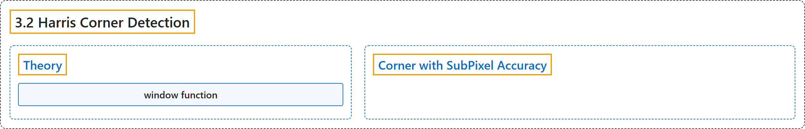

# 3.2 Harris Corner Detection

## Classification

## Glossary

| Term | Definition | 中文翻译 | Source |
|---|---|---|---|
| **3.2 Harris Corner Detection** Harris 角点检测 | (context) "Okay, **Corners are good features**? But how do we find them?" | （语境）好，**角点是好的特征**？那怎么找到它们？ | [OpenCV team, n.d.-a, "Feature Detection and Description", item 2](https://docs.opencv.org/4.x/db/d27/tutorial_py_table_of_contents_feature2d.html) |
| **Theory** 理论 | "It basically **finds the difference in intensity for a displacement of (u,v) in all directions**." | 它基本上是**求在所有方向上位移 (u,v) 时的强度差**。 | [OpenCV team, n.d.-b, "Theory", para. 1](https://docs.opencv.org/4.x/dc/d0d/tutorial_py_features_harris.html#autotoc_md1260) |
| **window function** 窗口函数 | "The window function is **either a rectangular window or a Gaussian window which gives weights to pixels underneath**." | 窗口函数是**矩形窗口或高斯窗口，它给窗口下的像素赋予权重**。 | [OpenCV team, n.d.-b, "Theory", para. 2](https://docs.opencv.org/4.x/dc/d0d/tutorial_py_features_harris.html#autotoc_md1260) |
| **Corner with SubPixel Accuracy** 亚像素精度角点 | (context) "OpenCV comes with a function cv.cornerSubPix() which **further refines the corners detected with sub-pixel accuracy**." | （语境）OpenCV 提供函数 cv.cornerSubPix()，它**以亚像素精度进一步细化检测到的角点**。 | [OpenCV team, n.d.-b, "Corner with SubPixel Accuracy", para. 1](https://docs.opencv.org/4.x/dc/d0d/tutorial_py_features_harris.html#autotoc_md1262) |

## References

OpenCV team. (n.d.-a). *Feature Detection and Description*. OpenCV-Python Tutorials (Version 4.13.0). Retrieved October 31, 2026, from <https://docs.opencv.org/4.x/db/d27/tutorial_py_table_of_contents_feature2d.html>

OpenCV team. (n.d.-b). *Harris Corner Detection*. OpenCV-Python Tutorials (Version 4.13.0). Retrieved October 31, 2026, from <https://docs.opencv.org/4.x/dc/d0d/tutorial_py_features_harris.html>
