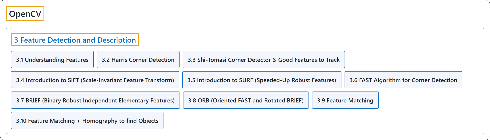

# 3. Feature Detection and Description

## Classification

## Glossary

| Term | Definition | 中文翻译 | Source |
|---|---|---|---|
| **3 Feature Detection and Description** 特征检测与描述 | "In this section you will learn about **feature detectors and descriptors**" | 在本节中，你将学习**特征检测器和描述子** | [OpenCV team, n.d.-b, "OpenCV-Python Tutorials", item 5](https://docs.opencv.org/4.x/d6/d00/tutorial_py_root.html) |
| **[3.1 Understanding Features](understanding-features.md)** 理解特征 | (context) "**What are the main features in an image?** How can finding those features be useful to us?" | （语境）**图像中的主要特征是什么**？找到这些特征对我们有什么用？ | [OpenCV team, n.d.-a, "Feature Detection and Description", item 1](https://docs.opencv.org/4.x/db/d27/tutorial_py_table_of_contents_feature2d.html) |
| **[3.2 Harris Corner Detection](harris-corner-detection.md)** Harris 角点检测 | (context) "Okay, **Corners are good features**? But how do we find them?" | （语境）好，**角点是好的特征**？那怎么找到它们？ | [OpenCV team, n.d.-a, "Feature Detection and Description", item 2](https://docs.opencv.org/4.x/db/d27/tutorial_py_table_of_contents_feature2d.html) |
| **[3.3 Shi-Tomasi Corner Detector & Good Features to Track](shi-tomasi-corner-detector-good-features-to-track.md)** Shi-Tomasi 角点检测器与适合跟踪的特征 | (context) "We will look into **Shi-Tomasi corner detection**" | （语境）我们将研究 **Shi-Tomasi 角点检测** | [OpenCV team, n.d.-a, "Feature Detection and Description", item 3](https://docs.opencv.org/4.x/db/d27/tutorial_py_table_of_contents_feature2d.html) |
| **[3.4 Introduction to SIFT (Scale-Invariant Feature Transform)](introduction-to-sift-scale-invariant-feature-transform.md)** SIFT（尺度不变特征变换）简介 | (context) "Lowe developed **a breakthrough method to find scale-invariant features** and it is called SIFT" | （语境）Lowe 提出了**一种寻找尺度不变特征的突破性方法**，称为 SIFT | [OpenCV team, n.d.-a, "Feature Detection and Description", item 4](https://docs.opencv.org/4.x/db/d27/tutorial_py_table_of_contents_feature2d.html) |
| **[3.5 Introduction to SURF (Speeded-Up Robust Features)](introduction-to-surf-speeded-up-robust-features.md)** SURF（加速稳健特征）简介 | (context) "SIFT is really good, but not fast enough, so people came up with **a speeded-up version called SURF**." | （语境）SIFT 确实很好，但不够快，所以人们提出了**一个加速版本，叫 SURF**。 | [OpenCV team, n.d.-a, "Feature Detection and Description", item 5](https://docs.opencv.org/4.x/db/d27/tutorial_py_table_of_contents_feature2d.html) |
| **[3.6 FAST Algorithm for Corner Detection](fast-algorithm-for-corner-detection.md)** 用于角点检测的 FAST 算法 | (context) "But they are not fast enough to work in real-time applications like SLAM. There comes **the FAST algorithm**, which is really "FAST"." | （语境）但它们不够快，无法用于 SLAM 等实时应用。于是有了 **FAST 算法**，它真的很“快”。 | [OpenCV team, n.d.-a, "Feature Detection and Description", item 6](https://docs.opencv.org/4.x/db/d27/tutorial_py_table_of_contents_feature2d.html) |
| **[3.7 BRIEF (Binary Robust Independent Elementary Features)](brief-binary-robust-independent-elementary-features.md)** BRIEF（二进制稳健独立基本特征） | (context) "SIFT uses **a feature descriptor with 128 floating point numbers**." | （语境）SIFT 使用**一个由 128 个浮点数组成的特征描述子**。 | [OpenCV team, n.d.-a, "Feature Detection and Description", item 7](https://docs.opencv.org/4.x/db/d27/tutorial_py_table_of_contents_feature2d.html) |
| **[3.8 ORB (Oriented FAST and Rotated BRIEF)](orb-oriented-fast-and-rotated-brief.md)** ORB（定向 FAST 与旋转 BRIEF） | (context) "SIFT and SURF are good in what they do, but what if you have to pay a few dollars every year to use them in your applications? Yeah, **they are patented**!!!" | （语境）SIFT 和 SURF 本身很好，但如果每年要付钱才能在应用中使用它们呢？没错，**它们有专利**！！！ | [OpenCV team, n.d.-a, "Feature Detection and Description", item 8](https://docs.opencv.org/4.x/db/d27/tutorial_py_table_of_contents_feature2d.html) |
| **[3.9 Feature Matching](feature-matching.md)** 特征匹配 | (context) "OpenCV provides **two techniques, Brute-Force matcher and FLANN based matcher**." | （语境）OpenCV 提供**两种技术：暴力匹配器和基于 FLANN 的匹配器**。 | [OpenCV team, n.d.-a, "Feature Detection and Description", item 9](https://docs.opencv.org/4.x/db/d27/tutorial_py_table_of_contents_feature2d.html) |
| **[3.10 Feature Matching + Homography to find Objects](feature-matching-homography-to-find-objects.md)** 特征匹配与单应性寻找物体 | (context) "Let's mix it up with calib3d module **to find objects in a complex image**." | （语境）让我们把它和 calib3d 模块结合起来，**在复杂图像中寻找物体**。 | [OpenCV team, n.d.-a, "Feature Detection and Description", item 10](https://docs.opencv.org/4.x/db/d27/tutorial_py_table_of_contents_feature2d.html) |

## References

OpenCV team. (n.d.-a). *Feature Detection and Description*. OpenCV-Python Tutorials (Version 4.13.0). Retrieved October 31, 2026, from <https://docs.opencv.org/4.x/db/d27/tutorial_py_table_of_contents_feature2d.html>

OpenCV team. (n.d.-b). *OpenCV-Python Tutorials*. OpenCV-Python Tutorials (Version 4.13.0). Retrieved October 31, 2026, from <https://docs.opencv.org/4.x/d6/d00/tutorial_py_root.html>
