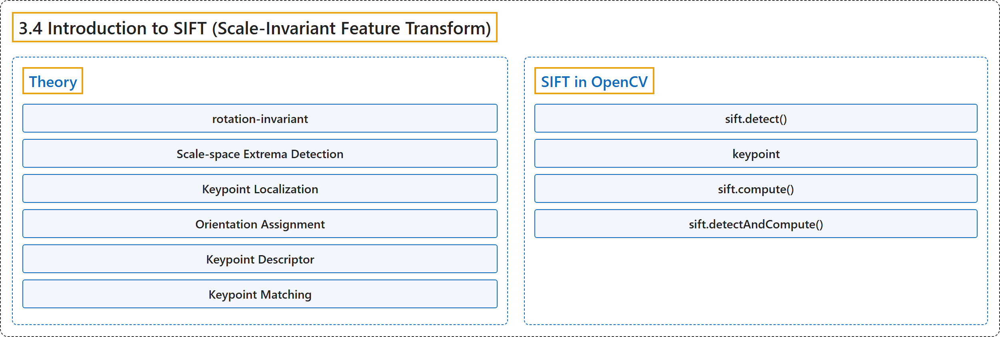

# 3.4 Introduction to SIFT (Scale-Invariant Feature Transform)

## Classification

## Glossary

| Term | Definition | 中文翻译 | Source |
|---|---|---|---|
| **3.4 Introduction to SIFT (Scale-Invariant Feature Transform)** SIFT（尺度不变特征变换）简介 | (context) "Lowe developed **a breakthrough method to find scale-invariant features** and it is called SIFT" | （语境）Lowe 提出了**一种寻找尺度不变特征的突破性方法**，称为 SIFT | [OpenCV team, n.d.-a, "Feature Detection and Description", item 4](https://docs.opencv.org/4.x/db/d27/tutorial_py_table_of_contents_feature2d.html) |
| **Theory** 理论 | "In 2004, D.Lowe, University of British Columbia, came up with a new algorithm, Scale Invariant Feature Transform (SIFT) in his paper, Distinctive Image Features from Scale-Invariant Keypoints, which **extract keypoints and compute its descriptors**." | 2004 年，不列颠哥伦比亚大学的 D.Lowe 在论文 Distinctive Image Features from Scale-Invariant Keypoints 中提出了一种新算法：尺度不变特征变换（SIFT），它**提取关键点并计算其描述子**。 | [OpenCV team, n.d.-b, "Theory", para. 2](https://docs.opencv.org/4.x/da/df5/tutorial_py_sift_intro.html#autotoc_md1281) |
| **rotation-invariant** 旋转不变 | "They are rotation-invariant, which means, **even if the image is rotated, we can find the same corners**." | 它们是旋转不变的，意思是**即使图像旋转了，也能找到相同的角点**。 | [OpenCV team, n.d.-b, "Theory", para. 1](https://docs.opencv.org/4.x/da/df5/tutorial_py_sift_intro.html#autotoc_md1281) |
| **Scale-space Extrema Detection** 尺度空间极值检测 | "So, we can find **the local maxima across the scale and space** which gives us a list of (x,y,σ) values which means there is a potential keypoint at (x,y) at σ scale." | 于是可以求出**跨尺度和空间的局部极大值**，得到一组 (x,y,σ) 值，表示在 σ 尺度下 (x,y) 处有一个潜在关键点。 | [OpenCV team, n.d.-b, "1. Scale-space Extrema Detection", para. 1](https://docs.opencv.org/4.x/da/df5/tutorial_py_sift_intro.html#autotoc_md1282) |
| **Laplacian of Gaussian (LoG)** 高斯拉普拉斯（LoG） | (context) "LoG acts as **a blob detector which detects blobs in various sizes due to change in σ**." | （语境）LoG 充当**斑点检测器，随着 σ 的变化检测各种大小的斑点**。 | [OpenCV team, n.d.-b, "1. Scale-space Extrema Detection", para. 1](https://docs.opencv.org/4.x/da/df5/tutorial_py_sift_intro.html#autotoc_md1282) |
| **Difference of Gaussians (DoG)** 高斯差分（DoG） | "Difference of Gaussian is obtained as **the difference of Gaussian blurring of an image with two different σ**, let it be σ and kσ." | 高斯差分是**用两个不同的 σ（设为 σ 和 kσ）对图像做高斯模糊所得结果之差**。 | [OpenCV team, n.d.-b, "1. Scale-space Extrema Detection", para. 2](https://docs.opencv.org/4.x/da/df5/tutorial_py_sift_intro.html#autotoc_md1282) |
| **Keypoint Localization** 关键点定位 | "Once potential keypoints locations are found, **they have to be refined to get more accurate results**." | 找到潜在关键点的位置后，**还要对它们加以细化以得到更准确的结果**。 | [OpenCV team, n.d.-b, "2. Keypoint Localization", para. 1](https://docs.opencv.org/4.x/da/df5/tutorial_py_sift_intro.html#autotoc_md1283) |
| **Orientation Assignment** 方向分配 | "Now **an orientation is assigned to each keypoint to achieve invariance to image rotation**." | 现在**给每个关键点分配一个方向，以实现对图像旋转的不变性**。 | [OpenCV team, n.d.-b, "3. Orientation Assignment", para. 1](https://docs.opencv.org/4.x/da/df5/tutorial_py_sift_intro.html#autotoc_md1284) |
| **Keypoint Descriptor** 关键点描述子 | "So **a total of 128 bin values** are available. It is represented as a vector to form keypoint descriptor." | 于是共有 **128 个直方柱值**。把它表示为一个向量，就构成关键点描述子。 | [OpenCV team, n.d.-b, "4. Keypoint Descriptor", para. 1](https://docs.opencv.org/4.x/da/df5/tutorial_py_sift_intro.html#autotoc_md1285) |
| **Keypoint Matching** 关键点匹配 | "Keypoints between two images are matched by **identifying their nearest neighbours**." | 两幅图像之间的关键点通过**找出它们的最近邻**来匹配。 | [OpenCV team, n.d.-b, "5. Keypoint Matching", para. 1](https://docs.opencv.org/4.x/da/df5/tutorial_py_sift_intro.html#autotoc_md1286) |
| **SIFT in OpenCV** OpenCV 中的 SIFT | (No definition) | （无定义） | [OpenCV team, n.d.-b, "SIFT in OpenCV"](https://docs.opencv.org/4.x/da/df5/tutorial_py_sift_intro.html#autotoc_md1287) |
| **sift.detect()** detect 方法 | "sift.detect() function **finds the keypoint in the images**." | sift.detect() 函数**在图像中寻找关键点**。 | [OpenCV team, n.d.-b, "SIFT in OpenCV", para. 2](https://docs.opencv.org/4.x/da/df5/tutorial_py_sift_intro.html#autotoc_md1287) |
| **keypoint** 关键点 | "Each keypoint is **a special structure which has many attributes**" | 每个关键点都是**一种具有许多属性的特殊结构** | [OpenCV team, n.d.-b, "SIFT in OpenCV", para. 2](https://docs.opencv.org/4.x/da/df5/tutorial_py_sift_intro.html#autotoc_md1287) |
| **sift.compute()** compute 方法 | "Since you already found keypoints, you can call sift.compute() which **computes the descriptors from the keypoints we have found**." | 既然已经找到了关键点，可以调用 sift.compute()，它**根据已找到的关键点计算描述子**。 | [OpenCV team, n.d.-b, "SIFT in OpenCV", item 1](https://docs.opencv.org/4.x/da/df5/tutorial_py_sift_intro.html#autotoc_md1287) |
| **sift.detectAndCompute()** detectAndCompute 方法 | "If you didn't find keypoints, **directly find keypoints and descriptors in a single step** with the function, sift.detectAndCompute()." | 如果还没有找到关键点，可以用函数 sift.detectAndCompute() **一步直接求出关键点和描述子**。 | [OpenCV team, n.d.-b, "SIFT in OpenCV", item 2](https://docs.opencv.org/4.x/da/df5/tutorial_py_sift_intro.html#autotoc_md1287) |

## References

OpenCV team. (n.d.-a). *Feature Detection and Description*. OpenCV-Python Tutorials (Version 4.13.0). Retrieved October 31, 2026, from <https://docs.opencv.org/4.x/db/d27/tutorial_py_table_of_contents_feature2d.html>

OpenCV team. (n.d.-b). *Introduction to SIFT (Scale-Invariant Feature Transform)*. OpenCV-Python Tutorials (Version 4.13.0). Retrieved October 31, 2026, from <https://docs.opencv.org/4.x/da/df5/tutorial_py_sift_intro.html>
