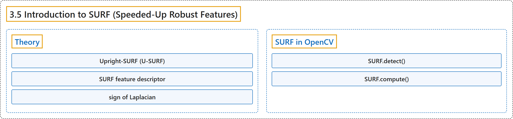

# 3.5 Introduction to SURF (Speeded-Up Robust Features)

## Classification

## Glossary

| Term | Definition | 中文翻译 | Source |
|---|---|---|---|
| **3.5 Introduction to SURF (Speeded-Up Robust Features)** SURF（加速稳健特征）简介 | (context) "SIFT is really good, but not fast enough, so people came up with **a speeded-up version called SURF**." | （语境）SIFT 确实很好，但不够快，所以人们提出了**一个加速版本，叫 SURF**。 | [OpenCV team, n.d.-a, "Feature Detection and Description", item 5](https://docs.opencv.org/4.x/db/d27/tutorial_py_table_of_contents_feature2d.html) |
| **Theory** 理论 | "As name suggests, it is **a speeded-up version of SIFT**." | 顾名思义，它是 **SIFT 的加速版本**。 | [OpenCV team, n.d.-b, "Theory", para. 1](https://docs.opencv.org/4.x/df/dd2/tutorial_py_surf_intro.html#autotoc_md1289) |
| **Upright-SURF (U-SURF)** 竖直 SURF（U-SURF） | "For many applications, rotation invariance is not required, so **no need of finding this orientation, which speeds up the process**. SURF provides such a functionality called Upright-SURF or U-SURF." | 对许多应用来说并不需要旋转不变性，因此**无需求这个方向，从而加快了处理速度**。SURF 提供了这样一种功能，称为 Upright-SURF 或 U-SURF。 | [OpenCV team, n.d.-b, "Theory", para. 3](https://docs.opencv.org/4.x/df/dd2/tutorial_py_surf_intro.html#autotoc_md1289) |
| **SURF feature descriptor** SURF 特征描述子 | (context) "This when represented as a vector gives **SURF feature descriptor with total 64 dimensions**." | （语境）把它表示为向量，就得到**共 64 维的 SURF 特征描述子**。 | [OpenCV team, n.d.-b, "Theory", para. 4](https://docs.opencv.org/4.x/df/dd2/tutorial_py_surf_intro.html#autotoc_md1289) |
| **sign of Laplacian** 拉普拉斯符号 | "The sign of the Laplacian **distinguishes bright blobs on dark backgrounds from the reverse situation**." | 拉普拉斯符号**区分暗背景上的亮斑点与相反的情形**。 | [OpenCV team, n.d.-b, "Theory", para. 6](https://docs.opencv.org/4.x/df/dd2/tutorial_py_surf_intro.html#autotoc_md1289) |
| **SURF in OpenCV** OpenCV 中的 SURF | (No definition) | （无定义） | [OpenCV team, n.d.-b, "SURF in OpenCV"](https://docs.opencv.org/4.x/df/dd2/tutorial_py_surf_intro.html#autotoc_md1290) |
| **SURF.detect()** detect 方法 | (context) "Then as we did in SIFT, we can use SURF.detect(), SURF.compute() etc **for finding keypoints and descriptors**." | （语境）然后像 SIFT 中那样，可以用 SURF.detect()、SURF.compute() 等**来求关键点和描述子**。 | [OpenCV team, n.d.-b, "SURF in OpenCV", para. 1](https://docs.opencv.org/4.x/df/dd2/tutorial_py_surf_intro.html#autotoc_md1290) |
| **SURF.compute()** compute 方法 | (context) "Then as we did in SIFT, we can use SURF.detect(), SURF.compute() etc **for finding keypoints and descriptors**." | （语境）然后像 SIFT 中那样，可以用 SURF.detect()、SURF.compute() 等**来求关键点和描述子**。 | [OpenCV team, n.d.-b, "SURF in OpenCV", para. 1](https://docs.opencv.org/4.x/df/dd2/tutorial_py_surf_intro.html#autotoc_md1290) |

## References

OpenCV team. (n.d.-a). *Feature Detection and Description*. OpenCV-Python Tutorials (Version 4.13.0). Retrieved October 31, 2026, from <https://docs.opencv.org/4.x/db/d27/tutorial_py_table_of_contents_feature2d.html>

OpenCV team. (n.d.-b). *Introduction to SURF (Speeded-Up Robust Features)*. OpenCV-Python Tutorials (Version 4.13.0). Retrieved October 31, 2026, from <https://docs.opencv.org/4.x/df/dd2/tutorial_py_surf_intro.html>
