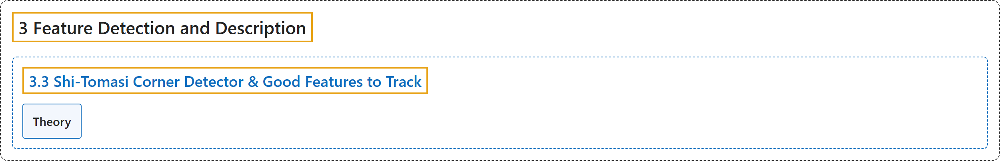

# 3.3 Shi-Tomasi Corner Detector & Good Features to Track

## Classification

## Glossary

| Term | Definition | 中文翻译 | Source |
|---|---|---|---|
| **3.3 Shi-Tomasi Corner Detector & Good Features to Track** Shi-Tomasi 角点检测器与适合跟踪的特征 | (context) "We will look into **Shi-Tomasi corner detection**" | （语境）我们将研究 **Shi-Tomasi 角点检测** | [OpenCV team, n.d.-a, "Feature Detection and Description", item 3](https://docs.opencv.org/4.x/db/d27/tutorial_py_table_of_contents_feature2d.html) |
| **Theory** 理论 | "Later in 1994, J. Shi and C. Tomasi **made a small modification to it** in their paper Good Features to Track which shows better results compared to Harris Corner Detector." | 后来在 1994 年，J. Shi 和 C. Tomasi 在论文 Good Features to Track 中**对它做了一个小改动**，效果比 Harris 角点检测器更好。 | [OpenCV team, n.d.-b, "Theory", para. 1](https://docs.opencv.org/4.x/d4/d8c/tutorial_py_shi_tomasi.html#autotoc_md1278) |

## References

OpenCV team. (n.d.-a). *Feature Detection and Description*. OpenCV-Python Tutorials (Version 4.13.0). Retrieved October 31, 2026, from <https://docs.opencv.org/4.x/db/d27/tutorial_py_table_of_contents_feature2d.html>

OpenCV team. (n.d.-b). *Shi-Tomasi Corner Detector & Good Features to Track*. OpenCV-Python Tutorials (Version 4.13.0). Retrieved October 31, 2026, from <https://docs.opencv.org/4.x/d4/d8c/tutorial_py_shi_tomasi.html>
