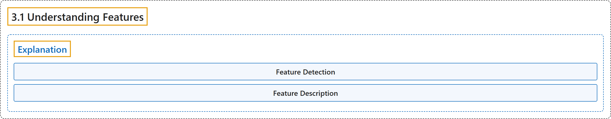

# 3.1 Understanding Features

## Classification

## Glossary

| Term | Definition | 中文翻译 | Source |
|---|---|---|---|
| **3.1 Understanding Features** 理解特征 | (context) "**What are the main features in an image?** How can finding those features be useful to us?" | （语境）**图像中的主要特征是什么**？找到这些特征对我们有什么用？ | [OpenCV team, n.d.-a, "Feature Detection and Description", item 1](https://docs.opencv.org/4.x/db/d27/tutorial_py_table_of_contents_feature2d.html) |
| **Explanation** 解释 | "The answer is, we are looking for **specific patterns or specific features which are unique, can be easily tracked and can be easily compared**." | 答案是，我们在寻找**独特的、容易跟踪且容易比较的特定模式或特定特征**。 | [OpenCV team, n.d.-b, "Explanation", para. 3](https://docs.opencv.org/4.x/df/d54/tutorial_py_features_meaning.html#autotoc_md1266) |
| **Feature Detection** 特征检测 | "So **finding these image features** is called Feature Detection." | 因此，**寻找这些图像特征**称为特征检测。 | [OpenCV team, n.d.-b, "Explanation", para. 11](https://docs.opencv.org/4.x/df/d54/tutorial_py_features_meaning.html#autotoc_md1266) |
| **Feature Description** 特征描述 | "Similarly, a computer also should **describe the region around the feature so that it can find it in other images**. So called description is called Feature Description." | 同样，计算机也应当**描述特征周围的区域，以便在其他图像中找到它**。这种描述称为特征描述。 | [OpenCV team, n.d.-b, "Explanation", para. 12](https://docs.opencv.org/4.x/df/d54/tutorial_py_features_meaning.html#autotoc_md1266) |

## References

OpenCV team. (n.d.-a). *Feature Detection and Description*. OpenCV-Python Tutorials (Version 4.13.0). Retrieved October 31, 2026, from <https://docs.opencv.org/4.x/db/d27/tutorial_py_table_of_contents_feature2d.html>

OpenCV team. (n.d.-b). *Understanding Features*. OpenCV-Python Tutorials (Version 4.13.0). Retrieved October 31, 2026, from <https://docs.opencv.org/4.x/df/d54/tutorial_py_features_meaning.html>
