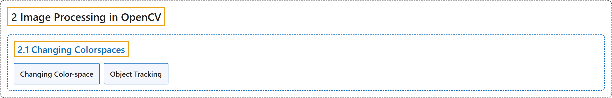

# 2.1 Changing Colorspaces

## Classification

## Glossary

| Term | Definition | 中文翻译 | Source |
|---|---|---|---|
| **2.1 Changing Colorspaces** 颜色空间转换 | (context) "Learn to **change images between different color spaces**." | （语境）学习**在不同颜色空间之间转换图像**。 | [OpenCV team, n.d.-b, "Image Processing in OpenCV", item 1](https://docs.opencv.org/4.x/d2/d96/tutorial_py_table_of_contents_imgproc.html) |
| **Changing Color-space** 颜色空间转换 | (context) "There are **more than 150 color-space conversion methods** available in OpenCV." | （语境）OpenCV 中有**超过 150 种颜色空间转换方法**。 | [OpenCV team, n.d.-a, "Changing Color-space", para. 1](https://docs.opencv.org/4.x/df/d9d/tutorial_py_colorspaces.html#autotoc_md1319) |
| **Object Tracking** 目标跟踪 | (context) "Now that we know how to convert a BGR image to HSV, we can use this to **extract a colored object**." | （语境）既然知道了如何把 BGR 图像转换为 HSV，就可以用它来**提取一个彩色物体**。 | [OpenCV team, n.d.-a, "Object Tracking", para. 1](https://docs.opencv.org/4.x/df/d9d/tutorial_py_colorspaces.html#autotoc_md1320) |

## References

OpenCV team. (n.d.-a). *Changing Colorspaces*. OpenCV-Python Tutorials (Version 4.13.0). Retrieved October 31, 2026, from <https://docs.opencv.org/4.x/df/d9d/tutorial_py_colorspaces.html>

OpenCV team. (n.d.-b). *Image Processing in OpenCV*. OpenCV-Python Tutorials (Version 4.13.0). Retrieved October 31, 2026, from <https://docs.opencv.org/4.x/d2/d96/tutorial_py_table_of_contents_imgproc.html>
