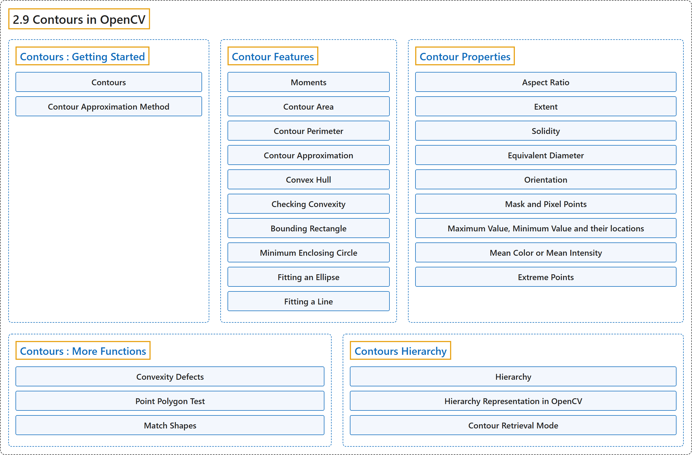

# 2.9 Contours in OpenCV

## Classification

## Glossary

| Term | Definition | 中文翻译 | Source |
|---|---|---|---|
| **2.9 Contours in OpenCV** OpenCV 中的轮廓 | (context) "**All about Contours in OpenCV**" | （语境）**关于 OpenCV 中轮廓的一切** | [OpenCV team, n.d.-g, "Image Processing in OpenCV", item 9](https://docs.opencv.org/4.x/d2/d96/tutorial_py_table_of_contents_imgproc.html) |
| **Contours : Getting Started** 轮廓入门 | (context) "Learn to **find and draw Contours**" | （语境）学习**寻找和绘制轮廓** | [OpenCV team, n.d.-f, "Contours in OpenCV", item 1](https://docs.opencv.org/4.x/d3/d05/tutorial_py_table_of_contents_contours.html) |
| **Contours** 轮廓 | "Contours can be explained simply as **a curve joining all the continuous points (along the boundary), having same color or intensity**." | 轮廓可以简单地解释为**连接所有连续点（沿边界）、具有相同颜色或强度的曲线**。 | [OpenCV team, n.d.-c, "What are contours?", para. 1](https://docs.opencv.org/4.x/d4/d73/tutorial_py_contours_begin.html#autotoc_md1347) |
| **Contour Approximation Method** 轮廓近似方法 | (context) "But **does it store all the coordinates** ? That is specified by this contour approximation method." | （语境）但**它会存储所有坐标吗**？这由轮廓近似方法来指定。 | [OpenCV team, n.d.-c, "Contour Approximation Method", para. 2](https://docs.opencv.org/4.x/d4/d73/tutorial_py_contours_begin.html#autotoc_md1349) |
| **Contour Features** 轮廓特征 | (context) "Learn to find **different features of contours like area, perimeter, bounding rectangle etc**." | （语境）学习求**轮廓的各种特征，如面积、周长、外接矩形等**。 | [OpenCV team, n.d.-f, "Contours in OpenCV", item 2](https://docs.opencv.org/4.x/d3/d05/tutorial_py_table_of_contents_contours.html) |
| **Moments** 矩 | "Image moments help you to **calculate some features like center of mass of the object, area of the object etc**." | 图像矩帮助你**计算一些特征，如物体的质心、物体的面积等**。 | [OpenCV team, n.d.-a, "1. Moments", para. 1](https://docs.opencv.org/4.x/dd/d49/tutorial_py_contour_features.html#autotoc_md1324) |
| **Contour Area** 轮廓面积 | (context) "Contour area is given by the function cv.contourArea() or **from moments, M['m00']**." | （语境）轮廓面积由函数 cv.contourArea() 给出，或者**由矩 M['m00'] 得到**。 | [OpenCV team, n.d.-a, "2. Contour Area", para. 1](https://docs.opencv.org/4.x/dd/d49/tutorial_py_contour_features.html#autotoc_md1325) |
| **Contour Perimeter** 轮廓周长 | "It is also called **arc length**." | 它也称为**弧长**。 | [OpenCV team, n.d.-a, "3. Contour Perimeter", para. 1](https://docs.opencv.org/4.x/dd/d49/tutorial_py_contour_features.html#autotoc_md1326) |
| **Contour Approximation** 轮廓近似 | "It **approximates a contour shape to another shape with less number of vertices depending upon the precision we specify**." | 它**按照我们指定的精度，把一个轮廓形状近似为另一个顶点更少的形状**。 | [OpenCV team, n.d.-a, "4. Contour Approximation", para. 1](https://docs.opencv.org/4.x/dd/d49/tutorial_py_contour_features.html#autotoc_md1327) |
| **Douglas-Peucker algorithm** 道格拉斯-普克算法 | (context) "It is **an implementation of Douglas-Peucker algorithm**." | （语境）它是**道格拉斯-普克算法的一种实现**。 | [OpenCV team, n.d.-a, "4. Contour Approximation", para. 1](https://docs.opencv.org/4.x/dd/d49/tutorial_py_contour_features.html#autotoc_md1327) |
| **Convex Hull** 凸包 | "Here, cv.convexHull() function **checks a curve for convexity defects and corrects it**." | 这里，cv.convexHull() 函数**检查曲线的凸缺陷并加以修正**。 | [OpenCV team, n.d.-a, "5. Convex Hull", para. 1](https://docs.opencv.org/4.x/dd/d49/tutorial_py_contour_features.html#autotoc_md1328) |
| **convex curves** 凸曲线 | "Generally speaking, convex curves are **the curves which are always bulged out, or at-least flat**." | 一般来说，凸曲线是**始终向外凸出、或至少是平的曲线**。 | [OpenCV team, n.d.-a, "5. Convex Hull", para. 1](https://docs.opencv.org/4.x/dd/d49/tutorial_py_contour_features.html#autotoc_md1328) |
| **convexity defects** 凸缺陷 | "And **if it is bulged inside**, it is called convexity defects." | 而**如果它向内凹进**，就称为凸缺陷。 | [OpenCV team, n.d.-a, "5. Convex Hull", para. 1](https://docs.opencv.org/4.x/dd/d49/tutorial_py_contour_features.html#autotoc_md1328) |
| **Checking Convexity** 检查凸性 | "There is a function to **check if a curve is convex or not**, cv.isContourConvex()." | 有一个函数可以**检查曲线是否为凸**：cv.isContourConvex()。 | [OpenCV team, n.d.-a, "6. Checking Convexity", para. 1](https://docs.opencv.org/4.x/dd/d49/tutorial_py_contour_features.html#autotoc_md1329) |
| **Bounding Rectangle** 外接矩形 | (context) "There are **two types of bounding rectangles**." | （语境）外接矩形有**两种类型**。 | [OpenCV team, n.d.-a, "7. Bounding Rectangle", para. 1](https://docs.opencv.org/4.x/dd/d49/tutorial_py_contour_features.html#autotoc_md1330) |
| **Straight Bounding Rectangle** 直立外接矩形 | "It is **a straight rectangle, it doesn't consider the rotation of the object**." | 它是**一个直立的矩形，不考虑物体的旋转**。 | [OpenCV team, n.d.-a, "7.a. Straight Bounding Rectangle", para. 1](https://docs.opencv.org/4.x/dd/d49/tutorial_py_contour_features.html#autotoc_md1331) |
| **Rotated Rectangle** 旋转矩形 | "Here, **bounding rectangle is drawn with minimum area, so it considers the rotation also**." | 这里，**外接矩形按最小面积绘制，因此也考虑了旋转**。 | [OpenCV team, n.d.-a, "7.b. Rotated Rectangle", para. 1](https://docs.opencv.org/4.x/dd/d49/tutorial_py_contour_features.html#autotoc_md1332) |
| **Minimum Enclosing Circle** 最小外接圆 | "It is **a circle which completely covers the object with minimum area**." | 它是**以最小面积完全覆盖物体的圆**。 | [OpenCV team, n.d.-a, "8. Minimum Enclosing Circle", para. 1](https://docs.opencv.org/4.x/dd/d49/tutorial_py_contour_features.html#autotoc_md1333) |
| **Fitting an Ellipse** 拟合椭圆 | (context) "Next one is to **fit an ellipse to an object**." | （语境）下一个是**为物体拟合一个椭圆**。 | [OpenCV team, n.d.-a, "9. Fitting an Ellipse", para. 1](https://docs.opencv.org/4.x/dd/d49/tutorial_py_contour_features.html#autotoc_md1334) |
| **Fitting a Line** 拟合直线 | (context) "Similarly we can **fit a line to a set of points**." | （语境）类似地，我们可以**为一组点拟合一条直线**。 | [OpenCV team, n.d.-a, "10. Fitting a Line", para. 1](https://docs.opencv.org/4.x/dd/d49/tutorial_py_contour_features.html#autotoc_md1335) |
| **Contour Properties** 轮廓属性 | (context) "Learn to find **different properties of contours like Solidity, Mean Intensity etc**." | （语境）学习求**轮廓的各种属性，如实心度、平均强度等**。 | [OpenCV team, n.d.-f, "Contours in OpenCV", item 3](https://docs.opencv.org/4.x/d3/d05/tutorial_py_table_of_contents_contours.html) |
| **Aspect Ratio** 宽高比 | "It is **the ratio of width to height of bounding rect of the object**." | 它是**物体外接矩形的宽与高之比**。 | [OpenCV team, n.d.-b, "1. Aspect Ratio", para. 1](https://docs.opencv.org/4.x/d1/d32/tutorial_py_contour_properties.html#autotoc_md1336) |
| **Extent** 范围比（Extent） | "Extent is **the ratio of contour area to bounding rectangle area**." | Extent 是**轮廓面积与外接矩形面积之比**。 | [OpenCV team, n.d.-b, "2. Extent", para. 1](https://docs.opencv.org/4.x/d1/d32/tutorial_py_contour_properties.html#autotoc_md1337) |
| **Solidity** 实心度 | "Solidity is **the ratio of contour area to its convex hull area**." | 实心度是**轮廓面积与其凸包面积之比**。 | [OpenCV team, n.d.-b, "3. Solidity", para. 1](https://docs.opencv.org/4.x/d1/d32/tutorial_py_contour_properties.html#autotoc_md1338) |
| **Equivalent Diameter** 等效直径 | "Equivalent Diameter is **the diameter of the circle whose area is same as the contour area**." | 等效直径是**面积与轮廓面积相同的圆的直径**。 | [OpenCV team, n.d.-b, "4. Equivalent Diameter", para. 1](https://docs.opencv.org/4.x/d1/d32/tutorial_py_contour_properties.html#autotoc_md1339) |
| **Orientation** 方向 | "Orientation is **the angle at which object is directed**." | 方向是**物体所指向的角度**。 | [OpenCV team, n.d.-b, "5. Orientation", para. 1](https://docs.opencv.org/4.x/d1/d32/tutorial_py_contour_properties.html#autotoc_md1340) |
| **Mask and Pixel Points** 掩模与像素点 | (context) "In some cases, we may need **all the points which comprises that object**." | （语境）有些情况下，我们可能需要**构成该物体的所有点**。 | [OpenCV team, n.d.-b, "6. Mask and Pixel Points", para. 1](https://docs.opencv.org/4.x/d1/d32/tutorial_py_contour_properties.html#autotoc_md1341) |
| **Maximum Value, Minimum Value and their locations** 最大值、最小值及其位置 | (context) "We can find these parameters **using a mask image**." | （语境）我们可以**用掩模图像**求出这些参数。 | [OpenCV team, n.d.-b, "7. Maximum Value, Minimum Value and their locations", para. 1](https://docs.opencv.org/4.x/d1/d32/tutorial_py_contour_properties.html#autotoc_md1342) |
| **Mean Color or Mean Intensity** 平均颜色或平均强度 | "Here, we can find **the average color of an object**. Or it can be **average intensity of the object in grayscale mode**." | 这里可以求出**物体的平均颜色**。也可以是**灰度模式下物体的平均强度**。 | [OpenCV team, n.d.-b, "8. Mean Color or Mean Intensity", para. 1](https://docs.opencv.org/4.x/d1/d32/tutorial_py_contour_properties.html#autotoc_md1343) |
| **Extreme Points** 极点 | "Extreme Points means **topmost, bottommost, rightmost and leftmost points of the object**." | 极点指**物体最上、最下、最右和最左的点**。 | [OpenCV team, n.d.-b, "9. Extreme Points", para. 1](https://docs.opencv.org/4.x/d1/d32/tutorial_py_contour_properties.html#autotoc_md1344) |
| **Contours : More Functions** 轮廓：更多函数 | (context) "Learn to find **convexity defects, pointPolygonTest, match different shapes etc**." | （语境）学习求**凸缺陷、使用 pointPolygonTest、匹配不同形状等**。 | [OpenCV team, n.d.-f, "Contours in OpenCV", item 4](https://docs.opencv.org/4.x/d3/d05/tutorial_py_table_of_contents_contours.html) |
| **Convexity Defects** 凸缺陷 | "**Any deviation of the object from this hull** can be considered as convexity defect." | **物体对凸包的任何偏离**都可以看作凸缺陷。 | [OpenCV team, n.d.-d, "1. Convexity Defects", para. 1](https://docs.opencv.org/4.x/d5/d45/tutorial_py_contours_more_functions.html#autotoc_md1361) |
| **Point Polygon Test** 点与多边形测试 | "This function **finds the shortest distance between a point in the image and a contour**." | 这个函数**求图像中一个点到轮廓的最短距离**。 | [OpenCV team, n.d.-d, "2. Point Polygon Test", para. 1](https://docs.opencv.org/4.x/d5/d45/tutorial_py_contours_more_functions.html#autotoc_md1362) |
| **Match Shapes** 形状匹配 | "OpenCV comes with a function cv.matchShapes() which **enables us to compare two shapes, or two contours and returns a metric showing the similarity**." | OpenCV 提供函数 cv.matchShapes()，它**让我们比较两个形状或两个轮廓，并返回一个表示相似度的度量**。 | [OpenCV team, n.d.-d, "3. Match Shapes", para. 1](https://docs.opencv.org/4.x/d5/d45/tutorial_py_contours_more_functions.html#autotoc_md1363) |
| **Hu-Moments** Hu 矩 | "Hu-Moments are **seven moments invariant to translation, rotation and scale**." | Hu 矩是**对平移、旋转和缩放保持不变的七个矩**。 | [OpenCV team, n.d.-d, "3. Match Shapes", Note](https://docs.opencv.org/4.x/d5/d45/tutorial_py_contours_more_functions.html#autotoc_md1363) |
| **Contours Hierarchy** 轮廓层级 | (context) "Learn about **Contour Hierarchy**" | （语境）学习**轮廓层级** | [OpenCV team, n.d.-f, "Contours in OpenCV", item 5](https://docs.opencv.org/4.x/d3/d05/tutorial_py_table_of_contents_contours.html) |
| **Hierarchy** 层级 | "**Representation of this relationship** is called the Hierarchy." | **这种关系的表示**称为层级。 | [OpenCV team, n.d.-e, "What is Hierarchy?", para. 1](https://docs.opencv.org/4.x/d9/d8b/tutorial_py_contours_hierarchy.html#autotoc_md1352) |
| **parent** 父轮廓 | "In this case, we call **outer one as parent** and inner one as child." | 这种情况下，我们把**外面的称为父轮廓**，里面的称为子轮廓。 | [OpenCV team, n.d.-e, "What is Hierarchy?", para. 1](https://docs.opencv.org/4.x/d9/d8b/tutorial_py_contours_hierarchy.html#autotoc_md1352) |
| **child** 子轮廓 | "In this case, we call outer one as parent and **inner one as child**." | 这种情况下，我们把外面的称为父轮廓，**里面的称为子轮廓**。 | [OpenCV team, n.d.-e, "What is Hierarchy?", para. 1](https://docs.opencv.org/4.x/d9/d8b/tutorial_py_contours_hierarchy.html#autotoc_md1352) |
| **external or outermost** 外部轮廓（最外层） | (context) "Here, **contours 0,1,2** are external or outermost." | （语境）这里，**轮廓 0、1、2** 是外部的或最外层的。 | [OpenCV team, n.d.-e, "What is Hierarchy?", para. 4](https://docs.opencv.org/4.x/d9/d8b/tutorial_py_contours_hierarchy.html#autotoc_md1352) |
| **same hierarchy level** 同一层级 | (context) "We can say, they are in hierarchy-0 or simply they are in **same hierarchy level**." | （语境）可以说它们处于 hierarchy-0，或者简单地说处于**同一层级**。 | [OpenCV team, n.d.-e, "What is Hierarchy?", para. 4](https://docs.opencv.org/4.x/d9/d8b/tutorial_py_contours_hierarchy.html#autotoc_md1352) |
| **first child** 第一个子轮廓 | (context) "From the way I numbered the boxes, I would say **contour-4 is the first child of contour-3a** (It can be contour-5 also)." | （语境）按照我给方框编号的方式，我会说**轮廓 4 是轮廓 3a 的第一个子轮廓**（也可以是轮廓 5）。 | [OpenCV team, n.d.-e, "What is Hierarchy?", para. 5](https://docs.opencv.org/4.x/d9/d8b/tutorial_py_contours_hierarchy.html#autotoc_md1352) |
| **Hierarchy Representation in OpenCV** OpenCV 中的层级表示 | "OpenCV represents it as **an array of four values** : [Next, Previous, First_Child, Parent]" | OpenCV 把它表示为**由四个值组成的数组**：[Next, Previous, First_Child, Parent] | [OpenCV team, n.d.-e, "Hierarchy Representation in OpenCV", para. 1](https://docs.opencv.org/4.x/d9/d8b/tutorial_py_contours_hierarchy.html#autotoc_md1353) |
| **Next** 下一个（Next） | "Next denotes **next contour at the same hierarchical level**." | Next 表示**同一层级上的下一个轮廓**。 | [OpenCV team, n.d.-e, "Hierarchy Representation in OpenCV", para. 2](https://docs.opencv.org/4.x/d9/d8b/tutorial_py_contours_hierarchy.html#autotoc_md1353) |
| **Previous** 上一个（Previous） | "Previous denotes **previous contour at the same hierarchical level**." | Previous 表示**同一层级上的上一个轮廓**。 | [OpenCV team, n.d.-e, "Hierarchy Representation in OpenCV", para. 5](https://docs.opencv.org/4.x/d9/d8b/tutorial_py_contours_hierarchy.html#autotoc_md1353) |
| **First_Child** 第一个子轮廓（First_Child） | "First_Child denotes **its first child contour**." | First_Child 表示**它的第一个子轮廓**。 | [OpenCV team, n.d.-e, "Hierarchy Representation in OpenCV", para. 7](https://docs.opencv.org/4.x/d9/d8b/tutorial_py_contours_hierarchy.html#autotoc_md1353) |
| **Parent** 父轮廓（Parent） | "Parent denotes **index of its parent contour**." | Parent 表示**其父轮廓的索引**。 | [OpenCV team, n.d.-e, "Hierarchy Representation in OpenCV", para. 9](https://docs.opencv.org/4.x/d9/d8b/tutorial_py_contours_hierarchy.html#autotoc_md1353) |
| **Contour Retrieval Mode** 轮廓检索模式 | (context) "But when we found the contours in image using cv.findContours() function, we have passed an argument, **Contour Retrieval Mode**." | （语境）但用 cv.findContours() 函数在图像中寻找轮廓时，我们传入了一个参数：**轮廓检索模式**。 | [OpenCV team, n.d.-e, "Theory", para. 1](https://docs.opencv.org/4.x/d9/d8b/tutorial_py_contours_hierarchy.html#autotoc_md1351) |

## References

OpenCV team. (n.d.-a). *Contour Features*. OpenCV-Python Tutorials (Version 4.13.0). Retrieved October 31, 2026, from <https://docs.opencv.org/4.x/dd/d49/tutorial_py_contour_features.html>

OpenCV team. (n.d.-b). *Contour Properties*. OpenCV-Python Tutorials (Version 4.13.0). Retrieved October 31, 2026, from <https://docs.opencv.org/4.x/d1/d32/tutorial_py_contour_properties.html>

OpenCV team. (n.d.-c). *Contours : Getting Started*. OpenCV-Python Tutorials (Version 4.13.0). Retrieved October 31, 2026, from <https://docs.opencv.org/4.x/d4/d73/tutorial_py_contours_begin.html>

OpenCV team. (n.d.-d). *Contours : More Functions*. OpenCV-Python Tutorials (Version 4.13.0). Retrieved October 31, 2026, from <https://docs.opencv.org/4.x/d5/d45/tutorial_py_contours_more_functions.html>

OpenCV team. (n.d.-e). *Contours Hierarchy*. OpenCV-Python Tutorials (Version 4.13.0). Retrieved October 31, 2026, from <https://docs.opencv.org/4.x/d9/d8b/tutorial_py_contours_hierarchy.html>

OpenCV team. (n.d.-f). *Contours in OpenCV*. OpenCV-Python Tutorials (Version 4.13.0). Retrieved October 31, 2026, from <https://docs.opencv.org/4.x/d3/d05/tutorial_py_table_of_contents_contours.html>

OpenCV team. (n.d.-g). *Image Processing in OpenCV*. OpenCV-Python Tutorials (Version 4.13.0). Retrieved October 31, 2026, from <https://docs.opencv.org/4.x/d2/d96/tutorial_py_table_of_contents_imgproc.html>
