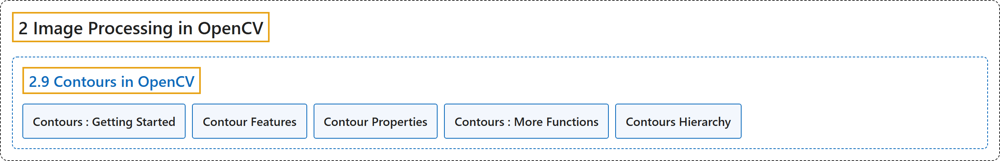

# 2.9 Contours in OpenCV

## Classification

## Glossary

| Term | Definition | 中文翻译 | Source |
|---|---|---|---|
| **2.9 Contours in OpenCV** OpenCV 中的轮廓 | (context) "**All about Contours in OpenCV**" | （语境）**关于 OpenCV 中轮廓的一切** | [OpenCV team, n.d.-b, "Image Processing in OpenCV", item 9](https://docs.opencv.org/4.x/d2/d96/tutorial_py_table_of_contents_imgproc.html) |
| **Contours : Getting Started** 轮廓入门 | (context) "Learn to **find and draw Contours**" | （语境）学习**寻找和绘制轮廓** | [OpenCV team, n.d.-a, "Contours in OpenCV", item 1](https://docs.opencv.org/4.x/d3/d05/tutorial_py_table_of_contents_contours.html) |
| **Contour Features** 轮廓特征 | (context) "Learn to find **different features of contours like area, perimeter, bounding rectangle etc**." | （语境）学习求**轮廓的各种特征，如面积、周长、外接矩形等**。 | [OpenCV team, n.d.-a, "Contours in OpenCV", item 2](https://docs.opencv.org/4.x/d3/d05/tutorial_py_table_of_contents_contours.html) |
| **Contour Properties** 轮廓属性 | (context) "Learn to find **different properties of contours like Solidity, Mean Intensity etc**." | （语境）学习求**轮廓的各种属性，如实心度、平均强度等**。 | [OpenCV team, n.d.-a, "Contours in OpenCV", item 3](https://docs.opencv.org/4.x/d3/d05/tutorial_py_table_of_contents_contours.html) |
| **Contours : More Functions** 轮廓：更多函数 | (context) "Learn to find **convexity defects, pointPolygonTest, match different shapes etc**." | （语境）学习求**凸缺陷、使用 pointPolygonTest、匹配不同形状等**。 | [OpenCV team, n.d.-a, "Contours in OpenCV", item 4](https://docs.opencv.org/4.x/d3/d05/tutorial_py_table_of_contents_contours.html) |
| **Contours Hierarchy** 轮廓层级 | (context) "Learn about **Contour Hierarchy**" | （语境）学习**轮廓层级** | [OpenCV team, n.d.-a, "Contours in OpenCV", item 5](https://docs.opencv.org/4.x/d3/d05/tutorial_py_table_of_contents_contours.html) |

## References

OpenCV team. (n.d.-a). *Contours in OpenCV*. OpenCV-Python Tutorials (Version 4.13.0). Retrieved October 31, 2026, from <https://docs.opencv.org/4.x/d3/d05/tutorial_py_table_of_contents_contours.html>

OpenCV team. (n.d.-b). *Image Processing in OpenCV*. OpenCV-Python Tutorials (Version 4.13.0). Retrieved October 31, 2026, from <https://docs.opencv.org/4.x/d2/d96/tutorial_py_table_of_contents_imgproc.html>
