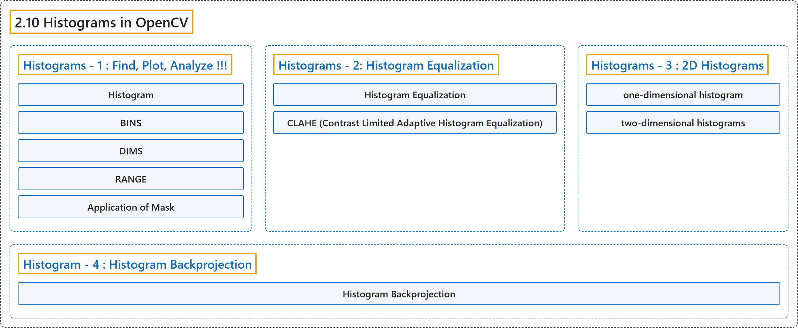

# 2.10 Histograms in OpenCV

## Classification

## Glossary

| Term | Definition | 中文翻译 | Source |
|---|---|---|---|
| **2.10 Histograms in OpenCV** OpenCV 中的直方图 | (context) "**All about histograms in OpenCV**" | （语境）**关于 OpenCV 中直方图的一切** | [OpenCV team, n.d.-f, "Image Processing in OpenCV", item 10](https://docs.opencv.org/4.x/d2/d96/tutorial_py_table_of_contents_imgproc.html) |
| **Histograms - 1 : Find, Plot, Analyze !!!** 直方图 1：计算、绘制、分析 | (context) "Learn **the basics of histograms**" | （语境）学习**直方图的基础** | [OpenCV team, n.d.-e, "Histograms in OpenCV", item 1](https://docs.opencv.org/4.x/de/db2/tutorial_py_table_of_contents_histograms.html) |
| **Histogram** 直方图 | "You can consider histogram as **a graph or plot, which gives you an overall idea about the intensity distribution of an image**." | 可以把直方图看作**一张图或曲线，它让你对图像的强度分布有一个整体的了解**。 | [OpenCV team, n.d.-b, "Theory", para. 1](https://docs.opencv.org/4.x/d1/db7/tutorial_py_histogram_begins.html#autotoc_md1405) |
| **BINS** 直方柱（BINS） | "So what you do is simply **split the whole histogram to 16 sub-parts and value of each sub-part is the sum of all pixel count in it**. This each sub-part is called "BIN"." | 所以你要做的只是**把整个直方图分成 16 个子部分，每个子部分的值是其中所有像素数之和**。每个子部分称为“BIN”。 | [OpenCV team, n.d.-b, "Find Histogram", para. 3](https://docs.opencv.org/4.x/d1/db7/tutorial_py_histogram_begins.html#autotoc_md1406) |
| **DIMS** 维数（DIMS） | "DIMS : It is **the number of parameters for which we collect the data**." | DIMS：它是**我们为之收集数据的参数个数**。 | [OpenCV team, n.d.-b, "Find Histogram", para. 4](https://docs.opencv.org/4.x/d1/db7/tutorial_py_histogram_begins.html#autotoc_md1406) |
| **RANGE** 范围（RANGE） | "RANGE : It is **the range of intensity values you want to measure**." | RANGE：它是**你想测量的强度值的范围**。 | [OpenCV team, n.d.-b, "Find Histogram", para. 5](https://docs.opencv.org/4.x/d1/db7/tutorial_py_histogram_begins.html#autotoc_md1406) |
| **Application of Mask** 掩模的应用 | "Just **create a mask image with white color on the region you want to find histogram and black otherwise**." | 只需**创建一幅掩模图像，在想求直方图的区域为白色，其余为黑色**。 | [OpenCV team, n.d.-b, "Application of Mask", para. 1](https://docs.opencv.org/4.x/d1/db7/tutorial_py_histogram_begins.html#autotoc_md1412) |
| **Histograms - 2: Histogram Equalization** 直方图 2：直方图均衡化 | (context) "Learn to **Equalize Histograms to get better contrast for images**" | （语境）学习**均衡化直方图，让图像获得更好的对比度** | [OpenCV team, n.d.-e, "Histograms in OpenCV", item 2](https://docs.opencv.org/4.x/de/db2/tutorial_py_table_of_contents_histograms.html) |
| **Histogram Equalization** 直方图均衡化 | "So you need to **stretch this histogram to either ends** (as given in below image, from wikipedia) and that is what Histogram Equalization does (in simple words)." | 所以需要**把这个直方图向两端拉伸**（如下图所示，图来自维基百科），简单地说，这就是直方图均衡化所做的事。 | [OpenCV team, n.d.-c, "Theory", para. 1](https://docs.opencv.org/4.x/d5/daf/tutorial_py_histogram_equalization.html#autotoc_md1415) |
| **CLAHE (Contrast Limited Adaptive Histogram Equalization)** CLAHE（限制对比度自适应直方图均衡化） | (No definition) | （无定义） | [OpenCV team, n.d.-c, "CLAHE (Contrast Limited Adaptive Histogram Equalization)"](https://docs.opencv.org/4.x/d5/daf/tutorial_py_histogram_equalization.html#autotoc_md1417) |
| **adaptive histogram equalization** 自适应直方图均衡化 | "So to solve this problem, adaptive histogram equalization is used. In this, **image is divided into small blocks called "tiles"** (tileSize is 8x8 by default in OpenCV). Then **each of these blocks are histogram equalized as usual**." | 为了解决这个问题，使用自适应直方图均衡化。在这种方法中，**图像被分成称为“tiles”的小块**（OpenCV 中 tileSize 默认为 8×8）。然后**对每一块照常做直方图均衡化**。 | [OpenCV team, n.d.-c, "CLAHE (Contrast Limited Adaptive Histogram Equalization)", para. 3](https://docs.opencv.org/4.x/d5/daf/tutorial_py_histogram_equalization.html#autotoc_md1417) |
| **contrast limiting** 对比度限制 | "If any histogram bin is above the specified contrast limit (by default 40 in OpenCV), **those pixels are clipped and distributed uniformly to other bins before applying histogram equalization**." | 如果某个直方柱超过指定的对比度上限（OpenCV 中默认为 40），**这些像素会在做直方图均衡化之前被裁剪并均匀分配到其他直方柱**。 | [OpenCV team, n.d.-c, "CLAHE (Contrast Limited Adaptive Histogram Equalization)", para. 3](https://docs.opencv.org/4.x/d5/daf/tutorial_py_histogram_equalization.html#autotoc_md1417) |
| **Histograms - 3 : 2D Histograms** 直方图 3：二维直方图 | (context) "Learn to **find and plot 2D Histograms**" | （语境）学习**计算和绘制二维直方图** | [OpenCV team, n.d.-e, "Histograms in OpenCV", item 3](https://docs.opencv.org/4.x/de/db2/tutorial_py_table_of_contents_histograms.html) |
| **one-dimensional histogram** 一维直方图 | "It is called one-dimensional because **we are taking only one feature into our consideration**, ie grayscale intensity value of the pixel." | 它之所以称为一维，是因为**我们只考虑一个特征**，即像素的灰度强度值。 | [OpenCV team, n.d.-d, "Introduction", para. 1](https://docs.opencv.org/4.x/dd/d0d/tutorial_py_2d_histogram.html#autotoc_md1392) |
| **two-dimensional histograms** 二维直方图 | "But in two-dimensional histograms, **you consider two features**." | 而在二维直方图中，**要考虑两个特征**。 | [OpenCV team, n.d.-d, "Introduction", para. 1](https://docs.opencv.org/4.x/dd/d0d/tutorial_py_2d_histogram.html#autotoc_md1392) |
| **color histograms** 颜色直方图 | "Normally it is used for finding color histograms where **two features are Hue & Saturation values of every pixel**." | 通常它用于求颜色直方图，其中**两个特征是每个像素的色调和饱和度值**。 | [OpenCV team, n.d.-d, "Introduction", para. 1](https://docs.opencv.org/4.x/dd/d0d/tutorial_py_2d_histogram.html#autotoc_md1392) |
| **Histogram - 4 : Histogram Backprojection** 直方图 4：直方图反向投影 | (context) "Learn **histogram backprojection to segment colored objects**" | （语境）学习**用直方图反向投影分割彩色物体** | [OpenCV team, n.d.-e, "Histograms in OpenCV", item 4](https://docs.opencv.org/4.x/de/db2/tutorial_py_table_of_contents_histograms.html) |
| **Histogram Backprojection** 直方图反向投影 | "It is used for **image segmentation or finding objects of interest in an image**." | 它用于**图像分割或寻找图像中感兴趣的物体**。 | [OpenCV team, n.d.-a, "Theory", para. 2](https://docs.opencv.org/4.x/dc/df6/tutorial_py_histogram_backprojection.html#autotoc_md1400) |

## References

OpenCV team. (n.d.-a). *Histogram - 4 : Histogram Backprojection*. OpenCV-Python Tutorials (Version 4.13.0). Retrieved October 31, 2026, from <https://docs.opencv.org/4.x/dc/df6/tutorial_py_histogram_backprojection.html>

OpenCV team. (n.d.-b). *Histograms - 1 : Find, Plot, Analyze !!!*. OpenCV-Python Tutorials (Version 4.13.0). Retrieved October 31, 2026, from <https://docs.opencv.org/4.x/d1/db7/tutorial_py_histogram_begins.html>

OpenCV team. (n.d.-c). *Histograms - 2: Histogram Equalization*. OpenCV-Python Tutorials (Version 4.13.0). Retrieved October 31, 2026, from <https://docs.opencv.org/4.x/d5/daf/tutorial_py_histogram_equalization.html>

OpenCV team. (n.d.-d). *Histograms - 3 : 2D Histograms*. OpenCV-Python Tutorials (Version 4.13.0). Retrieved October 31, 2026, from <https://docs.opencv.org/4.x/dd/d0d/tutorial_py_2d_histogram.html>

OpenCV team. (n.d.-e). *Histograms in OpenCV*. OpenCV-Python Tutorials (Version 4.13.0). Retrieved October 31, 2026, from <https://docs.opencv.org/4.x/de/db2/tutorial_py_table_of_contents_histograms.html>

OpenCV team. (n.d.-f). *Image Processing in OpenCV*. OpenCV-Python Tutorials (Version 4.13.0). Retrieved October 31, 2026, from <https://docs.opencv.org/4.x/d2/d96/tutorial_py_table_of_contents_imgproc.html>
