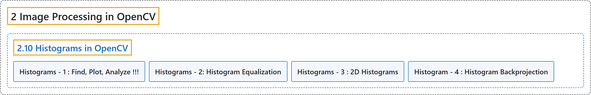

# 2.10 Histograms in OpenCV

## Classification

## Glossary

| Term | Definition | 中文翻译 | Source |
|---|---|---|---|
| **2.10 Histograms in OpenCV** OpenCV 中的直方图 | (context) "**All about histograms in OpenCV**" | （语境）**关于 OpenCV 中直方图的一切** | [OpenCV team, n.d.-b, "Image Processing in OpenCV", item 10](https://docs.opencv.org/4.x/d2/d96/tutorial_py_table_of_contents_imgproc.html) |
| **Histograms - 1 : Find, Plot, Analyze !!!** 直方图 1：计算、绘制、分析 | (context) "Learn **the basics of histograms**" | （语境）学习**直方图的基础** | [OpenCV team, n.d.-a, "Histograms in OpenCV", item 1](https://docs.opencv.org/4.x/de/db2/tutorial_py_table_of_contents_histograms.html) |
| **Histograms - 2: Histogram Equalization** 直方图 2：直方图均衡化 | (context) "Learn to **Equalize Histograms to get better contrast for images**" | （语境）学习**均衡化直方图，让图像获得更好的对比度** | [OpenCV team, n.d.-a, "Histograms in OpenCV", item 2](https://docs.opencv.org/4.x/de/db2/tutorial_py_table_of_contents_histograms.html) |
| **Histograms - 3 : 2D Histograms** 直方图 3：二维直方图 | (context) "Learn to **find and plot 2D Histograms**" | （语境）学习**计算和绘制二维直方图** | [OpenCV team, n.d.-a, "Histograms in OpenCV", item 3](https://docs.opencv.org/4.x/de/db2/tutorial_py_table_of_contents_histograms.html) |
| **Histogram - 4 : Histogram Backprojection** 直方图 4：直方图反向投影 | (context) "Learn **histogram backprojection to segment colored objects**" | （语境）学习**用直方图反向投影分割彩色物体** | [OpenCV team, n.d.-a, "Histograms in OpenCV", item 4](https://docs.opencv.org/4.x/de/db2/tutorial_py_table_of_contents_histograms.html) |

## References

OpenCV team. (n.d.-a). *Histograms in OpenCV*. OpenCV-Python Tutorials (Version 4.13.0). Retrieved October 31, 2026, from <https://docs.opencv.org/4.x/de/db2/tutorial_py_table_of_contents_histograms.html>

OpenCV team. (n.d.-b). *Image Processing in OpenCV*. OpenCV-Python Tutorials (Version 4.13.0). Retrieved October 31, 2026, from <https://docs.opencv.org/4.x/d2/d96/tutorial_py_table_of_contents_imgproc.html>
