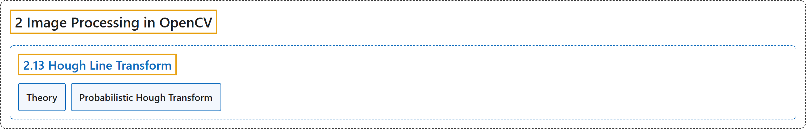

# 2.13 Hough Line Transform

## Classification

## Glossary

| Term | Definition | 中文翻译 | Source |
|---|---|---|---|
| **2.13 Hough Line Transform** 霍夫直线变换 | (context) "Learn to **detect lines in an image**" | （语境）学习**检测图像中的直线** | [OpenCV team, n.d.-b, "Image Processing in OpenCV", item 13](https://docs.opencv.org/4.x/d2/d96/tutorial_py_table_of_contents_imgproc.html) |
| **Theory** 理论 | "The Hough Transform is **a popular technique to detect any shape, if you can represent that shape in a mathematical form**." | 霍夫变换是**一种常用的技术，只要能用数学形式表示某种形状，就能检测这种形状**。 | [OpenCV team, n.d.-a, "Theory", para. 1](https://docs.opencv.org/4.x/d6/d10/tutorial_py_houghlines.html#autotoc_md1422) |
| **Probabilistic Hough Transform** 概率霍夫变换 | "Probabilistic Hough Transform is **an optimization of the Hough Transform we saw**." | 概率霍夫变换是**对前面所见霍夫变换的一种优化**。 | [OpenCV team, n.d.-a, "Probabilistic Hough Transform", para. 1](https://docs.opencv.org/4.x/d6/d10/tutorial_py_houghlines.html#autotoc_md1424) |

## References

OpenCV team. (n.d.-a). *Hough Line Transform*. OpenCV-Python Tutorials (Version 4.13.0). Retrieved October 31, 2026, from <https://docs.opencv.org/4.x/d6/d10/tutorial_py_houghlines.html>

OpenCV team. (n.d.-b). *Image Processing in OpenCV*. OpenCV-Python Tutorials (Version 4.13.0). Retrieved October 31, 2026, from <https://docs.opencv.org/4.x/d2/d96/tutorial_py_table_of_contents_imgproc.html>
