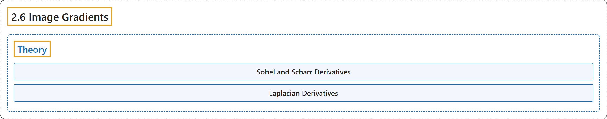

# 2.6 Image Gradients

## Classification

## Glossary

| Term | Definition | 中文翻译 | Source |
|---|---|---|---|
| **2.6 Image Gradients** 图像梯度 | (context) "Learn to **find image gradients, edges etc**." | （语境）学习**求图像梯度、边缘等**。 | [OpenCV team, n.d.-b, "Image Processing in OpenCV", item 6](https://docs.opencv.org/4.x/d2/d96/tutorial_py_table_of_contents_imgproc.html) |
| **Theory** 理论 | "OpenCV provides **three types of gradient filters or High-pass filters**, Sobel, Scharr and Laplacian." | OpenCV 提供**三种梯度滤波器（即高通滤波器）**：Sobel、Scharr 和 Laplacian。 | [OpenCV team, n.d.-a, "Theory", para. 1](https://docs.opencv.org/4.x/d5/d0f/tutorial_py_gradients.html#autotoc_md1386) |
| **Sobel and Scharr Derivatives** Sobel 与 Scharr 导数 | "Sobel operators is **a joint Gaussian smoothing plus differentiation operation**, so it is more resistant to noise." | Sobel 算子是**高斯平滑与微分相结合的运算**，因此对噪声更稳健。 | [OpenCV team, n.d.-a, "1. Sobel and Scharr Derivatives", para. 1](https://docs.opencv.org/4.x/d5/d0f/tutorial_py_gradients.html#autotoc_md1387) |
| **Laplacian Derivatives** 拉普拉斯导数 | (context) "It calculates **the Laplacian of the image** given by the relation," | （语境）它计算**图像的拉普拉斯算子**，由下式给出， | [OpenCV team, n.d.-a, "2. Laplacian Derivatives", para. 1](https://docs.opencv.org/4.x/d5/d0f/tutorial_py_gradients.html#autotoc_md1388) |

## References

OpenCV team. (n.d.-a). *Image Gradients*. OpenCV-Python Tutorials (Version 4.13.0). Retrieved October 31, 2026, from <https://docs.opencv.org/4.x/d5/d0f/tutorial_py_gradients.html>

OpenCV team. (n.d.-b). *Image Processing in OpenCV*. OpenCV-Python Tutorials (Version 4.13.0). Retrieved October 31, 2026, from <https://docs.opencv.org/4.x/d2/d96/tutorial_py_table_of_contents_imgproc.html>
