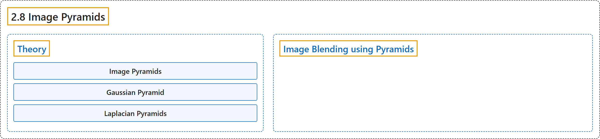

# 2.8 Image Pyramids

## Classification

## Glossary

| Term | Definition | 中文翻译 | Source |
|---|---|---|---|
| **2.8 Image Pyramids** 图像金字塔 | (context) "Learn about **image pyramids and how to use them for image blending**" | （语境）学习**图像金字塔，以及如何用它进行图像融合** | [OpenCV team, n.d.-a, "Image Processing in OpenCV", item 8](https://docs.opencv.org/4.x/d2/d96/tutorial_py_table_of_contents_imgproc.html) |
| **Theory** 理论 | (No definition) | （无定义） | [OpenCV team, n.d.-b, "Theory"](https://docs.opencv.org/4.x/dc/dff/tutorial_py_pyramids.html#autotoc_md1438) |
| **Image Pyramids** 图像金字塔 | "**These set of images with different resolutions** are called Image Pyramids" | **这组分辨率不同的图像**称为图像金字塔 | [OpenCV team, n.d.-b, "Theory", para. 1](https://docs.opencv.org/4.x/dc/dff/tutorial_py_pyramids.html#autotoc_md1438) |
| **Gaussian Pyramid** 高斯金字塔 | "Higher level (Low resolution) in a Gaussian Pyramid is **formed by removing consecutive rows and columns in Lower level (higher resolution) image**." | 高斯金字塔中较高的一层（低分辨率）是**通过去掉较低一层（高分辨率）图像中连续的行和列而形成的**。 | [OpenCV team, n.d.-b, "Theory", para. 3](https://docs.opencv.org/4.x/dc/dff/tutorial_py_pyramids.html#autotoc_md1438) |
| **Octave** 八度 | "So **area reduces to one-fourth of original area**. It is called an Octave." | 于是**面积缩小为原来的四分之一**。这称为一个八度（Octave）。 | [OpenCV team, n.d.-b, "Theory", para. 3](https://docs.opencv.org/4.x/dc/dff/tutorial_py_pyramids.html#autotoc_md1438) |
| **Laplacian Pyramids** 拉普拉斯金字塔 | "A level in Laplacian Pyramid is formed by **the difference between that level in Gaussian Pyramid and expanded version of its upper level in Gaussian Pyramid**." | 拉普拉斯金字塔中的一层由**高斯金字塔中该层与其上一层的扩展版本之差**构成。 | [OpenCV team, n.d.-b, "Theory", para. 7](https://docs.opencv.org/4.x/dc/dff/tutorial_py_pyramids.html#autotoc_md1438) |
| **Image Blending using Pyramids** 用金字塔进行图像融合 | "In that case, **image blending with Pyramids gives you seamless blending without leaving much data in the images**." | 这时，**用金字塔做图像融合可以实现无缝融合，而不会在图像中留下太多数据**。 | [OpenCV team, n.d.-b, "Image Blending using Pyramids", para. 1](https://docs.opencv.org/4.x/dc/dff/tutorial_py_pyramids.html#autotoc_md1439) |

## References

OpenCV team. (n.d.-a). *Image Processing in OpenCV*. OpenCV-Python Tutorials (Version 4.13.0). Retrieved October 31, 2026, from <https://docs.opencv.org/4.x/d2/d96/tutorial_py_table_of_contents_imgproc.html>

OpenCV team. (n.d.-b). *Image Pyramids*. OpenCV-Python Tutorials (Version 4.13.0). Retrieved October 31, 2026, from <https://docs.opencv.org/4.x/dc/dff/tutorial_py_pyramids.html>
