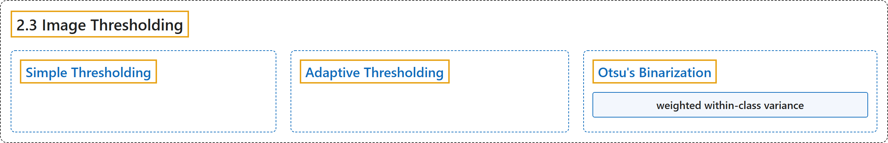

# 2.3 Image Thresholding

## Classification

## Glossary

| Term | Definition | 中文翻译 | Source |
|---|---|---|---|
| **2.3 Image Thresholding** 图像阈值化 | (context) "Learn to **convert images to binary images using global thresholding, Adaptive thresholding, Otsu's binarization etc**" | （语境）学习**用全局阈值、自适应阈值、Otsu 二值化等方法把图像转换为二值图像** | [OpenCV team, n.d.-a, "Image Processing in OpenCV", item 3](https://docs.opencv.org/4.x/d2/d96/tutorial_py_table_of_contents_imgproc.html) |
| **Simple Thresholding** 简单阈值化 | "For every pixel, **the same threshold value is applied**." | 对每个像素**都使用同一个阈值**。 | [OpenCV team, n.d.-b, "Simple Thresholding", para. 1](https://docs.opencv.org/4.x/d7/d4d/tutorial_py_thresholding.html#autotoc_md1446) |
| **Adaptive Thresholding** 自适应阈值化 | "Here, **the algorithm determines the threshold for a pixel based on a small region around it**." | 这里，**算法根据像素周围的一个小区域来确定该像素的阈值**。 | [OpenCV team, n.d.-b, "Adaptive Thresholding", para. 1](https://docs.opencv.org/4.x/d7/d4d/tutorial_py_thresholding.html#autotoc_md1447) |
| **Otsu's Binarization** Otsu 二值化（大津法） | "In contrast, **Otsu's method avoids having to choose a value and determines it automatically**." | 相比之下，**Otsu 方法无需人为选择阈值，而是自动确定它**。 | [OpenCV team, n.d.-b, "Otsu's Binarization", para. 1](https://docs.opencv.org/4.x/d7/d4d/tutorial_py_thresholding.html#autotoc_md1448) |
| **weighted within-class variance** 加权类内方差 | (context) "Since we are working with bimodal images, Otsu's algorithm **tries to find a threshold value (t) which minimizes the weighted within-class variance** given by the relation:" | （语境）由于我们处理的是双峰图像，Otsu 算法**试图找到一个使加权类内方差最小的阈值 (t)**，该方差由下式给出： | [OpenCV team, n.d.-b, "How does Otsu's Binarization work?", para. 2](https://docs.opencv.org/4.x/d7/d4d/tutorial_py_thresholding.html#autotoc_md1449) |

## References

OpenCV team. (n.d.-a). *Image Processing in OpenCV*. OpenCV-Python Tutorials (Version 4.13.0). Retrieved October 31, 2026, from <https://docs.opencv.org/4.x/d2/d96/tutorial_py_table_of_contents_imgproc.html>

OpenCV team. (n.d.-b). *Image Thresholding*. OpenCV-Python Tutorials (Version 4.13.0). Retrieved October 31, 2026, from <https://docs.opencv.org/4.x/d7/d4d/tutorial_py_thresholding.html>
