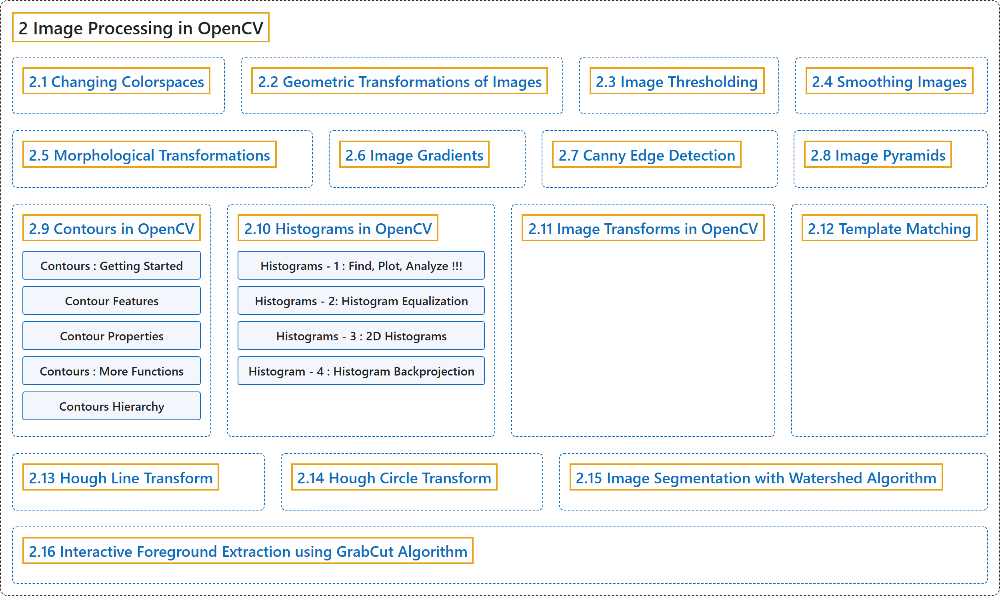

# 2. Image Processing in OpenCV

## Classification

## Glossary

| Term | Definition | 中文翻译 | Source |
|---|---|---|---|
| **2 Image Processing in OpenCV** OpenCV 中的图像处理 | "In this section you will learn **different image processing functions inside OpenCV**." | 在本节中，你将学习 **OpenCV 中各种图像处理函数**。 | [OpenCV team, n.d.-b, "OpenCV-Python Tutorials", item 4](https://docs.opencv.org/4.x/d6/d00/tutorial_py_root.html) |
| **[2.1 Changing Colorspaces](changing-colorspaces.md)** 颜色空间转换 | (context) "Learn to **change images between different color spaces**." | （语境）学习**在不同颜色空间之间转换图像**。 | [OpenCV team, n.d.-a, "Image Processing in OpenCV", item 1](https://docs.opencv.org/4.x/d2/d96/tutorial_py_table_of_contents_imgproc.html) |
| **[2.2 Geometric Transformations of Images](geometric-transformations-of-images.md)** 图像的几何变换 | (context) "Learn to apply **different geometric transformations to images like rotation, translation etc**." | （语境）学习对图像施加**各种几何变换，如旋转、平移等**。 | [OpenCV team, n.d.-a, "Image Processing in OpenCV", item 2](https://docs.opencv.org/4.x/d2/d96/tutorial_py_table_of_contents_imgproc.html) |
| **[2.3 Image Thresholding](image-thresholding.md)** 图像阈值化 | (context) "Learn to **convert images to binary images using global thresholding, Adaptive thresholding, Otsu's binarization etc**" | （语境）学习**用全局阈值、自适应阈值、Otsu 二值化等方法把图像转换为二值图像** | [OpenCV team, n.d.-a, "Image Processing in OpenCV", item 3](https://docs.opencv.org/4.x/d2/d96/tutorial_py_table_of_contents_imgproc.html) |
| **[2.4 Smoothing Images](smoothing-images.md)** 图像平滑 | (context) "Learn to **blur the images, filter the images with custom kernels etc**." | （语境）学习**模糊图像、用自定义卷积核过滤图像等**。 | [OpenCV team, n.d.-a, "Image Processing in OpenCV", item 4](https://docs.opencv.org/4.x/d2/d96/tutorial_py_table_of_contents_imgproc.html) |
| **[2.5 Morphological Transformations](morphological-transformations.md)** 形态学变换 | (context) "Learn about **morphological transformations like Erosion, Dilation, Opening, Closing etc**" | （语境）学习**形态学变换，如腐蚀、膨胀、开运算、闭运算等** | [OpenCV team, n.d.-a, "Image Processing in OpenCV", item 5](https://docs.opencv.org/4.x/d2/d96/tutorial_py_table_of_contents_imgproc.html) |
| **[2.6 Image Gradients](image-gradients.md)** 图像梯度 | (context) "Learn to **find image gradients, edges etc**." | （语境）学习**求图像梯度、边缘等**。 | [OpenCV team, n.d.-a, "Image Processing in OpenCV", item 6](https://docs.opencv.org/4.x/d2/d96/tutorial_py_table_of_contents_imgproc.html) |
| **[2.7 Canny Edge Detection](canny-edge-detection.md)** Canny 边缘检测 | (context) "Learn to **find edges with Canny Edge Detection**" | （语境）学习**用 Canny 边缘检测寻找边缘** | [OpenCV team, n.d.-a, "Image Processing in OpenCV", item 7](https://docs.opencv.org/4.x/d2/d96/tutorial_py_table_of_contents_imgproc.html) |
| **[2.8 Image Pyramids](image-pyramids.md)** 图像金字塔 | (context) "Learn about **image pyramids and how to use them for image blending**" | （语境）学习**图像金字塔，以及如何用它进行图像融合** | [OpenCV team, n.d.-a, "Image Processing in OpenCV", item 8](https://docs.opencv.org/4.x/d2/d96/tutorial_py_table_of_contents_imgproc.html) |
| **[2.9 Contours in OpenCV](contours-in-opencv.md)** OpenCV 中的轮廓 | (context) "**All about Contours in OpenCV**" | （语境）**关于 OpenCV 中轮廓的一切** | [OpenCV team, n.d.-a, "Image Processing in OpenCV", item 9](https://docs.opencv.org/4.x/d2/d96/tutorial_py_table_of_contents_imgproc.html) |
| **[2.10 Histograms in OpenCV](histograms-in-opencv.md)** OpenCV 中的直方图 | (context) "**All about histograms in OpenCV**" | （语境）**关于 OpenCV 中直方图的一切** | [OpenCV team, n.d.-a, "Image Processing in OpenCV", item 10](https://docs.opencv.org/4.x/d2/d96/tutorial_py_table_of_contents_imgproc.html) |
| **[2.11 Image Transforms in OpenCV](image-transforms-in-opencv.md)** OpenCV 中的图像变换 | (context) "Meet **different Image Transforms in OpenCV like Fourier Transform, Cosine Transform etc**." | （语境）认识 **OpenCV 中的各种图像变换，如傅里叶变换、余弦变换等**。 | [OpenCV team, n.d.-a, "Image Processing in OpenCV", item 11](https://docs.opencv.org/4.x/d2/d96/tutorial_py_table_of_contents_imgproc.html) |
| **[2.12 Template Matching](template-matching.md)** 模板匹配 | (context) "Learn to **search for an object in an image using Template Matching**" | （语境）学习**用模板匹配在图像中搜索物体** | [OpenCV team, n.d.-a, "Image Processing in OpenCV", item 12](https://docs.opencv.org/4.x/d2/d96/tutorial_py_table_of_contents_imgproc.html) |
| **[2.13 Hough Line Transform](hough-line-transform.md)** 霍夫直线变换 | (context) "Learn to **detect lines in an image**" | （语境）学习**检测图像中的直线** | [OpenCV team, n.d.-a, "Image Processing in OpenCV", item 13](https://docs.opencv.org/4.x/d2/d96/tutorial_py_table_of_contents_imgproc.html) |
| **[2.14 Hough Circle Transform](hough-circle-transform.md)** 霍夫圆变换 | (context) "Learn to **detect circles in an image**" | （语境）学习**检测图像中的圆** | [OpenCV team, n.d.-a, "Image Processing in OpenCV", item 14](https://docs.opencv.org/4.x/d2/d96/tutorial_py_table_of_contents_imgproc.html) |
| **[2.15 Image Segmentation with Watershed Algorithm](image-segmentation-with-watershed-algorithm.md)** 用分水岭算法分割图像 | (context) "Learn to **segment images with watershed segmentation**" | （语境）学习**用分水岭分割法分割图像** | [OpenCV team, n.d.-a, "Image Processing in OpenCV", item 15](https://docs.opencv.org/4.x/d2/d96/tutorial_py_table_of_contents_imgproc.html) |
| **[2.16 Interactive Foreground Extraction using GrabCut Algorithm](interactive-foreground-extraction-using-grabcut-algorithm.md)** 用 GrabCut 算法交互式提取前景 | (context) "Learn to **extract foreground with GrabCut algorithm**" | （语境）学习**用 GrabCut 算法提取前景** | [OpenCV team, n.d.-a, "Image Processing in OpenCV", item 16](https://docs.opencv.org/4.x/d2/d96/tutorial_py_table_of_contents_imgproc.html) |

## References

OpenCV team. (n.d.-a). *Image Processing in OpenCV*. OpenCV-Python Tutorials (Version 4.13.0). Retrieved October 31, 2026, from <https://docs.opencv.org/4.x/d2/d96/tutorial_py_table_of_contents_imgproc.html>

OpenCV team. (n.d.-b). *OpenCV-Python Tutorials*. OpenCV-Python Tutorials (Version 4.13.0). Retrieved October 31, 2026, from <https://docs.opencv.org/4.x/d6/d00/tutorial_py_root.html>
