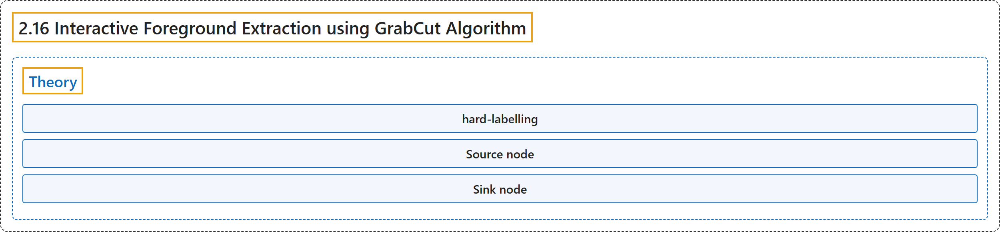

# 2.16 Interactive Foreground Extraction using GrabCut Algorithm

## Classification

## Glossary

| Term | Definition | 中文翻译 | Source |
|---|---|---|---|
| **2.16 Interactive Foreground Extraction using GrabCut Algorithm** 用 GrabCut 算法交互式提取前景 | (context) "Learn to **extract foreground with GrabCut algorithm**" | （语境）学习**用 GrabCut 算法提取前景** | [OpenCV team, n.d.-a, "Image Processing in OpenCV", item 16](https://docs.opencv.org/4.x/d2/d96/tutorial_py_table_of_contents_imgproc.html) |
| **Theory** 理论 | "An algorithm was needed for **foreground extraction with minimal user interaction**, and the result was GrabCut." | 当时需要一种**只需最少用户交互的前景提取**算法，结果就是 GrabCut。 | [OpenCV team, n.d.-b, "Theory", para. 1](https://docs.opencv.org/4.x/d8/d83/tutorial_py_grabcut.html#autotoc_md1382) |
| **hard-labelling** 硬标记 | "Similarly any user input specifying foreground and background are considered as hard-labelling which means **they won't change in the process**." | 类似地，任何指定前景和背景的用户输入都视为硬标记，意思是**它们在处理过程中不会改变**。 | [OpenCV team, n.d.-b, "Theory", item 1](https://docs.opencv.org/4.x/d8/d83/tutorial_py_grabcut.html#autotoc_md1382) |
| **Source node** 源节点 | "Additional two nodes are added, Source node and Sink node. **Every foreground pixel is connected to Source node**" | 另外加入两个节点：源节点和汇节点。**每个前景像素都与源节点相连** | [OpenCV team, n.d.-b, "Theory", item 5](https://docs.opencv.org/4.x/d8/d83/tutorial_py_grabcut.html#autotoc_md1382) |
| **Sink node** 汇节点 | "Additional two nodes are added, Source node and Sink node. Every foreground pixel is connected to Source node and **every background pixel is connected to Sink node**." | 另外加入两个节点：源节点和汇节点。每个前景像素都与源节点相连，**每个背景像素都与汇节点相连**。 | [OpenCV team, n.d.-b, "Theory", item 5](https://docs.opencv.org/4.x/d8/d83/tutorial_py_grabcut.html#autotoc_md1382) |

## References

OpenCV team. (n.d.-a). *Image Processing in OpenCV*. OpenCV-Python Tutorials (Version 4.13.0). Retrieved October 31, 2026, from <https://docs.opencv.org/4.x/d2/d96/tutorial_py_table_of_contents_imgproc.html>

OpenCV team. (n.d.-b). *Interactive Foreground Extraction using GrabCut Algorithm*. OpenCV-Python Tutorials (Version 4.13.0). Retrieved October 31, 2026, from <https://docs.opencv.org/4.x/d8/d83/tutorial_py_grabcut.html>
