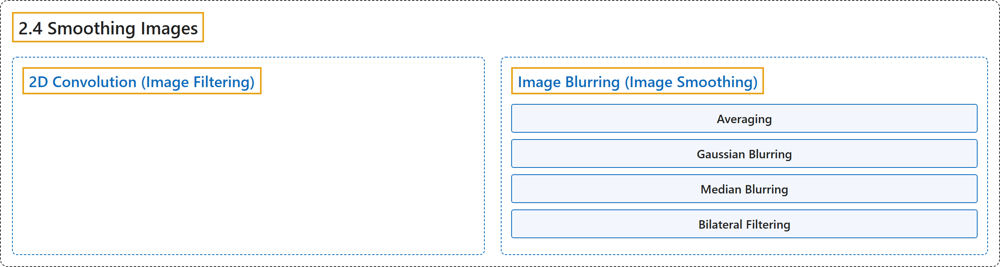

# 2.4 Smoothing Images

## Classification

## Glossary

| Term | Definition | 中文翻译 | Source |
|---|---|---|---|
| **2.4 Smoothing Images** 图像平滑 | (context) "Learn to **blur the images, filter the images with custom kernels etc**." | （语境）学习**模糊图像、用自定义卷积核过滤图像等**。 | [OpenCV team, n.d.-a, "Image Processing in OpenCV", item 4](https://docs.opencv.org/4.x/d2/d96/tutorial_py_table_of_contents_imgproc.html) |
| **2D Convolution (Image Filtering)** 二维卷积（图像滤波） | (context) "OpenCV provides a function cv.filter2D() to **convolve a kernel with an image**." | （语境）OpenCV 提供函数 cv.filter2D() 来**将卷积核与图像做卷积**。 | [OpenCV team, n.d.-b, "2D Convolution ( Image Filtering )", para. 2](https://docs.opencv.org/4.x/d4/d13/tutorial_py_filtering.html#autotoc_md1366) |
| **Image Blurring (Image Smoothing)** 图像模糊（图像平滑） | "Image blurring is achieved by **convolving the image with a low-pass filter kernel**." | 图像模糊是通过**把图像与低通滤波器卷积核做卷积**来实现的。 | [OpenCV team, n.d.-b, "Image Blurring (Image Smoothing)", para. 1](https://docs.opencv.org/4.x/d4/d13/tutorial_py_filtering.html#autotoc_md1367) |
| **Averaging** 均值滤波 | "This is done by **convolving an image with a normalized box filter**." | 它是通过**把图像与归一化的方框滤波器做卷积**来完成的。 | [OpenCV team, n.d.-b, "1. Averaging", para. 1](https://docs.opencv.org/4.x/d4/d13/tutorial_py_filtering.html#autotoc_md1368) |
| **Gaussian Blurring** 高斯模糊 | "In this method, instead of a box filter, **a Gaussian kernel is used**." | 在这种方法中，**使用高斯核**代替方框滤波器。 | [OpenCV team, n.d.-b, "2. Gaussian Blurring", para. 1](https://docs.opencv.org/4.x/d4/d13/tutorial_py_filtering.html#autotoc_md1369) |
| **Median Blurring** 中值模糊 | "Here, the function cv.medianBlur() **takes the median of all the pixels under the kernel area and the central element is replaced with this median value**." | 这里，函数 cv.medianBlur() **取卷积核区域内所有像素的中值，并用这个中值替换中心元素**。 | [OpenCV team, n.d.-b, "3. Median Blurring", para. 1](https://docs.opencv.org/4.x/d4/d13/tutorial_py_filtering.html#autotoc_md1370) |
| **Bilateral Filtering** 双边滤波 | "Bilateral filtering also takes a Gaussian filter in space, but **one more Gaussian filter which is a function of pixel difference**." | 双边滤波同样在空间上使用一个高斯滤波器，但**还多用一个以像素差为自变量的高斯滤波器**。 | [OpenCV team, n.d.-b, "4. Bilateral Filtering", para. 2](https://docs.opencv.org/4.x/d4/d13/tutorial_py_filtering.html#autotoc_md1371) |

## References

OpenCV team. (n.d.-a). *Image Processing in OpenCV*. OpenCV-Python Tutorials (Version 4.13.0). Retrieved October 31, 2026, from <https://docs.opencv.org/4.x/d2/d96/tutorial_py_table_of_contents_imgproc.html>

OpenCV team. (n.d.-b). *Smoothing Images*. OpenCV-Python Tutorials (Version 4.13.0). Retrieved October 31, 2026, from <https://docs.opencv.org/4.x/d4/d13/tutorial_py_filtering.html>
