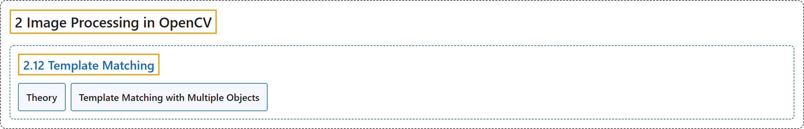

# 2.12 Template Matching

## Classification

## Glossary

| Term | Definition | 中文翻译 | Source |
|---|---|---|---|
| **2.12 Template Matching** 模板匹配 | (context) "Learn to **search for an object in an image using Template Matching**" | （语境）学习**用模板匹配在图像中搜索物体** | [OpenCV team, n.d.-a, "Image Processing in OpenCV", item 12](https://docs.opencv.org/4.x/d2/d96/tutorial_py_table_of_contents_imgproc.html) |
| **Theory** 理论 | "Template Matching is **a method for searching and finding the location of a template image in a larger image**." | 模板匹配是**一种在较大图像中搜索并找到模板图像位置的方法**。 | [OpenCV team, n.d.-b, "Theory", para. 1](https://docs.opencv.org/4.x/d4/dc6/tutorial_py_template_matching.html#autotoc_md1442) |
| **Template Matching with Multiple Objects** 多目标模板匹配 | (context) "In that case, **we will use thresholding**." | （语境）这时，**我们将使用阈值化**。 | [OpenCV team, n.d.-b, "Template Matching with Multiple Objects", para. 1](https://docs.opencv.org/4.x/d4/dc6/tutorial_py_template_matching.html#autotoc_md1444) |

## References

OpenCV team. (n.d.-a). *Image Processing in OpenCV*. OpenCV-Python Tutorials (Version 4.13.0). Retrieved October 31, 2026, from <https://docs.opencv.org/4.x/d2/d96/tutorial_py_table_of_contents_imgproc.html>

OpenCV team. (n.d.-b). *Template Matching*. OpenCV-Python Tutorials (Version 4.13.0). Retrieved October 31, 2026, from <https://docs.opencv.org/4.x/d4/dc6/tutorial_py_template_matching.html>
