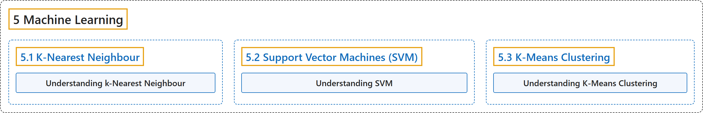

# 5. Machine Learning

## Classification

## Glossary

| Term | Definition | 中文翻译 | Source |
|---|---|---|---|
| **5 Machine Learning** 机器学习 | (context) "In this section you will learn **different image processing functions inside OpenCV**." | （语境）在本节中，你将学习 **OpenCV 中各种图像处理函数**。（原文如此，与第 4 组的句子相同） | [OpenCV team, n.d.-b, "OpenCV-Python Tutorials", item 8](https://docs.opencv.org/4.x/d6/d00/tutorial_py_root.html) |
| **[5.1 K-Nearest Neighbour](k-nearest-neighbour.md)** K 近邻 | (context) "Learn to **use kNN for classification** Plus learn about handwritten digit recognition using kNN" | （语境）学习**用 kNN 做分类**，另外学习用 kNN 识别手写数字 | [OpenCV team, n.d.-a, "Machine Learning", item 1](https://docs.opencv.org/4.x/d6/de2/tutorial_py_table_of_contents_ml.html) |
| **[5.2 Support Vector Machines (SVM)](support-vector-machines-svm.md)** 支持向量机（SVM） | (context) "Understand **concepts of SVM**" | （语境）理解 **SVM 的概念** | [OpenCV team, n.d.-a, "Machine Learning", item 2](https://docs.opencv.org/4.x/d6/de2/tutorial_py_table_of_contents_ml.html) |
| **[5.3 K-Means Clustering](k-means-clustering.md)** K 均值聚类 | (context) "Learn to use K-Means Clustering **to group data to a number of clusters**." | （语境）学习用 K 均值聚类**把数据分成若干簇**。 | [OpenCV team, n.d.-a, "Machine Learning", item 3](https://docs.opencv.org/4.x/d6/de2/tutorial_py_table_of_contents_ml.html) |

## References

OpenCV team. (n.d.-a). *Machine Learning*. OpenCV-Python Tutorials (Version 4.13.0). Retrieved October 31, 2026, from <https://docs.opencv.org/4.x/d6/de2/tutorial_py_table_of_contents_ml.html>

OpenCV team. (n.d.-b). *OpenCV-Python Tutorials*. OpenCV-Python Tutorials (Version 4.13.0). Retrieved October 31, 2026, from <https://docs.opencv.org/4.x/d6/d00/tutorial_py_root.html>
