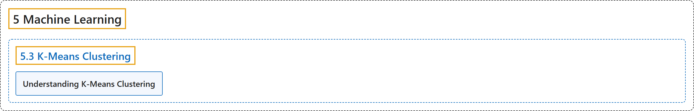

# 5.3 K-Means Clustering

## Classification

## Glossary

| Term | Definition | 中文翻译 | Source |
|---|---|---|---|
| **5.3 K-Means Clustering** K 均值聚类 | (context) "Learn to use K-Means Clustering **to group data to a number of clusters**." | （语境）学习用 K 均值聚类**把数据分成若干簇**。 | [OpenCV team, n.d.-b, "Machine Learning", item 3](https://docs.opencv.org/4.x/d6/de2/tutorial_py_table_of_contents_ml.html) |
| **Understanding K-Means Clustering** 理解 K 均值聚类 | (context) "Read to get **an intuitive understanding of K-Means Clustering**" | （语境）阅读以获得**对 K 均值聚类的直观理解** | [OpenCV team, n.d.-a, "K-Means Clustering", item 1](https://docs.opencv.org/4.x/d9/d70/tutorial_py_kmeans_index.html) |

## References

OpenCV team. (n.d.-a). *K-Means Clustering*. OpenCV-Python Tutorials (Version 4.13.0). Retrieved October 31, 2026, from <https://docs.opencv.org/4.x/d9/d70/tutorial_py_kmeans_index.html>

OpenCV team. (n.d.-b). *Machine Learning*. OpenCV-Python Tutorials (Version 4.13.0). Retrieved October 31, 2026, from <https://docs.opencv.org/4.x/d6/de2/tutorial_py_table_of_contents_ml.html>
