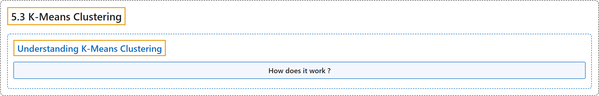

# 5.3 K-Means Clustering

## Classification

## Glossary

| Term | Definition | 中文翻译 | Source |
|---|---|---|---|
| **5.3 K-Means Clustering** K 均值聚类 | (context) "Learn to use K-Means Clustering **to group data to a number of clusters**." | （语境）学习用 K 均值聚类**把数据分成若干簇**。 | [OpenCV team, n.d.-b, "Machine Learning", item 3](https://docs.opencv.org/4.x/d6/de2/tutorial_py_table_of_contents_ml.html) |
| **Understanding K-Means Clustering** 理解 K 均值聚类 | (context) "Read to get **an intuitive understanding of K-Means Clustering**" | （语境）阅读以获得**对 K 均值聚类的直观理解** | [OpenCV team, n.d.-a, "K-Means Clustering", item 1](https://docs.opencv.org/4.x/d9/d70/tutorial_py_kmeans_index.html) |
| **How does it work ?** 工作原理 | "This algorithm is **an iterative process**." | 这个算法是**一个迭代过程**。 | [OpenCV team, n.d.-c, "How does it work ?", para. 1](https://docs.opencv.org/4.x/de/d4d/tutorial_py_kmeans_understanding.html#autotoc_md1474) |
| **Step : 1** 第 1 步 | "Step : 1 - **Algorithm randomly chooses two centroids**, C1 and C2 (sometimes, any two data are taken as the centroids)." | 第 1 步：**算法随机选择两个质心** C1 和 C2（有时任取两个数据作为质心）。 | [OpenCV team, n.d.-c, "How does it work ?", para. 3](https://docs.opencv.org/4.x/de/d4d/tutorial_py_kmeans_understanding.html#autotoc_md1474) |
| **Step : 2** 第 2 步 | "Step : 2 - It **calculates the distance from each point to both centroids**." | 第 2 步：**计算每个点到两个质心的距离**。 | [OpenCV team, n.d.-c, "How does it work ?", para. 4](https://docs.opencv.org/4.x/de/d4d/tutorial_py_kmeans_understanding.html#autotoc_md1474) |
| **Step : 3** 第 3 步 | "Step : 3 - Next we **calculate the average of all blue points and red points separately and that will be our new centroids**." | 第 3 步：接着**分别计算所有蓝点和红点的平均值，作为新的质心**。 | [OpenCV team, n.d.-c, "How does it work ?", para. 6](https://docs.opencv.org/4.x/de/d4d/tutorial_py_kmeans_understanding.html#autotoc_md1474) |

## References

OpenCV team. (n.d.-a). *K-Means Clustering*. OpenCV-Python Tutorials (Version 4.13.0). Retrieved October 31, 2026, from <https://docs.opencv.org/4.x/d9/d70/tutorial_py_kmeans_index.html>

OpenCV team. (n.d.-b). *Machine Learning*. OpenCV-Python Tutorials (Version 4.13.0). Retrieved October 31, 2026, from <https://docs.opencv.org/4.x/d6/de2/tutorial_py_table_of_contents_ml.html>

OpenCV team. (n.d.-c). *Understanding K-Means Clustering*. OpenCV-Python Tutorials (Version 4.13.0). Retrieved October 31, 2026, from <https://docs.opencv.org/4.x/de/d4d/tutorial_py_kmeans_understanding.html>
