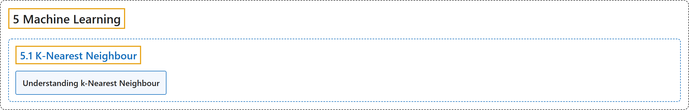

# 5.1 K-Nearest Neighbour

## Classification

## Glossary

| Term | Definition | 中文翻译 | Source |
|---|---|---|---|
| **5.1 K-Nearest Neighbour** K 近邻 | (context) "Learn to **use kNN for classification** Plus learn about handwritten digit recognition using kNN" | （语境）学习**用 kNN 做分类**，另外学习用 kNN 识别手写数字 | [OpenCV team, n.d.-b, "Machine Learning", item 1](https://docs.opencv.org/4.x/d6/de2/tutorial_py_table_of_contents_ml.html) |
| **Understanding k-Nearest Neighbour** 理解 K 近邻 | (context) "Get **a basic understanding of what kNN is**" | （语境）**基本了解 kNN 是什么** | [OpenCV team, n.d.-a, "K-Nearest Neighbour", item 1](https://docs.opencv.org/4.x/d0/d72/tutorial_py_knn_index.html) |

## References

OpenCV team. (n.d.-a). *K-Nearest Neighbour*. OpenCV-Python Tutorials (Version 4.13.0). Retrieved October 31, 2026, from <https://docs.opencv.org/4.x/d0/d72/tutorial_py_knn_index.html>

OpenCV team. (n.d.-b). *Machine Learning*. OpenCV-Python Tutorials (Version 4.13.0). Retrieved October 31, 2026, from <https://docs.opencv.org/4.x/d6/de2/tutorial_py_table_of_contents_ml.html>
