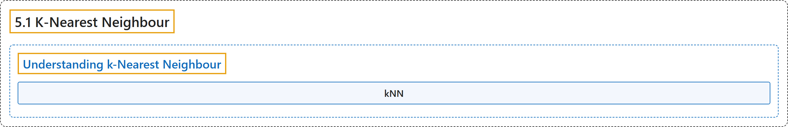

# 5.1 K-Nearest Neighbour

## Classification

## Glossary

| Term | Definition | 中文翻译 | Source |
|---|---|---|---|
| **5.1 K-Nearest Neighbour** K 近邻 | (context) "Learn to **use kNN for classification** Plus learn about handwritten digit recognition using kNN" | （语境）学习**用 kNN 做分类**，另外学习用 kNN 识别手写数字 | [OpenCV team, n.d.-b, "Machine Learning", item 1](https://docs.opencv.org/4.x/d6/de2/tutorial_py_table_of_contents_ml.html) |
| **Understanding k-Nearest Neighbour** 理解 K 近邻 | (context) "Get **a basic understanding of what kNN is**" | （语境）**基本了解 kNN 是什么** | [OpenCV team, n.d.-a, "K-Nearest Neighbour", item 1](https://docs.opencv.org/4.x/d0/d72/tutorial_py_knn_index.html) |
| **kNN** K 近邻（kNN） | "kNN is **one of the simplest classification algorithms available for supervised learning**." | kNN 是**监督学习中最简单的分类算法之一**。 | [OpenCV team, n.d.-c, "Theory", para. 1](https://docs.opencv.org/4.x/d5/d26/tutorial_py_knn_understanding.html#autotoc_md1482) |
| **Class** 类别 | "We refer to **each family** as a Class." | 我们把**每个家族**称为一个类别。 | [OpenCV team, n.d.-c, "Theory", para. 2](https://docs.opencv.org/4.x/d5/d26/tutorial_py_knn_understanding.html#autotoc_md1482) |
| **Feature Space** 特征空间 | "You can consider a feature space as **a space where all data are projected**." | 可以把特征空间看作**所有数据投影到其中的空间**。 | [OpenCV team, n.d.-c, "Theory", para. 2](https://docs.opencv.org/4.x/d5/d26/tutorial_py_knn_understanding.html#autotoc_md1482) |
| **Classification** 分类 | "**He should be added to one of these Blue or Red families (or classes)**. We call that process, Classification." | **他应当被加入蓝色或红色家族（即类别）中的一个**。我们把这个过程称为分类。 | [OpenCV team, n.d.-c, "Theory", para. 3](https://docs.opencv.org/4.x/d5/d26/tutorial_py_knn_understanding.html#autotoc_md1482) |
| **Nearest Neighbour** 最近邻 | "This method is called simply Nearest Neighbour classification, because **classification depends only on the nearest neighbour**." | 这种方法简称为最近邻分类，因为**分类只取决于最近的那个邻居**。 | [OpenCV team, n.d.-c, "Theory", para. 4](https://docs.opencv.org/4.x/d5/d26/tutorial_py_knn_understanding.html#autotoc_md1482) |
| **modified kNN (weighted kNN)** 改进 kNN（加权 kNN） | "Then we add the total weights of each family separately and **classify the new-comer as part of whichever family received higher total weights**. This is called modified kNN or weighted kNN." | 然后分别累加每个家族的总权重，**把新来者归入总权重较高的那个家族**。这称为改进 kNN 或加权 kNN。 | [OpenCV team, n.d.-c, "Theory", para. 6](https://docs.opencv.org/4.x/d5/d26/tutorial_py_knn_understanding.html#autotoc_md1482) |

## References

OpenCV team. (n.d.-a). *K-Nearest Neighbour*. OpenCV-Python Tutorials (Version 4.13.0). Retrieved October 31, 2026, from <https://docs.opencv.org/4.x/d0/d72/tutorial_py_knn_index.html>

OpenCV team. (n.d.-b). *Machine Learning*. OpenCV-Python Tutorials (Version 4.13.0). Retrieved October 31, 2026, from <https://docs.opencv.org/4.x/d6/de2/tutorial_py_table_of_contents_ml.html>

OpenCV team. (n.d.-c). *Understanding k-Nearest Neighbour*. OpenCV-Python Tutorials (Version 4.13.0). Retrieved October 31, 2026, from <https://docs.opencv.org/4.x/d5/d26/tutorial_py_knn_understanding.html>
