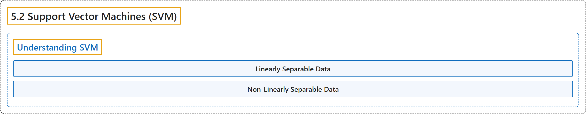

# 5.2 Support Vector Machines (SVM)

## Classification

## Glossary

| Term | Definition | 中文翻译 | Source |
|---|---|---|---|
| **5.2 Support Vector Machines (SVM)** 支持向量机（SVM） | (context) "Understand **concepts of SVM**" | （语境）理解 **SVM 的概念** | [OpenCV team, n.d.-a, "Machine Learning", item 2](https://docs.opencv.org/4.x/d6/de2/tutorial_py_table_of_contents_ml.html) |
| **Understanding SVM** 理解 SVM | (context) "Get **a basic understanding of what SVM is**" | （语境）**基本了解 SVM 是什么** | [OpenCV team, n.d.-b, "Support Vector Machines (SVM)", item 1](https://docs.opencv.org/4.x/d3/d02/tutorial_py_svm_index.html) |
| **Linearly Separable Data** 线性可分数据 | "Such data **which can be divided into two with a straight line (or hyperplanes in higher dimensions)** is called Linear Separable." | **能用一条直线（高维时为超平面）分成两部分**的数据称为线性可分。 | [OpenCV team, n.d.-c, "Linearly Separable Data", para. 2](https://docs.opencv.org/4.x/d4/db1/tutorial_py_svm_basics.html#autotoc_md1488) |
| **Decision Boundary** 决策边界 | "We find a line, f(x)=ax1+bx2+c which **divides both the data to two regions**." | 我们找到一条直线 f(x)=ax1+bx2+c，它**把两类数据分成两个区域**。 | [OpenCV team, n.d.-c, "Linearly Separable Data", para. 2](https://docs.opencv.org/4.x/d4/db1/tutorial_py_svm_basics.html#autotoc_md1488) |
| **Support Vectors** 支持向量 | "Just **the ones which are close to the opposite group** are sufficient." | 只需**靠近对方组的那些数据**就足够了。 | [OpenCV team, n.d.-c, "Linearly Separable Data", para. 4](https://docs.opencv.org/4.x/d4/db1/tutorial_py_svm_basics.html#autotoc_md1488) |
| **Support Planes** 支持平面 | "We can call them Support Vectors and **the lines passing through them** are called Support Planes." | 可以称它们为支持向量，**穿过它们的直线**称为支持平面。 | [OpenCV team, n.d.-c, "Linearly Separable Data", para. 4](https://docs.opencv.org/4.x/d4/db1/tutorial_py_svm_basics.html#autotoc_md1488) |
| **weight vector** 权重向量 | "Weight vector **decides the orientation of decision boundary** while bias point decides its location." | 权重向量**决定决策边界的方向**，而偏置决定其位置。 | [OpenCV team, n.d.-c, "Linearly Separable Data", para. 5](https://docs.opencv.org/4.x/d4/db1/tutorial_py_svm_basics.html#autotoc_md1488) |
| **bias** 偏置 | "Weight vector decides the orientation of decision boundary while **bias point decides its location**." | 权重向量决定决策边界的方向，而**偏置决定其位置**。 | [OpenCV team, n.d.-c, "Linearly Separable Data", para. 5](https://docs.opencv.org/4.x/d4/db1/tutorial_py_svm_basics.html#autotoc_md1488) |
| **Margin** 间隔 | "Margin is **twice this distance**, and we need to maximize this margin." | 间隔是**这个距离的两倍**，我们需要最大化这个间隔。 | [OpenCV team, n.d.-c, "Linearly Separable Data", para. 5](https://docs.opencv.org/4.x/d4/db1/tutorial_py_svm_basics.html#autotoc_md1488) |
| **Non-Linearly Separable Data** 非线性可分数据 | "Consider **some data which can't be divided into two with a straight line**." | 考虑**一些不能用一条直线分成两部分的数据**。 | [OpenCV team, n.d.-c, "Non-Linearly Separable Data", para. 1](https://docs.opencv.org/4.x/d4/db1/tutorial_py_svm_basics.html#autotoc_md1489) |
| **kernel function** 核函数 | "Let us define a kernel function K(p,q) which **does a dot product between two points**, shown below:" | 定义一个核函数 K(p,q)，它**对两个点做点积**，如下所示： | [OpenCV team, n.d.-c, "Non-Linearly Separable Data", para. 5](https://docs.opencv.org/4.x/d4/db1/tutorial_py_svm_basics.html#autotoc_md1489) |

## References

OpenCV team. (n.d.-a). *Machine Learning*. OpenCV-Python Tutorials (Version 4.13.0). Retrieved October 31, 2026, from <https://docs.opencv.org/4.x/d6/de2/tutorial_py_table_of_contents_ml.html>

OpenCV team. (n.d.-b). *Support Vector Machines (SVM)*. OpenCV-Python Tutorials (Version 4.13.0). Retrieved October 31, 2026, from <https://docs.opencv.org/4.x/d3/d02/tutorial_py_svm_index.html>

OpenCV team. (n.d.-c). *Understanding SVM*. OpenCV-Python Tutorials (Version 4.13.0). Retrieved October 31, 2026, from <https://docs.opencv.org/4.x/d4/db1/tutorial_py_svm_basics.html>
