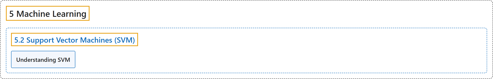

# 5.2 Support Vector Machines (SVM)

## Classification

## Glossary

| Term | Definition | 中文翻译 | Source |
|---|---|---|---|
| **5.2 Support Vector Machines (SVM)** 支持向量机（SVM） | (context) "Understand **concepts of SVM**" | （语境）理解 **SVM 的概念** | [OpenCV team, n.d.-a, "Machine Learning", item 2](https://docs.opencv.org/4.x/d6/de2/tutorial_py_table_of_contents_ml.html) |
| **Understanding SVM** 理解 SVM | (context) "Get **a basic understanding of what SVM is**" | （语境）**基本了解 SVM 是什么** | [OpenCV team, n.d.-b, "Support Vector Machines (SVM)", item 1](https://docs.opencv.org/4.x/d3/d02/tutorial_py_svm_index.html) |

## References

OpenCV team. (n.d.-a). *Machine Learning*. OpenCV-Python Tutorials (Version 4.13.0). Retrieved October 31, 2026, from <https://docs.opencv.org/4.x/d6/de2/tutorial_py_table_of_contents_ml.html>

OpenCV team. (n.d.-b). *Support Vector Machines (SVM)*. OpenCV-Python Tutorials (Version 4.13.0). Retrieved October 31, 2026, from <https://docs.opencv.org/4.x/d3/d02/tutorial_py_svm_index.html>
