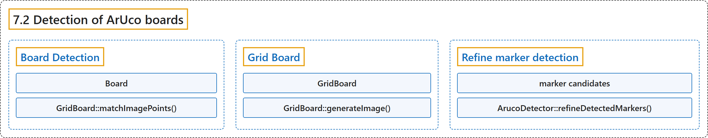

# 7.2 Detection of ArUco boards

## Classification

## Glossary

| Term | Definition | 中文翻译 | Source |
|---|---|---|---|
| **7.2 Detection of ArUco boards** ArUco 标定板检测 | "An ArUco board is **a set of markers that acts like a single marker in the sense that it provides a single pose for the camera**." | ArUco 标定板是**一组标记，它像单个标记一样，为相机提供单一的位姿**。 | [OpenCV team, n.d., "Detection of ArUco boards", para. 1](https://docs.opencv.org/4.x/db/da9/tutorial_aruco_board_detection.html) |
| **Board Detection** 标定板检测 | "A board detection is similar to the standard marker detection. **The only difference is in the pose estimation step**." | 标定板检测与标准的标记检测类似。**唯一的区别在于位姿估计这一步**。 | [OpenCV team, n.d., "Board Detection", para. 1](https://docs.opencv.org/4.x/db/da9/tutorial_aruco_board_detection.html#autotoc_md1083) |
| **Board** Board 类 | "board the cv::aruco::Board object **that defines the board layout and its ids**" | board：cv::aruco::Board 对象，**它定义标定板的布局及其 id** | [OpenCV team, n.d., "Board Detection", item 2](https://docs.opencv.org/4.x/db/da9/tutorial_aruco_board_detection.html#autotoc_md1083) |
| **GridBoard::matchImagePoints()** matchImagePoints 方法 | (context) "objPoints, imgPoints object and image points, **matched with cv::aruco::GridBoard::matchImagePoints()**" | （语境）objPoints、imgPoints：物点和像点，**由 cv::aruco::GridBoard::matchImagePoints() 匹配得到** | [OpenCV team, n.d., "Board Detection", item 1](https://docs.opencv.org/4.x/db/da9/tutorial_aruco_board_detection.html#autotoc_md1083) |
| **Grid Board** 网格标定板 | (No definition) | （无定义） | [OpenCV team, n.d., "Grid Board"](https://docs.opencv.org/4.x/db/da9/tutorial_aruco_board_detection.html#autotoc_md1084) |
| **GridBoard** GridBoard 类 | "The cv::aruco::GridBoard class is **a specialized class that inherits from the cv::aruco::Board class and which represents a Board with all the markers in the same plane and in a grid layout**" | cv::aruco::GridBoard 类是**一个继承自 cv::aruco::Board 类的专用类，表示所有标记位于同一平面并呈网格布局的标定板** | [OpenCV team, n.d., "Grid Board", para. 3](https://docs.opencv.org/4.x/db/da9/tutorial_aruco_board_detection.html#autotoc_md1084) |
| **GridBoard::generateImage()** generateImage 方法 | (context) "The function cv::aruco::GridBoard::generateImage() is **provided in cv::aruco::GridBoard class**" | （语境）函数 cv::aruco::GridBoard::generateImage() **由 cv::aruco::GridBoard 类提供** | [OpenCV team, n.d., "Grid Board", para. 1](https://docs.opencv.org/4.x/db/da9/tutorial_aruco_board_detection.html#autotoc_md1084) |
| **Refine marker detection** 细化标记检测 | "ArUco boards can also be used to **improve the detection of markers**." | ArUco 标定板还可以用来**改进标记的检测**。 | [OpenCV team, n.d., "Refine marker detection", para. 1](https://docs.opencv.org/4.x/db/da9/tutorial_aruco_board_detection.html#autotoc_md1085) |
| **marker candidates** 候选标记 | "This candidates are **square shapes that have been found in the original image but have failed to pass the identification step**" | 这些候选是**在原图像中找到、但没有通过识别步骤的方形** | [OpenCV team, n.d., "Refine marker detection", para. 4](https://docs.opencv.org/4.x/db/da9/tutorial_aruco_board_detection.html#autotoc_md1085) |
| **ArucoDetector::refineDetectedMarkers()** refineDetectedMarkers 方法 | "The cv::aruco::ArucoDetector::refineDetectedMarkers() function **finds correspondences between these candidates and the missing markers of the board**." | cv::aruco::ArucoDetector::refineDetectedMarkers() 函数**在这些候选与标定板上缺失的标记之间寻找对应关系**。 | [OpenCV team, n.d., "Refine marker detection", para. 5](https://docs.opencv.org/4.x/db/da9/tutorial_aruco_board_detection.html#autotoc_md1085) |

## References

OpenCV team. (n.d.). *Detection of ArUco boards*. OpenCV-Python Tutorials (Version 4.13.0). Retrieved October 31, 2026, from <https://docs.opencv.org/4.x/db/da9/tutorial_aruco_board_detection.html>
