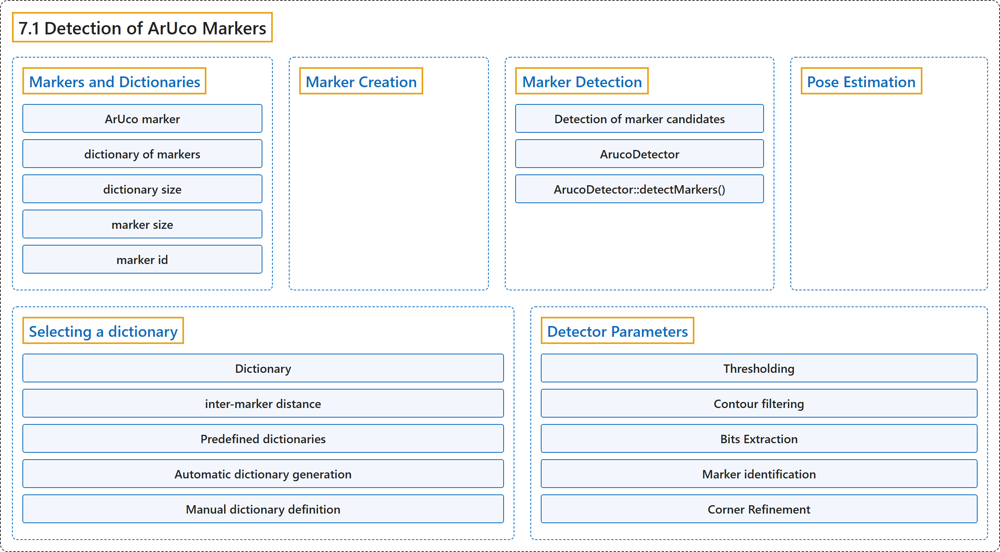

# 7.1 Detection of ArUco Markers

## Classification

## Glossary

| Term | Definition | 中文翻译 | Source |
|---|---|---|---|
| **7.1 Detection of ArUco Markers** ArUco 标记检测 | (context) "One of the most popular approaches is the use of **binary square fiducial markers**." | （语境）最常用的方法之一是使用**二进制方形基准标记**。 | [OpenCV team, n.d., "Detection of ArUco Markers", para. 2](https://docs.opencv.org/4.x/d5/dae/tutorial_aruco_detection.html) |
| **Markers and Dictionaries** 标记与字典 | (No definition) | （无定义） | [OpenCV team, n.d., "Markers and Dictionaries"](https://docs.opencv.org/4.x/d5/dae/tutorial_aruco_detection.html#autotoc_md1088) |
| **ArUco marker** ArUco 标记 | "An ArUco marker is **a synthetic square marker composed by a wide black border and an inner binary matrix which determines its identifier (id)**." | ArUco 标记是**一种人工合成的方形标记，由宽的黑色边框和决定其标识符（id）的内部二进制矩阵组成**。 | [OpenCV team, n.d., "Markers and Dictionaries", para. 1](https://docs.opencv.org/4.x/d5/dae/tutorial_aruco_detection.html#autotoc_md1088) |
| **dictionary of markers** 标记字典 | "A dictionary of markers is **the set of markers that are considered in a specific application**." | 标记字典是**某个具体应用中所考虑的标记集合**。 | [OpenCV team, n.d., "Markers and Dictionaries", para. 3](https://docs.opencv.org/4.x/d5/dae/tutorial_aruco_detection.html#autotoc_md1088) |
| **dictionary size** 字典大小 | "The dictionary size is **the number of markers that compose the dictionary**." | 字典大小是**组成字典的标记数量**。 | [OpenCV team, n.d., "Markers and Dictionaries", item 1](https://docs.opencv.org/4.x/d5/dae/tutorial_aruco_detection.html#autotoc_md1088) |
| **marker size** 标记尺寸 | "The marker size is **the size of those markers (the number of bits/modules)**." | 标记尺寸是**这些标记的大小（位数/模块数）**。 | [OpenCV team, n.d., "Markers and Dictionaries", item 2](https://docs.opencv.org/4.x/d5/dae/tutorial_aruco_detection.html#autotoc_md1088) |
| **marker id** 标记 id | "Instead, a marker id is **simply the marker index within the dictionary it belongs to**." | 实际上，标记 id **只是该标记在其所属字典中的索引**。 | [OpenCV team, n.d., "Markers and Dictionaries", para. 6](https://docs.opencv.org/4.x/d5/dae/tutorial_aruco_detection.html#autotoc_md1088) |
| **Marker Creation** 标记生成 | (context) "Before their detection, markers need to be **printed in order to be placed in the environment**." | （语境）在检测之前，标记需要**打印出来以便放置在环境中**。 | [OpenCV team, n.d., "Marker Creation", para. 1](https://docs.opencv.org/4.x/d5/dae/tutorial_aruco_detection.html#autotoc_md1089) |
| **Marker Detection** 标记检测 | "Given an image containing ArUco markers, **the detection process has to return a list of detected markers**." | 给定一幅包含 ArUco 标记的图像，**检测过程要返回检测到的标记列表**。 | [OpenCV team, n.d., "Marker Detection", para. 1](https://docs.opencv.org/4.x/d5/dae/tutorial_aruco_detection.html#autotoc_md1090) |
| **Detection of marker candidates** 候选标记检测 | "Detection of marker candidates. In this step **the image is analyzed in order to find square shapes that are candidates to be markers**." | 候选标记检测。在这一步中，**分析图像，寻找可能是标记的方形**。 | [OpenCV team, n.d., "Marker Detection", item 1](https://docs.opencv.org/4.x/d5/dae/tutorial_aruco_detection.html#autotoc_md1090) |
| **ArucoDetector** ArucoDetector 类 | (context) "When you create an cv::aruco::ArucoDetector object, **you need to pass the following parameters to the constructor**:" | （语境）创建 cv::aruco::ArucoDetector 对象时，**需要向构造函数传入以下参数**： | [OpenCV team, n.d., "Marker Detection", para. 1](https://docs.opencv.org/4.x/d5/dae/tutorial_aruco_detection.html#autotoc_md1090) |
| **ArucoDetector::detectMarkers()** detectMarkers 方法 | (context) "In the aruco module, the detection is performed in the cv::aruco::ArucoDetector::detectMarkers() function. This function is **the most important in the module**, since all the rest of the functionality is based on the detected markers returned by cv::aruco::ArucoDetector::detectMarkers()." | （语境）在 aruco 模块中，检测由 cv::aruco::ArucoDetector::detectMarkers() 函数完成。这个函数是**该模块中最重要的**，因为其余所有功能都基于它返回的检测结果。 | [OpenCV team, n.d., "Marker Detection", para. 1](https://docs.opencv.org/4.x/d5/dae/tutorial_aruco_detection.html#autotoc_md1090) |
| **Pose Estimation** 位姿估计 | "The camera pose relative to the marker is **a 3d transformation from the marker coordinate system to the camera coordinate system**." | 相机相对于标记的位姿是**从标记坐标系到相机坐标系的三维变换**。 | [OpenCV team, n.d., "Pose Estimation", para. 5](https://docs.opencv.org/4.x/d5/dae/tutorial_aruco_detection.html#autotoc_md1091) |
| **Selecting a dictionary** 选择字典 | (No definition) | （无定义） | [OpenCV team, n.d., "Selecting a dictionary"](https://docs.opencv.org/4.x/d5/dae/tutorial_aruco_detection.html#autotoc_md1092) |
| **Dictionary** Dictionary 类 | "The aruco module provides the Dictionary class **to represent a dictionary of markers**." | aruco 模块提供 Dictionary 类**来表示一个标记字典**。 | [OpenCV team, n.d., "Selecting a dictionary", para. 1](https://docs.opencv.org/4.x/d5/dae/tutorial_aruco_detection.html#autotoc_md1092) |
| **Dictionary::getByteListFromBits()** getByteListFromBits 静态方法 | "Fortunately, **a marker can be easily transformed to this form** using the static method Dictionary::getByteListFromBits()." | 幸好，用静态方法 Dictionary::getByteListFromBits() **可以很容易地把标记转换成这种形式**。 | [OpenCV team, n.d., "Manual dictionary definition", para. 4](https://docs.opencv.org/4.x/d5/dae/tutorial_aruco_detection.html#autotoc_md1095) |
| **inter-marker distance** 标记间距离 | "The inter-marker distance is **the minimum Hamming distance between dictionary markers that determines the dictionary's ability to detect and correct errors**." | 标记间距离是**字典中各标记之间的最小汉明距离，它决定字典检测和纠正错误的能力**。 | [OpenCV team, n.d., "Selecting a dictionary", para. 2](https://docs.opencv.org/4.x/d5/dae/tutorial_aruco_detection.html#autotoc_md1092) |
| **Predefined dictionaries** 预定义字典 | "The aruco module includes **a set of predefined dictionaries in a variety of marker sizes and number of markers**." | aruco 模块包含**一组标记尺寸和标记数量各不相同的预定义字典**。 | [OpenCV team, n.d., "Predefined dictionaries", para. 1](https://docs.opencv.org/4.x/d5/dae/tutorial_aruco_detection.html#autotoc_md1093) |
| **DICT_6X6_250** DICT_6X6_250 字典 | "cv::aruco::DICT_6X6_250 is **an example of predefined dictionary of markers with 6x6 bits and a total of 250 markers**." | cv::aruco::DICT_6X6_250 是**一个预定义字典的例子，标记为 6×6 位，共 250 个标记**。 | [OpenCV team, n.d., "Predefined dictionaries", para. 2](https://docs.opencv.org/4.x/d5/dae/tutorial_aruco_detection.html#autotoc_md1093) |
| **Automatic dictionary generation** 自动生成字典 | "A dictionary can be **generated automatically to adjust the desired number of markers and bits to optimize the inter-marker distance**:" | 字典可以**自动生成，按所需的标记数量和位数进行调整，以优化标记间距离**： | [OpenCV team, n.d., "Automatic dictionary generation", para. 1](https://docs.opencv.org/4.x/d5/dae/tutorial_aruco_detection.html#autotoc_md1094) |
| **Manual dictionary definition** 手动定义字典 | "Finally, **the dictionary can be configured manually, so that any encoding can be used**." | 最后，**字典可以手动配置，从而可以使用任意编码**。 | [OpenCV team, n.d., "Manual dictionary definition", para. 1](https://docs.opencv.org/4.x/d5/dae/tutorial_aruco_detection.html#autotoc_md1095) |
| **Detector Parameters** 检测器参数 | "One of the parameters of cv::aruco::ArucoDetector is a cv::aruco::DetectorParameters object. This object **includes all the options that can be customized during the marker detection process**." | cv::aruco::ArucoDetector 的参数之一是一个 cv::aruco::DetectorParameters 对象。这个对象**包含标记检测过程中所有可以自定义的选项**。 | [OpenCV team, n.d., "Detector Parameters", para. 1](https://docs.opencv.org/4.x/d5/dae/tutorial_aruco_detection.html#autotoc_md1096) |
| **Thresholding** 阈值化 | "One of the first steps in the marker detection process is **adaptive thresholding of the input image**." | 标记检测过程的最初步骤之一是**对输入图像做自适应阈值化**。 | [OpenCV team, n.d., "Thresholding", para. 1](https://docs.opencv.org/4.x/d5/dae/tutorial_aruco_detection.html#autotoc_md1097) |
| **Contour filtering** 轮廓过滤 | "They are **filtered out in different steps so that contours that are very unlikely to be markers are discarded**." | 它们**分几步被过滤，从而丢弃那些不太可能是标记的轮廓**。 | [OpenCV team, n.d., "Contour filtering", para. 1](https://docs.opencv.org/4.x/d5/dae/tutorial_aruco_detection.html#autotoc_md1100) |
| **Bits Extraction** 位提取 | "After candidate detection, **the bits of each candidate are analyzed in order to determine if they are markers or not**." | 候选检测之后，**分析每个候选的位，以确定它们是否是标记**。 | [OpenCV team, n.d., "Bits Extraction", para. 1](https://docs.opencv.org/4.x/d5/dae/tutorial_aruco_detection.html#autotoc_md1106) |
| **Marker identification** 标记识别 | "After the bits have been extracted, the next step is **checking whether the extracted code belongs to the marker dictionary** and, if necessary, error correction can be performed." | 位提取之后，下一步是**检查提取的编码是否属于标记字典**，必要时还可以进行纠错。 | [OpenCV team, n.d., "Marker identification", para. 1](https://docs.opencv.org/4.x/d5/dae/tutorial_aruco_detection.html#autotoc_md1111) |
| **Corner Refinement** 角点细化 | "After markers have been detected and identified, the last step is **performing subpixel refinement of the corner positions**" | 标记被检测和识别之后，最后一步是**对角点位置做亚像素细化** | [OpenCV team, n.d., "Corner Refinement", para. 1](https://docs.opencv.org/4.x/d5/dae/tutorial_aruco_detection.html#autotoc_md1114) |

## References

OpenCV team. (n.d.). *Detection of ArUco Markers*. OpenCV-Python Tutorials (Version 4.13.0). Retrieved October 31, 2026, from <https://docs.opencv.org/4.x/d5/dae/tutorial_aruco_detection.html>
