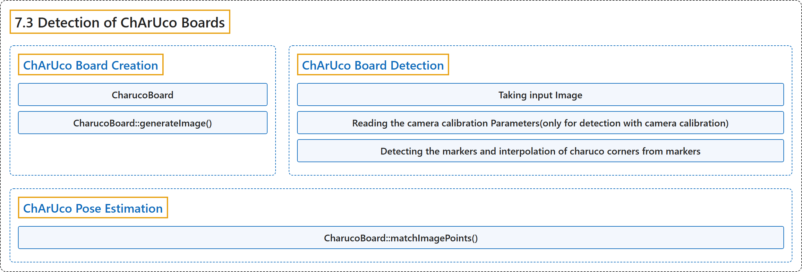

# 7.3 Detection of ChArUco Boards

## Classification

## Glossary

| Term | Definition | 中文翻译 | Source |
|---|---|---|---|
| **7.3 Detection of ChArUco Boards** ChArUco 标定板检测 | (context) "A ChArUco board **tries to combine the benefits of these two approaches**:" | （语境）ChArUco 标定板**试图结合这两种方法的优点**： | [OpenCV team, n.d., "Detection of ChArUco Boards", para. 3](https://docs.opencv.org/4.x/df/d4a/tutorial_charuco_detection.html) |
| **ChArUco Board Creation** ChArUco 标定板生成 | (No definition) | （无定义） | [OpenCV team, n.d., "ChArUco Board Creation"](https://docs.opencv.org/4.x/df/d4a/tutorial_charuco_detection.html#autotoc_md1121) |
| **CharucoBoard** CharucoBoard 类 | "The aruco module provides the cv::aruco::CharucoBoard class **that represents a Charuco Board and which inherits from the cv::aruco::Board class**." | aruco 模块提供 cv::aruco::CharucoBoard 类，**它表示一个 ChArUco 标定板，并继承自 cv::aruco::Board 类**。 | [OpenCV team, n.d., "ChArUco Board Creation", para. 1](https://docs.opencv.org/4.x/df/d4a/tutorial_charuco_detection.html#autotoc_md1121) |
| **CharucoBoard::generateImage()** generateImage 方法 | (context) "The function cv::aruco::CharucoBoard::generateImage() is **provided in cv::aruco::CharucoBoard class**" | （语境）函数 cv::aruco::CharucoBoard::generateImage() **由 cv::aruco::CharucoBoard 类提供** | [OpenCV team, n.d., "ChArUco Board Creation", para. 1](https://docs.opencv.org/4.x/df/d4a/tutorial_charuco_detection.html#autotoc_md1121) |
| **ChArUco Board Detection** ChArUco 标定板检测 | "When you detect a ChArUco board, **what you are actually detecting is each of the chessboard corners of the board**." | 检测 ChArUco 标定板时，**实际检测的是标定板上的每个棋盘角点**。 | [OpenCV team, n.d., "ChArUco Board Detection", para. 1](https://docs.opencv.org/4.x/df/d4a/tutorial_charuco_detection.html#autotoc_md1122) |
| **Taking input Image** 获取输入图像 | "The original image **where the markers are to be detected**." | 原始图像，**要在其中检测标记**。 | [OpenCV team, n.d., "ChArUco Board Detection", item 1](https://docs.opencv.org/4.x/df/d4a/tutorial_charuco_detection.html#autotoc_md1122) |
| **Reading the camera calibration Parameters(only for detection with camera calibration)** 读取相机标定参数（仅用于带相机标定的检测） | (context) "For detection of charuco corners without calibration, **this step is not required**." | （语境）对于不带标定的 ChArUco 角点检测，**这一步不是必需的**。 | [OpenCV team, n.d., "ChArUco Board Detection", item 2](https://docs.opencv.org/4.x/df/d4a/tutorial_charuco_detection.html#autotoc_md1122) |
| **Detecting the markers and interpolation of charuco corners from markers** 检测标记并由标记插值出 ChArUco 角点 | "So that, **first markers are detected, and then ChArUco corners are interpolated from markers**." | 因此，**先检测标记，再由标记插值出 ChArUco 角点**。 | [OpenCV team, n.d., "ChArUco Board Detection", item 3](https://docs.opencv.org/4.x/df/d4a/tutorial_charuco_detection.html#autotoc_md1122) |
| **CharucoDetector::detectBoard()** detectBoard 方法 | "The method that **detect the ChArUco corners** is cv::aruco::CharucoDetector::detectBoard()." | 检测 ChArUco 角点的方法是 cv::aruco::CharucoDetector::detectBoard()。 | [OpenCV team, n.d., "ChArUco Board Detection", item 3](https://docs.opencv.org/4.x/df/d4a/tutorial_charuco_detection.html#autotoc_md1122) |
| **ChArUco Pose Estimation** ChArUco 位姿估计 | (context) "The final goal of the ChArUco boards is **finding corners very accurately for a high precision calibration or pose estimation**." | （语境）ChArUco 标定板的最终目标是**非常精确地找到角点，用于高精度的标定或位姿估计**。 | [OpenCV team, n.d., "ChArUco Pose Estimation", para. 1](https://docs.opencv.org/4.x/df/d4a/tutorial_charuco_detection.html#autotoc_md1123) |
| **CharucoBoard::matchImagePoints()** matchImagePoints 方法 | (context) "**To perform pose estimation for charuco boards**, you should use cv::aruco::CharucoBoard::matchImagePoints() and cv::solvePnP():" | （语境）**要对 ChArUco 标定板做位姿估计**，应使用 cv::aruco::CharucoBoard::matchImagePoints() 和 cv::solvePnP()： | [OpenCV team, n.d., "ChArUco Pose Estimation", para. 3](https://docs.opencv.org/4.x/df/d4a/tutorial_charuco_detection.html#autotoc_md1123) |

## References

OpenCV team. (n.d.). *Detection of ChArUco Boards*. OpenCV-Python Tutorials (Version 4.13.0). Retrieved October 31, 2026, from <https://docs.opencv.org/4.x/df/d4a/tutorial_charuco_detection.html>
