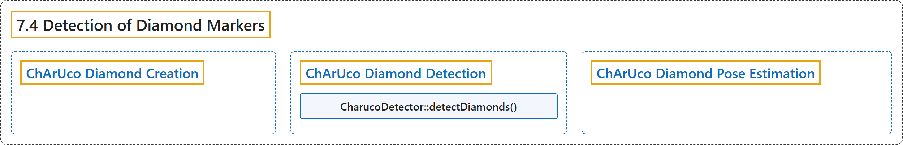

# 7.4 Detection of Diamond Markers

## Classification

## Glossary

| Term | Definition | 中文翻译 | Source |
|---|---|---|---|
| **7.4 Detection of Diamond Markers** 菱形标记检测 | "A ChArUco diamond marker (or simply diamond marker) is **a chessboard composed by 3x3 squares and 4 ArUco markers inside the white squares**." | ChArUco 菱形标记（简称菱形标记）是**一个由 3×3 个方格组成的棋盘，白色方格内有 4 个 ArUco 标记**。 | [OpenCV team, n.d., "Detection of Diamond Markers", para. 1](https://docs.opencv.org/4.x/d5/d07/tutorial_charuco_diamond_detection.html) |
| **ChArUco Diamond Creation** ChArUco 菱形标记生成 | (context) "The image of a diamond marker can be **easily created** using the cv::aruco::CharucoBoard::generateImage() function." | （语境）菱形标记的图像可以用 cv::aruco::CharucoBoard::generateImage() 函数**轻松生成**。 | [OpenCV team, n.d., "ChArUco Diamond Creation", para. 1](https://docs.opencv.org/4.x/d5/d07/tutorial_charuco_diamond_detection.html#autotoc_md1124) |
| **ChArUco Diamond Detection** ChArUco 菱形标记检测 | "As in most cases, **the detection of diamond markers requires a previous detection of ArUco markers**." | 与大多数情况一样，**检测菱形标记需要先检测 ArUco 标记**。 | [OpenCV team, n.d., "ChArUco Diamond Detection", para. 1](https://docs.opencv.org/4.x/d5/d07/tutorial_charuco_diamond_detection.html#autotoc_md1125) |
| **CharucoDetector::detectDiamonds()** detectDiamonds 方法 | "The cv::aruco::CharucoDetector::detectDiamonds() function **receives the original image and the previous detected marker corners and ids**." | cv::aruco::CharucoDetector::detectDiamonds() 函数**接收原始图像以及先前检测到的标记角点和 id**。 | [OpenCV team, n.d., "ChArUco Diamond Detection", para. 2](https://docs.opencv.org/4.x/d5/d07/tutorial_charuco_diamond_detection.html#autotoc_md1125) |
| **ChArUco Diamond Pose Estimation** ChArUco 菱形标记位姿估计 | "Since a ChArUco diamond is represented by its four corners, **its pose can be estimated in the same way than in a single ArUco marker**, i.e. using the cv::solvePnP() function." | 由于 ChArUco 菱形标记由其四个角点表示，**它的位姿可以用与单个 ArUco 标记相同的方式估计**，即使用 cv::solvePnP() 函数。 | [OpenCV team, n.d., "ChArUco Diamond Pose Estimation", para. 1](https://docs.opencv.org/4.x/d5/d07/tutorial_charuco_diamond_detection.html#autotoc_md1126) |

## References

OpenCV team. (n.d.). *Detection of Diamond Markers*. OpenCV-Python Tutorials (Version 4.13.0). Retrieved October 31, 2026, from <https://docs.opencv.org/4.x/d5/d07/tutorial_charuco_diamond_detection.html>
