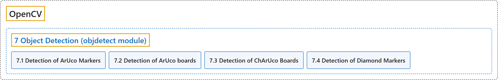

# 7. Object Detection (objdetect module)

## Classification

## Glossary

| Term | Definition | 中文翻译 | Source |
|---|---|---|---|
| **7 Object Detection (objdetect module)** 目标检测（objdetect 模块） | "In this section you will learn **object detection techniques like face detection etc**." | 在本节中，你将学习**目标检测技术，如人脸检测等**。 | [OpenCV team, n.d.-e, "OpenCV-Python Tutorials", item 10](https://docs.opencv.org/4.x/d6/d00/tutorial_py_root.html) |
| **[7.1 Detection of ArUco Markers](detection-of-aruco-markers.md)** ArUco 标记检测 | (context) "One of the most popular approaches is the use of **binary square fiducial markers**." | （语境）最常用的方法之一是使用**二进制方形基准标记**。 | [OpenCV team, n.d.-b, "Detection of ArUco Markers", para. 2](https://docs.opencv.org/4.x/d5/dae/tutorial_aruco_detection.html) |
| **[7.2 Detection of ArUco boards](detection-of-aruco-boards.md)** ArUco 标定板检测 | "An ArUco board is **a set of markers that acts like a single marker in the sense that it provides a single pose for the camera**." | ArUco 标定板是**一组标记，它像单个标记一样，为相机提供单一的位姿**。 | [OpenCV team, n.d.-a, "Detection of ArUco boards", para. 1](https://docs.opencv.org/4.x/db/da9/tutorial_aruco_board_detection.html) |
| **[7.3 Detection of ChArUco Boards](detection-of-charuco-boards.md)** ChArUco 标定板检测 | (context) "A ChArUco board **tries to combine the benefits of these two approaches**:" | （语境）ChArUco 标定板**试图结合这两种方法的优点**： | [OpenCV team, n.d.-c, "Detection of ChArUco Boards", para. 3](https://docs.opencv.org/4.x/df/d4a/tutorial_charuco_detection.html) |
| **[7.4 Detection of Diamond Markers](detection-of-diamond-markers.md)** 菱形标记检测 | "A ChArUco diamond marker (or simply diamond marker) is **a chessboard composed by 3x3 squares and 4 ArUco markers inside the white squares**." | ChArUco 菱形标记（简称菱形标记）是**一个由 3×3 个方格组成的棋盘，白色方格内有 4 个 ArUco 标记**。 | [OpenCV team, n.d.-d, "Detection of Diamond Markers", para. 1](https://docs.opencv.org/4.x/d5/d07/tutorial_charuco_diamond_detection.html) |

## References

OpenCV team. (n.d.-a). *Detection of ArUco boards*. OpenCV-Python Tutorials (Version 4.13.0). Retrieved October 31, 2026, from <https://docs.opencv.org/4.x/db/da9/tutorial_aruco_board_detection.html>

OpenCV team. (n.d.-b). *Detection of ArUco Markers*. OpenCV-Python Tutorials (Version 4.13.0). Retrieved October 31, 2026, from <https://docs.opencv.org/4.x/d5/dae/tutorial_aruco_detection.html>

OpenCV team. (n.d.-c). *Detection of ChArUco Boards*. OpenCV-Python Tutorials (Version 4.13.0). Retrieved October 31, 2026, from <https://docs.opencv.org/4.x/df/d4a/tutorial_charuco_detection.html>

OpenCV team. (n.d.-d). *Detection of Diamond Markers*. OpenCV-Python Tutorials (Version 4.13.0). Retrieved October 31, 2026, from <https://docs.opencv.org/4.x/d5/d07/tutorial_charuco_diamond_detection.html>

OpenCV team. (n.d.-e). *OpenCV-Python Tutorials*. OpenCV-Python Tutorials (Version 4.13.0). Retrieved October 31, 2026, from <https://docs.opencv.org/4.x/d6/d00/tutorial_py_root.html>
