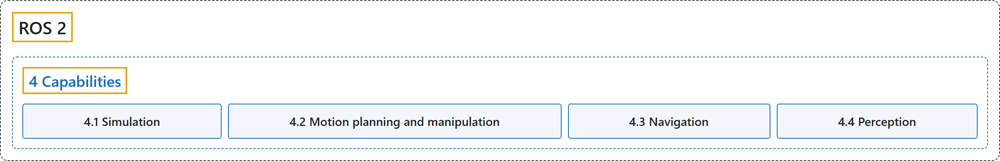

# 4. Capabilities

## Classification

## Glossary

| Term | Definition | 中文翻译 | Source |
|---|---|---|---|
| **4 Capabilities** 能力 | "Capabilities in ROS are **ready-to-use packages that offer common functions for robots, such as manipulation, motion planning, and perception**." | ROS 中的能力是**现成可用的软件包，为机器人提供常用功能，如操作、运动规划和感知**。 | [Open Robotics, n.d.-a, "Capabilities", para. 1](https://docs.ros.org/en/lyrical/About-ROS.html#capabilities) |
| **[4.1 Simulation](simulation.md)** 仿真 | "Simulation capabilities **allow you to test your robot’s software in virtual environments, often with physical accuracy**." | 仿真能力**让你在虚拟环境中测试机器人软件，通常具有物理上的准确性**。 | [Open Robotics, n.d.-e, "Simulation", para. 1](https://docs.ros.org/en/lyrical/Capabilities/About-Simulation.html#simulation) |
| **[4.2 Motion planning and manipulation](motion-planning-and-manipulation.md)** 运动规划与操作 | "Motion planning **enables you to control a robot’s movements to achieve an intended goal**. Manipulation capabilities **enable robots to analyze their environment and perform tasks like picking and placing objects**." | 运动规划**让你控制机器人的运动，以达到预期目标**。操作能力**让机器人分析其环境，并执行抓取和放置物体等任务**。 | [Open Robotics, n.d.-b, "Motion planning and manipulation", para. 1](https://docs.ros.org/en/lyrical/Capabilities/About-Motion-planning.html#motion-planning-and-manipulation) |
| **[4.3 Navigation](navigation.md)** 导航 | "Navigation capabilities **enable a robot to map its position in an environment and plan the path to a new destination**." | 导航能力**让机器人在环境中确定自身位置，并规划到新目的地的路径**。 | [Open Robotics, n.d.-c, "Navigation", para. 1](https://docs.ros.org/en/lyrical/Capabilities/About-Navigation.html#navigation) |
| **[4.4 Perception](perception.md)** 感知 | "Perception capabilities **help your robot to understand and interpret the world**." | 感知能力**帮助机器人理解和解释外部世界**。 | [Open Robotics, n.d.-d, "Perception", para. 1](https://docs.ros.org/en/lyrical/Capabilities/About-Perception.html#perception) |

## References

Open Robotics. (n.d.-a). *About ROS*. ROS 2 Documentation: Lyrical. Retrieved October 30, 2026, from <https://docs.ros.org/en/lyrical/About-ROS.html>

Open Robotics. (n.d.-b). *Motion planning and manipulation*. ROS 2 Documentation: Lyrical. Retrieved October 30, 2026, from <https://docs.ros.org/en/lyrical/Capabilities/About-Motion-planning.html>

Open Robotics. (n.d.-c). *Navigation*. ROS 2 Documentation: Lyrical. Retrieved October 30, 2026, from <https://docs.ros.org/en/lyrical/Capabilities/About-Navigation.html>

Open Robotics. (n.d.-d). *Perception*. ROS 2 Documentation: Lyrical. Retrieved October 30, 2026, from <https://docs.ros.org/en/lyrical/Capabilities/About-Perception.html>

Open Robotics. (n.d.-e). *Simulation*. ROS 2 Documentation: Lyrical. Retrieved October 30, 2026, from <https://docs.ros.org/en/lyrical/Capabilities/About-Simulation.html>
