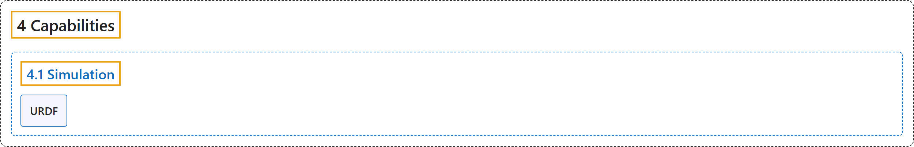

# 4.1 Simulation

## Classification

## Glossary

| Term | Definition | 中文翻译 | Source |
|---|---|---|---|
| **4.1 Simulation** 仿真 | "Simulation capabilities **allow you to test your robot’s software in virtual environments, often with physical accuracy**." | 仿真能力**让你在虚拟环境中测试机器人软件，通常具有物理上的准确性**。 | [Open Robotics, n.d.-a, "Simulation", para. 1](https://docs.ros.org/en/lyrical/Capabilities/About-Simulation.html#simulation) |
| **URDF** URDF（统一机器人描述格式） | "URDF (Unified Robot Description Format) is **a file format for specifying the geometry and organization of robots in ROS**." | URDF（统一机器人描述格式）是**一种在 ROS 中描述机器人几何结构和组成的文件格式**。 | [Open Robotics, n.d.-b, "URDF", para. 2](https://docs.ros.org/en/lyrical/Capabilities/Simulation/URDF/URDF-Main.html#urdf) |

## References

Open Robotics. (n.d.-a). *Simulation*. ROS 2 Documentation: Lyrical. Retrieved October 31, 2026, from <https://docs.ros.org/en/lyrical/Capabilities/About-Simulation.html>

Open Robotics. (n.d.-b). *URDF*. ROS 2 Documentation: Lyrical. Retrieved October 31, 2026, from <https://docs.ros.org/en/lyrical/Capabilities/Simulation/URDF/URDF-Main.html>
