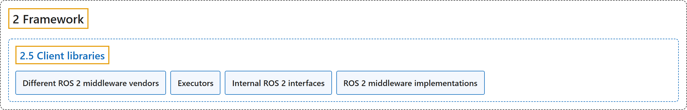

# 2.5 Client libraries

## Classification

## Glossary

| Term | Definition | 中文翻译 | Source |
|---|---|---|---|
| **2.5 Client libraries** 客户端库 | "Client libraries are **the APIs that allow you to implement your ROS code**." | 客户端库是**让你实现 ROS 代码的 API**。 | [Open Robotics, n.d.-a, "Client libraries in ROS", para. 1](https://docs.ros.org/en/lyrical/ROS-Framework/About-Client-Libraries.html#client-libraries-in-ros) |
| **Different ROS 2 middleware vendors** 不同的 ROS 2 中间件供应商 | (context) "ROS 2 supports multiple middleware implementations which provide **discovery, serialisation, and transportation communications**." | （语境）ROS 2 支持多种中间件实现，它们提供**发现、序列化和传输通信**。 | [Open Robotics, n.d.-b, "Different ROS 2 middleware vendors", para. 2](https://docs.ros.org/en/lyrical/ROS-Framework/client-libraries/About-Different-Middleware-Vendors.html#different-ros-2-middleware-vendors) |
| **Executors** 执行器 | "An Executor **uses one or more threads of the underlying operating system to invoke the callbacks of subscriptions, timers, service servers, action servers, etc. on incoming messages and events**." | 执行器**使用底层操作系统的一个或多个线程，在收到消息和事件时调用订阅、定时器、服务服务器、动作服务器等的回调**。 | [Open Robotics, n.d.-c, "Overview", para. 1](https://docs.ros.org/en/lyrical/ROS-Framework/client-libraries/About-Executors/About-Executors.html#overview) |
| **Internal ROS 2 interfaces** ROS 2 内部接口 | "The internal ROS interfaces are **public C APIs that are intended for use by developers who are creating client libraries or adding a new underlying middleware**, but are not intended for use by typical ROS users." | ROS 内部接口是**公开的 C API，供创建客户端库或添加新的底层中间件的开发者使用**，普通 ROS 用户不需要使用。 | [Open Robotics, n.d.-d, "Internal ROS 2 interfaces", para. 2](https://docs.ros.org/en/lyrical/ROS-Framework/client-libraries/About-Internal-Interfaces/About-Internal-Interfaces.html#internal-ros-2-interfaces) |
| **ROS 2 middleware implementations** ROS 2 中间件实现 | "ROS middleware implementations are **sets of packages that provide the underlying communication framework for ROS 2**." | ROS 中间件实现是**为 ROS 2 提供底层通信框架的软件包集合**。 | [Open Robotics, n.d.-e, "ROS 2 middleware implementations", para. 2](https://docs.ros.org/en/lyrical/ROS-Framework/client-libraries/About-Middleware-Implementations.html#ros-2-middleware-implementations) |

## References

Open Robotics. (n.d.-a). *Client libraries*. ROS 2 Documentation: Lyrical. Retrieved October 31, 2026, from <https://docs.ros.org/en/lyrical/ROS-Framework/About-Client-Libraries.html>

Open Robotics. (n.d.-b). *Different ROS 2 middleware vendors*. ROS 2 Documentation: Lyrical. Retrieved October 31, 2026, from <https://docs.ros.org/en/lyrical/ROS-Framework/client-libraries/About-Different-Middleware-Vendors.html>

Open Robotics. (n.d.-c). *Executors*. ROS 2 Documentation: Lyrical. Retrieved October 31, 2026, from <https://docs.ros.org/en/lyrical/ROS-Framework/client-libraries/About-Executors/About-Executors.html>

Open Robotics. (n.d.-d). *Internal ROS 2 interfaces*. ROS 2 Documentation: Lyrical. Retrieved October 31, 2026, from <https://docs.ros.org/en/lyrical/ROS-Framework/client-libraries/About-Internal-Interfaces/About-Internal-Interfaces.html>

Open Robotics. (n.d.-e). *ROS 2 middleware implementations*. ROS 2 Documentation: Lyrical. Retrieved October 31, 2026, from <https://docs.ros.org/en/lyrical/ROS-Framework/client-libraries/About-Middleware-Implementations.html>
