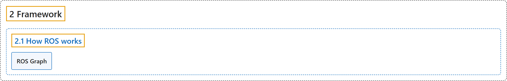

# 2.1 How ROS works

## Classification

## Glossary

| Term | Definition | 中文翻译 | Source |
|---|---|---|---|
| **2.1 How ROS works** ROS 如何工作 | (No definition) | （无定义） | [Open Robotics, n.d., "How ROS works"](https://docs.ros.org/en/lyrical/ROS-Framework/How-ROS-Works.html#how-ros-works) |
| **ROS Graph** ROS 图 | (No definition) | （无定义） | [Open Robotics, n.d., "ROS Graph"](https://docs.ros.org/en/lyrical/ROS-Framework/How-ROS-Works.html#ros-graph) |

## References

Open Robotics. (n.d.). *How ROS works*. ROS 2 Documentation: Lyrical. Retrieved October 31, 2026, from <https://docs.ros.org/en/lyrical/ROS-Framework/How-ROS-Works.html>
