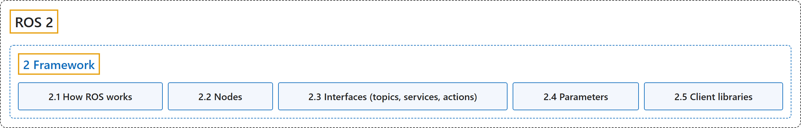

# 2. Framework

## Classification

## Glossary

| Term | Definition | 中文翻译 | Source |
|---|---|---|---|
| **2 Framework** 框架 | "The ROS framework is **the “plumbing” which allows for communication between parts of a robot, and within parts of a robot**." | ROS 框架是**让机器人各部分之间以及各部分内部能够通信的“管道”**。 | [Open Robotics, n.d.-a, "Framework", para. 1](https://docs.ros.org/en/lyrical/About-ROS.html#framework) |
| **[2.1 How ROS works](how-ros-works.md)** ROS 如何工作 | (No definition) | （无定义） | [Open Robotics, n.d.-c, "How ROS works"](https://docs.ros.org/en/lyrical/ROS-Framework/How-ROS-Works.html#how-ros-works) |
| **[2.2 Nodes](nodes.md)** 节点 | "A node is **a participant in the ROS 2 graph, which uses a client library to communicate with other nodes**." | 节点是 **ROS 2 图中的一个参与者，它使用客户端库与其他节点通信**。 | [Open Robotics, n.d.-e, "Overview of nodes", para. 1](https://docs.ros.org/en/lyrical/ROS-Framework/About-Nodes.html#overview-of-nodes) |
| **[2.3 Interfaces (topics, services, actions)](interfaces-topics-services-actions.md)** 接口（话题、服务、动作） | "Interfaces in ROS **define how nodes exchange data**, helping you design communication between different parts of a robotic application." | ROS 中的接口**规定节点之间如何交换数据**，帮助你设计机器人应用各部分之间的通信。 | [Open Robotics, n.d.-d, "Interfaces (topics, services, actions)", para. 1](https://docs.ros.org/en/lyrical/ROS-Framework/Interfaces-Topics-Services-Actions.html#topicsservicesactions) |
| **[2.4 Parameters](parameters.md)** 参数 | "Parameters in ROS **configure node behavior without requiring changes to the node’s source code**." | ROS 中的参数**在不修改节点源代码的情况下配置节点的行为**。 | [Open Robotics, n.d.-f, "Parameters", para. 1](https://docs.ros.org/en/lyrical/ROS-Framework/About-Parameters.html#parameters) |
| **[2.5 Client libraries](client-libraries.md)** 客户端库 | "Client libraries are **the APIs that allow you to implement your ROS code**." | 客户端库是**让你实现 ROS 代码的 API**。 | [Open Robotics, n.d.-b, "Client libraries in ROS", para. 1](https://docs.ros.org/en/lyrical/ROS-Framework/About-Client-Libraries.html#client-libraries-in-ros) |

## References

Open Robotics. (n.d.-a). *About ROS*. ROS 2 Documentation: Lyrical. Retrieved October 30, 2026, from <https://docs.ros.org/en/lyrical/About-ROS.html>

Open Robotics. (n.d.-b). *Client libraries*. ROS 2 Documentation: Lyrical. Retrieved October 30, 2026, from <https://docs.ros.org/en/lyrical/ROS-Framework/About-Client-Libraries.html>

Open Robotics. (n.d.-c). *How ROS works*. ROS 2 Documentation: Lyrical. Retrieved October 30, 2026, from <https://docs.ros.org/en/lyrical/ROS-Framework/How-ROS-Works.html>

Open Robotics. (n.d.-d). *Interfaces (topics, services, actions)*. ROS 2 Documentation: Lyrical. Retrieved October 30, 2026, from <https://docs.ros.org/en/lyrical/ROS-Framework/Interfaces-Topics-Services-Actions.html>

Open Robotics. (n.d.-e). *Nodes*. ROS 2 Documentation: Lyrical. Retrieved October 30, 2026, from <https://docs.ros.org/en/lyrical/ROS-Framework/About-Nodes.html>

Open Robotics. (n.d.-f). *Parameters*. ROS 2 Documentation: Lyrical. Retrieved October 30, 2026, from <https://docs.ros.org/en/lyrical/ROS-Framework/About-Parameters.html>
