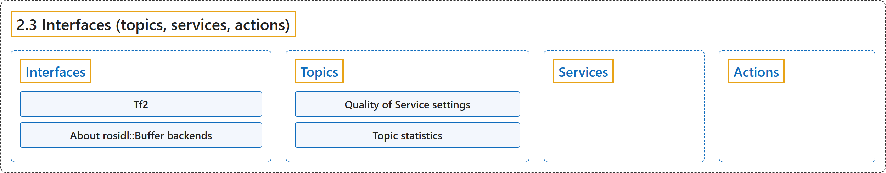

# 2.3 Interfaces (topics, services, actions)

## Classification

## Glossary

| Term | Definition | 中文翻译 | Source |
|---|---|---|---|
| **2.3 Interfaces (topics, services, actions)** 接口（话题、服务、动作） | "Interfaces in ROS **define how nodes exchange data**, helping you design communication between different parts of a robotic application." | ROS 中的接口**规定节点之间如何交换数据**，帮助你设计机器人应用各部分之间的通信。 | [Open Robotics, n.d.-d, "Interfaces (topics, services, actions)", para. 1](https://docs.ros.org/en/lyrical/ROS-Framework/Interfaces-Topics-Services-Actions.html#topicsservicesactions) |
| **Interfaces** 接口 | "Interfaces in ROS **define the structured data used by nodes to exchange messages, make requests, and coordinate long-running tasks**." | ROS 中的接口**规定节点用来交换消息、发出请求和协调长时间任务的结构化数据**。 | [Open Robotics, n.d.-c, "Interfaces", para. 1](https://docs.ros.org/en/lyrical/ROS-Framework/interfaces/About-Interfaces.html#interfaces) |
| **Tf2** tf2 | "tf2 is **the transform library, which lets the user keep track of multiple coordinate frames over time**." | tf2 是**坐标变换库，让用户随时间跟踪多个坐标系**。 | [Open Robotics, n.d.-g, "Overview", para. 1](https://docs.ros.org/en/lyrical/ROS-Framework/interfaces/About-Tf2/About-Tf2.html#overview) |
| **About rosidl::Buffer backends** rosidl::Buffer 后端 | "rosidl::Buffer backends **let message payloads use vendor-specific memory domains such as GPU memory while keeping familiar message APIs**." | rosidl::Buffer 后端**让消息载荷使用 GPU 内存等厂商专用内存域，同时保持熟悉的消息 API**。 | [Open Robotics, n.d.-a, "About rosidl::Buffer backends", para. 1](https://docs.ros.org/en/lyrical/ROS-Framework/interfaces/Working-with-interfaces/Buffer-Backends/About-Buffer-Backends.html#about-rosidl-buffer-backends) |
| **Topics** 话题 | "Topics in ROS **provide a publish/subscribe interface for sharing continuous data streams between nodes**." | ROS 中的话题**提供一种发布/订阅接口，用于在节点之间共享连续的数据流**。 | [Open Robotics, n.d.-i, "Topics", para. 1](https://docs.ros.org/en/lyrical/ROS-Framework/interfaces/About-Topics.html#topics) |
| **Quality of Service settings** 服务质量设置 | "ROS 2 offers a rich variety of Quality of Service (QoS) policies **that allow you to tune communication between nodes**." | ROS 2 提供丰富多样的服务质量（QoS）策略，**让你调节节点之间的通信**。 | [Open Robotics, n.d.-e, "Overview", para. 1](https://docs.ros.org/en/lyrical/ROS-Framework/interfaces/topics/About-Quality-of-Service-Settings.html#overview) |
| **Topic statistics** 话题统计 | "ROS 2 provides **integrated measurement of statistics for messages received by any subscription**." | ROS 2 提供**对任何订阅所收到消息的统计数据的集成测量**。 | [Open Robotics, n.d.-h, "Overview", para. 1](https://docs.ros.org/en/lyrical/ROS-Framework/interfaces/topics/About-Topic-Statistics.html#overview) |
| **Services** 服务 | "In ROS 2, a service refers to **a remote procedure call**." | 在 ROS 2 中，服务指的是**一次远程过程调用**。 | [Open Robotics, n.d.-f, "Services", para. 2](https://docs.ros.org/en/lyrical/ROS-Framework/interfaces/About-Services.html#services) |
| **Actions** 动作 | "In ROS 2, an action refers to **a long-running remote procedure call with feedback and the ability to cancel or preempt the goal**." | 在 ROS 2 中，动作指的是**一次长时间运行的远程过程调用，带有反馈，并能取消或抢占目标**。 | [Open Robotics, n.d.-b, "Actions", para. 2](https://docs.ros.org/en/lyrical/ROS-Framework/interfaces/About-Actions.html#actions) |

## References

Open Robotics. (n.d.-a). *About rosidl::Buffer backends*. ROS 2 Documentation: Lyrical. Retrieved October 31, 2026, from <https://docs.ros.org/en/lyrical/ROS-Framework/interfaces/Working-with-interfaces/Buffer-Backends/About-Buffer-Backends.html>

Open Robotics. (n.d.-b). *Actions*. ROS 2 Documentation: Lyrical. Retrieved October 31, 2026, from <https://docs.ros.org/en/lyrical/ROS-Framework/interfaces/About-Actions.html>

Open Robotics. (n.d.-c). *Interfaces*. ROS 2 Documentation: Lyrical. Retrieved October 31, 2026, from <https://docs.ros.org/en/lyrical/ROS-Framework/interfaces/About-Interfaces.html>

Open Robotics. (n.d.-d). *Interfaces (topics, services, actions)*. ROS 2 Documentation: Lyrical. Retrieved October 31, 2026, from <https://docs.ros.org/en/lyrical/ROS-Framework/Interfaces-Topics-Services-Actions.html>

Open Robotics. (n.d.-e). *Quality of Service settings*. ROS 2 Documentation: Lyrical. Retrieved October 31, 2026, from <https://docs.ros.org/en/lyrical/ROS-Framework/interfaces/topics/About-Quality-of-Service-Settings.html>

Open Robotics. (n.d.-f). *Services*. ROS 2 Documentation: Lyrical. Retrieved October 31, 2026, from <https://docs.ros.org/en/lyrical/ROS-Framework/interfaces/About-Services.html>

Open Robotics. (n.d.-g). *Tf2*. ROS 2 Documentation: Lyrical. Retrieved October 31, 2026, from <https://docs.ros.org/en/lyrical/ROS-Framework/interfaces/About-Tf2/About-Tf2.html>

Open Robotics. (n.d.-h). *Topic statistics*. ROS 2 Documentation: Lyrical. Retrieved October 31, 2026, from <https://docs.ros.org/en/lyrical/ROS-Framework/interfaces/topics/About-Topic-Statistics.html>

Open Robotics. (n.d.-i). *Topics*. ROS 2 Documentation: Lyrical. Retrieved October 31, 2026, from <https://docs.ros.org/en/lyrical/ROS-Framework/interfaces/About-Topics.html>
