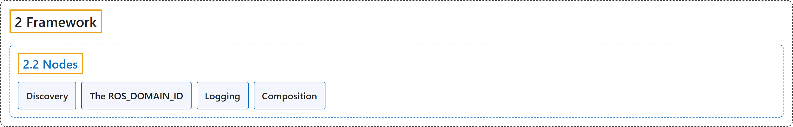

# 2.2 Nodes

## Classification

## Glossary

| Term | Definition | 中文翻译 | Source |
|---|---|---|---|
| **2.2 Nodes** 节点 | "A node is **a participant in the ROS 2 graph, which uses a client library to communicate with other nodes**." | 节点是 **ROS 2 图中的一个参与者，它使用客户端库与其他节点通信**。 | [Open Robotics, n.d.-d, "Overview of nodes", para. 1](https://docs.ros.org/en/lyrical/ROS-Framework/About-Nodes.html#overview-of-nodes) |
| **Discovery** 发现 | "Discovery **lets ROS nodes find each other so they can communicate without manual connection setup**." | 发现**让 ROS 节点互相找到对方，从而无需手动建立连接就能通信**。 | [Open Robotics, n.d.-b, "Discovery", para. 1](https://docs.ros.org/en/lyrical/ROS-Framework/nodes/About-Discovery.html#discovery) |
| **The ROS_DOMAIN_ID** ROS 域 ID | "In DDS, **the primary mechanism for having different logical networks share a physical network** is known as the Domain ID." | 在 DDS 中，**让不同逻辑网络共享同一物理网络的主要机制**称为域 ID（Domain ID）。 | [Open Robotics, n.d.-e, "Overview", para. 1](https://docs.ros.org/en/lyrical/ROS-Framework/nodes/About-Domain-ID.html#overview) |
| **Logging** 日志 | "ROS logging **helps you monitor node behavior and diagnose problems by sending logs to console output, log files, and the /rosout topic**." | ROS 日志**通过把日志发送到控制台输出、日志文件和 /rosout 话题，帮助你监控节点行为、诊断问题**。 | [Open Robotics, n.d.-c, "Logging", para. 1](https://docs.ros.org/en/lyrical/ROS-Framework/nodes/About-Logging/About-Logging.html#logging) |
| **Composition** 组合 | "Composition **lets you decide how ROS nodes are arranged into processes when an application is deployed**." | 组合**让你在部署应用时决定 ROS 节点如何分配到各个进程中**。 | [Open Robotics, n.d.-a, "Composition", para. 1](https://docs.ros.org/en/lyrical/ROS-Framework/nodes/About-Composition.html#composition) |

## References

Open Robotics. (n.d.-a). *Composition*. ROS 2 Documentation: Lyrical. Retrieved October 31, 2026, from <https://docs.ros.org/en/lyrical/ROS-Framework/nodes/About-Composition.html>

Open Robotics. (n.d.-b). *Discovery*. ROS 2 Documentation: Lyrical. Retrieved October 31, 2026, from <https://docs.ros.org/en/lyrical/ROS-Framework/nodes/About-Discovery.html>

Open Robotics. (n.d.-c). *Logging*. ROS 2 Documentation: Lyrical. Retrieved October 31, 2026, from <https://docs.ros.org/en/lyrical/ROS-Framework/nodes/About-Logging/About-Logging.html>

Open Robotics. (n.d.-d). *Nodes*. ROS 2 Documentation: Lyrical. Retrieved October 31, 2026, from <https://docs.ros.org/en/lyrical/ROS-Framework/About-Nodes.html>

Open Robotics. (n.d.-e). *The ROS_DOMAIN_ID*. ROS 2 Documentation: Lyrical. Retrieved October 31, 2026, from <https://docs.ros.org/en/lyrical/ROS-Framework/nodes/About-Domain-ID.html>
