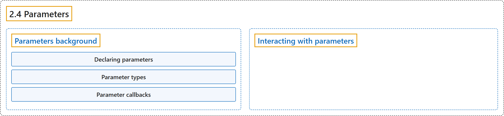

# 2.4 Parameters

## Classification

## Glossary

| Term | Definition | 中文翻译 | Source |
|---|---|---|---|
| **2.4 Parameters** 参数 | "Parameters in ROS **configure node behavior without requiring changes to the node’s source code**." | ROS 中的参数**在不修改节点源代码的情况下配置节点的行为**。 | [Open Robotics, n.d., "Parameters", para. 1](https://docs.ros.org/en/lyrical/ROS-Framework/About-Parameters.html#parameters) |
| **Parameters background** 参数背景 | (No definition) | （无定义） | [Open Robotics, n.d., "Parameters background"](https://docs.ros.org/en/lyrical/ROS-Framework/About-Parameters.html#parameters-background) |
| **Declaring parameters** 声明参数 | (context) "By default, a node needs to declare **all of the parameters that it will accept during its lifetime**." | （语境）默认情况下，节点需要声明**它在生命周期内会接受的所有参数**。 | [Open Robotics, n.d., "Declaring parameters", para. 1](https://docs.ros.org/en/lyrical/ROS-Framework/About-Parameters.html#declaring-parameters) |
| **Parameter types** 参数类型 | (context) "Each parameter on a ROS 2 node has **one of the pre-defined parameter types** as mentioned in the Overview." | （语境）ROS 2 节点上的每个参数都具有**预定义参数类型中的一种**，如概述中所述。 | [Open Robotics, n.d., "Parameter types", para. 1](https://docs.ros.org/en/lyrical/ROS-Framework/About-Parameters.html#parameter-types) |
| **Parameter callbacks** 参数回调 | "A ROS 2 node can register **three different types of callbacks to be informed when changes are happening to parameters**." | ROS 2 节点可以注册**三种不同类型的回调，以便在参数发生变化时得到通知**。 | [Open Robotics, n.d., "Parameter callbacks", para. 1](https://docs.ros.org/en/lyrical/ROS-Framework/About-Parameters.html#parameter-callbacks) |
| **Interacting with parameters** 与参数交互 | (context) "External processes can **perform parameter operations via parameter services that are created by default when a node is instantiated**." | （语境）外部进程可以**通过节点实例化时默认创建的参数服务来执行参数操作**。 | [Open Robotics, n.d., "Interacting with parameters", para. 1](https://docs.ros.org/en/lyrical/ROS-Framework/About-Parameters.html#interacting-with-parameters) |

## References

Open Robotics. (n.d.). *Parameters*. ROS 2 Documentation: Lyrical. Retrieved October 31, 2026, from <https://docs.ros.org/en/lyrical/ROS-Framework/About-Parameters.html>
