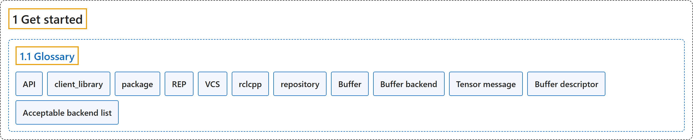

# 1.1 Glossary

## Classification

## Glossary

| Term | Definition | 中文翻译 | Source |
|---|---|---|---|
| **1.1 Glossary** 术语表 | "This article provides **a glossary of commonly used ROS terms**, helping you understand key definitions and follow related documentation more easily." | 本文提供**一份 ROS 常用术语的词汇表**，帮助你理解关键定义，更容易读懂相关文档。 | [Open Robotics, n.d., "Glossary", para. 1](https://docs.ros.org/en/lyrical/Get-Started/Glossary.html#glossary) |
| **API** API | "An API, or Application Programming Interface, is **an interface that is provided by an “application”**, which in this case is usually a shared library or other language appropriate shared resource." | API（应用程序编程接口）是**由一个“应用”提供的接口**，这里的“应用”通常是一个共享库或其他适合该语言的共享资源。 | [Open Robotics, n.d., "API"](https://docs.ros.org/en/lyrical/Get-Started/Glossary.html#term-API) |
| **client_library** 客户端库 | "A client library is **an API that provides access to the ROS graph using primitive middleware concepts like Topics, Services, and Actions**." | 客户端库是**一种 API，它用话题、服务和动作等基本中间件概念来访问 ROS 图**。 | [Open Robotics, n.d., "client_library"](https://docs.ros.org/en/lyrical/Get-Started/Glossary.html#term-client_library) |
| **package** 软件包 | "**A single unit of software, including source code, build system files, documentation, tests, and other associated resources.**" | **一个单独的软件单元，包括源代码、构建系统文件、文档、测试和其他相关资源。** | [Open Robotics, n.d., "package"](https://docs.ros.org/en/lyrical/Get-Started/Glossary.html#term-package) |
| **REP** REP（机器人增强提案） | "Robotics Enhancement Proposal. **A document that describes an enhancement, standardization, or convention for the ROS community.**" | 机器人增强提案。**一份描述 ROS 社区的增强、标准化或约定的文档。** | [Open Robotics, n.d., "REP"](https://docs.ros.org/en/lyrical/Get-Started/Glossary.html#term-REP) |
| **VCS** 版本控制系统 | "**Version Control System**, such as CVS, SVN, git, mercurial, etc…" | **版本控制系统**，如 CVS、SVN、git、mercurial 等。 | [Open Robotics, n.d., "VCS"](https://docs.ros.org/en/lyrical/Get-Started/Glossary.html#term-VCS) |
| **rclcpp** rclcpp | "**The C++ specific Client Library for ROS.**" | **ROS 的 C++ 专用客户端库。** | [Open Robotics, n.d., "rclcpp"](https://docs.ros.org/en/lyrical/Get-Started/Glossary.html#term-rclcpp) |
| **repository** 仓库 | "A **collection of packages** usually managed using a VCS like git or mercurial and usually hosted on a site like GitHub or BitBucket." | **软件包的集合**，通常用 git 或 mercurial 等 VCS 管理，通常托管在 GitHub 或 BitBucket 等网站上。 | [Open Robotics, n.d., "repository"](https://docs.ros.org/en/lyrical/Get-Started/Glossary.html#term-repository) |
| **Buffer** 缓冲区 | "rosidl::Buffer<T>, **the in-memory container used by generated C++ messages for variable-length primitive array fields** (uint8[], float32[], …)." | rosidl::Buffer<T>，**生成的 C++ 消息用来存放变长基本类型数组字段的内存容器**（uint8[]、float32[] 等）。 | [Open Robotics, n.d., "Buffer"](https://docs.ros.org/en/lyrical/Get-Started/Glossary.html#term-Buffer) |
| **Buffer backend** 缓冲区后端 | "**A pluginlib plugin, implementing the rosidl::BufferBackend interface, that teaches the RMW how to transport a rosidl::Buffer whose storage lives in a vendor-specific memory domain** (for example, GPU memory)." | **一个 pluginlib 插件，实现 rosidl::BufferBackend 接口，告诉 RMW 如何传输存储在厂商专用内存域中的 rosidl::Buffer**（例如 GPU 内存）。 | [Open Robotics, n.d., "Buffer backend"](https://docs.ros.org/en/lyrical/Get-Started/Glossary.html#term-Buffer-backend) |
| **Tensor message** 张量消息 | "**A normal ROS 2 message**, such as tensor_msgs/msg/ExperimentalTensor, **that carries tensor metadata and stores the raw tensor bytes in a uint8[] field backed by rosidl::Buffer**." | **一种普通的 ROS 2 消息**，如 tensor_msgs/msg/ExperimentalTensor，**它携带张量元数据，并把原始张量字节存放在由 rosidl::Buffer 支撑的 uint8[] 字段中**。 | [Open Robotics, n.d., "Tensor message"](https://docs.ros.org/en/lyrical/Get-Started/Glossary.html#term-Tensor-message) |
| **Buffer descriptor** 缓冲区描述符 | "**A normal ROS 2 .msg produced by a BufferBackend that travels on the wire in place of the raw uint8[] contents of a buffer-backed field.**" | **由 BufferBackend 生成的一种普通 ROS 2 .msg，在传输线路上代替缓冲区支撑字段的原始 uint8[] 内容。** | [Open Robotics, n.d., "Buffer descriptor"](https://docs.ros.org/en/lyrical/Get-Started/Glossary.html#term-Buffer-descriptor) |
| **Acceptable backend list** 可接受后端列表 | "**A comma-separated list of backend names the subscription is willing to receive**; "cpu" (or empty) means CPU-only, "any" means any installed backend, and CPU is always implicitly acceptable." | **一个用逗号分隔的后端名称列表，列出订阅愿意接收的后端**；"cpu"（或空）表示只用 CPU，"any" 表示任何已安装的后端，CPU 总是隐含可接受。 | [Open Robotics, n.d., "Acceptable backend list"](https://docs.ros.org/en/lyrical/Get-Started/Glossary.html#term-Acceptable-backend-list) |

## References

Open Robotics. (n.d.). *Glossary*. ROS 2 Documentation: Lyrical. Retrieved October 31, 2026, from <https://docs.ros.org/en/lyrical/Get-Started/Glossary.html>
