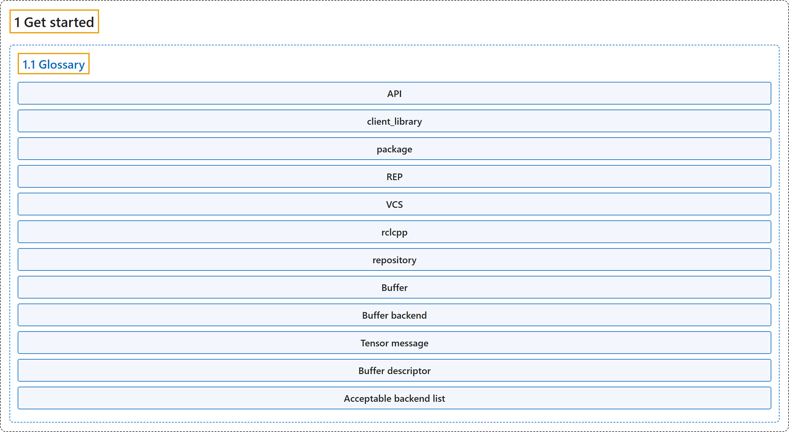

# 1. Get started

## Classification

## Glossary

| Term | Definition | 中文翻译 | Source |
|---|---|---|---|
| **1 Get started** 入门 | (No definition) | （无定义） | [Open Robotics, n.d.-b, "Get started", documentation menu](https://docs.ros.org/en/lyrical/Get-Started.html) |
| **[1.1 Glossary](glossary.md)** 术语表 | "This article provides **a glossary of commonly used ROS terms**, helping you understand key definitions and follow related documentation more easily." | 本文提供**一份 ROS 常用术语的词汇表**，帮助你理解关键定义，更容易读懂相关文档。 | [Open Robotics, n.d.-a, "Glossary", para. 1](https://docs.ros.org/en/lyrical/Get-Started/Glossary.html#glossary) |

## References

Open Robotics. (n.d.-a). *Glossary*. ROS 2 Documentation: Lyrical. Retrieved October 30, 2026, from <https://docs.ros.org/en/lyrical/Get-Started/Glossary.html>

Open Robotics. (n.d.-b). *ROS 2 documentation: Lyrical*. Retrieved October 30, 2026, from <https://docs.ros.org/en/lyrical/>
