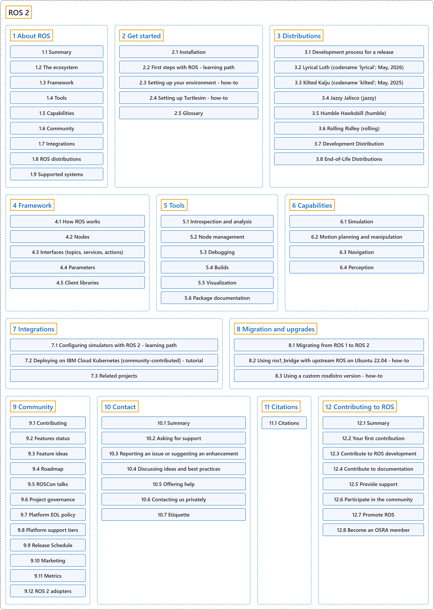

# ROS 2

## Classification

## Glossary

| Term | Definition | 中文翻译 | Source |
|---|---|---|---|
| **ROS 2** ROS 2 | "ROS (Robot Operating System) is **an open-source ecosystem that provides the framework, tools, and libraries for building, deploying, running, and maintaining robotic applications**." | ROS（Robot Operating System，机器人操作系统）是**一个开源生态系统，提供用于构建、部署、运行和维护机器人应用的框架、工具和库**。 | [Open Robotics, n.d.-a, "About ROS", para. 1](https://docs.ros.org/en/lyrical/About-ROS.html#about-ros) |
| **[1 About ROS](about-ros/index.md)** 关于 ROS | (context) "This article introduces **the main areas of the ecosystem** and outlines their intended use." | （语境）本文介绍**这个生态系统的主要领域**，并概述它们的预期用途。 | [Open Robotics, n.d.-a, "About ROS", para. 1](https://docs.ros.org/en/lyrical/About-ROS.html#about-ros) |
| **[2 Get started](get-started/index.md)** 入门 | (No definition) | （无定义） | [Open Robotics, n.d.-b, "Get started", documentation menu](https://docs.ros.org/en/lyrical/Get-Started.html) |
| **[3 Distributions](distributions/index.md)** 发行版 | "ROS distributions provide **stable, versioned sets of packages that help developers choose a supported platform for building and maintaining robotic applications**." | ROS 发行版提供**稳定的、带版本号的软件包集合，帮助开发者选择一个受支持的平台来构建和维护机器人应用**。 | [Open Robotics, n.d.-c, "Distributions", para. 1](https://docs.ros.org/en/lyrical/Releases.html#distributions) |
| **[4 Framework](framework/index.md)** 框架 | "The ROS framework is **the “plumbing” which allows for communication between parts of a robot, and within parts of a robot**." | ROS 框架是**让机器人各部分之间以及各部分内部能够通信的“管道”**。 | [Open Robotics, n.d.-a, "Framework", para. 1](https://docs.ros.org/en/lyrical/About-ROS.html#framework) |
| **[5 Tools](tools/index.md)** 工具 | "Tools in ROS **help developers build, test, and monitor robotic systems**." | ROS 中的工具**帮助开发者构建、测试和监控机器人系统**。 | [Open Robotics, n.d.-a, "Tools", para. 1](https://docs.ros.org/en/lyrical/About-ROS.html#tools) |
| **[6 Capabilities](capabilities/index.md)** 能力 | "Capabilities in ROS are **ready-to-use packages that offer common functions for robots, such as manipulation, motion planning, and perception**." | ROS 中的能力是**现成可用的软件包，为机器人提供常用功能，如操作、运动规划和感知**。 | [Open Robotics, n.d.-a, "Capabilities", para. 1](https://docs.ros.org/en/lyrical/About-ROS.html#capabilities) |
| **[7 Integrations](integrations/index.md)** 集成 | "ROS **works with other Open Robotics platforms** to make development and deployment easier." | ROS **与 Open Robotics 的其他平台协同工作**，让开发和部署更容易。 | [Open Robotics, n.d.-a, "Integrations", para. 1](https://docs.ros.org/en/lyrical/About-ROS.html#integrations) |
| **[8 Migration and upgrades](migration-and-upgrades/index.md)** 迁移与升级 | (No definition) | （无定义） | [Open Robotics, n.d.-b, "Migration and upgrades", documentation menu](https://docs.ros.org/en/lyrical/Migration-and-Upgrades.html) |
| **[9 Community](community/index.md)** 社区 | "Community in ROS is **the global network of developers, researchers, companies, and contributors who help our library of open-source software grow and improve**." | ROS 中的社区是**由开发者、研究人员、公司和贡献者组成的全球网络，他们帮助我们的开源软件库成长和完善**。 | [Open Robotics, n.d.-a, "Community", para. 1](https://docs.ros.org/en/lyrical/About-ROS.html#community) |
| **[10 Contact](contact/index.md)** 联系 | (context) "This article explains **the main support and contact channels**, including Robotics Stack Exchange and GitHub issues." | （语境）本文说明**主要的支持和联系渠道**，包括 Robotics Stack Exchange 和 GitHub issues。 | [Open Robotics, n.d.-d, "Contact", para. 1](https://docs.ros.org/en/lyrical/Contact.html#contact) |
| **[11 Citations](citations/index.md)** 引用 | (No definition) | （无定义） | [Open Robotics, n.d.-b, "Citations", documentation menu](https://docs.ros.org/en/lyrical/Citations.html) |
| **[12 Contributing to ROS](contributing-to-ros/index.md)** 为 ROS 做贡献 | (context) "This article introduces **the main ways you can contribute to ROS** and helps you identify an appropriate first contribution based on your skills and experience." | （语境）本文介绍**你为 ROS 做贡献的主要方式**，并帮助你根据自己的技能和经验找到合适的第一次贡献。 | [Open Robotics, n.d.-e, "Contributing to ROS", para. 1](https://docs.ros.org/en/lyrical/Contributing-To-ROS.html#contributing-to-ros) |

## References

Open Robotics. (n.d.-a). *About ROS*. ROS 2 Documentation: Lyrical. Retrieved October 30, 2026, from <https://docs.ros.org/en/lyrical/About-ROS.html>

Open Robotics. (n.d.-b). *ROS 2 documentation: Lyrical*. Retrieved October 30, 2026, from <https://docs.ros.org/en/lyrical/>

Open Robotics. (n.d.-c). *Distributions*. ROS 2 Documentation: Lyrical. Retrieved October 30, 2026, from <https://docs.ros.org/en/lyrical/Releases.html>

Open Robotics. (n.d.-d). *Contact*. ROS 2 Documentation: Lyrical. Retrieved October 30, 2026, from <https://docs.ros.org/en/lyrical/Contact.html>

Open Robotics. (n.d.-e). *Contributing to ROS*. ROS 2 Documentation: Lyrical. Retrieved October 30, 2026, from <https://docs.ros.org/en/lyrical/Contributing-To-ROS.html>
