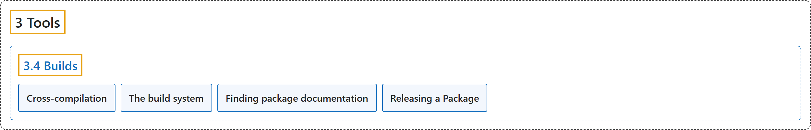

# 3.4 Builds

## Classification

## Glossary

| Term | Definition | 中文翻译 | Source |
|---|---|---|---|
| **3.4 Builds** 构建 | (No definition) | （无定义） | [Open Robotics, n.d.-a, "Builds"](https://docs.ros.org/en/lyrical/Developer-Tools/About-Build.html) |
| **Cross-compilation** 交叉编译 | "Cross-compilation **helps developers build ROS software for target systems that differ from their development machine or require architecture-specific tuning**." | 交叉编译**帮助开发者为不同于开发机器、或需要针对特定架构调优的目标系统构建 ROS 软件**。 | [Open Robotics, n.d.-b, "Cross-compilation", para. 1](https://docs.ros.org/en/lyrical/Developer-Tools/Build/About-Cross-Compilation.html#cross-compilation) |
| **The build system** 构建系统 | "The build system is **what allows developers to build their ROS 2 code as needed**." | 构建系统是**让开发者按需构建其 ROS 2 代码的东西**。 | [Open Robotics, n.d.-e, "The build system", para. 2](https://docs.ros.org/en/lyrical/Developer-Tools/Build/About-Build-System.html#the-build-system) |
| **Finding package documentation** 查找包文档 | (No definition) | （无定义） | [Open Robotics, n.d.-c, "Finding package documentation"](https://docs.ros.org/en/lyrical/Developer-Tools/Build/Package-Docs.html#finding-package-documentation) |
| **Releasing a Package** 发布软件包 | (No definition) | （无定义） | [Open Robotics, n.d.-d, "Releasing a Package"](https://docs.ros.org/en/lyrical/Developer-Tools/Build/Releasing/Releasing-a-Package.html#releasing-a-package) |

## References

Open Robotics. (n.d.-a). *Builds*. ROS 2 Documentation: Lyrical. Retrieved October 31, 2026, from <https://docs.ros.org/en/lyrical/Developer-Tools/About-Build.html>

Open Robotics. (n.d.-b). *Cross-compilation*. ROS 2 Documentation: Lyrical. Retrieved October 31, 2026, from <https://docs.ros.org/en/lyrical/Developer-Tools/Build/About-Cross-Compilation.html>

Open Robotics. (n.d.-c). *Finding package documentation*. ROS 2 Documentation: Lyrical. Retrieved October 31, 2026, from <https://docs.ros.org/en/lyrical/Developer-Tools/Build/Package-Docs.html>

Open Robotics. (n.d.-d). *Releasing a Package*. ROS 2 Documentation: Lyrical. Retrieved October 31, 2026, from <https://docs.ros.org/en/lyrical/Developer-Tools/Build/Releasing/Releasing-a-Package.html>

Open Robotics. (n.d.-e). *The build system*. ROS 2 Documentation: Lyrical. Retrieved October 31, 2026, from <https://docs.ros.org/en/lyrical/Developer-Tools/Build/About-Build-System.html>
