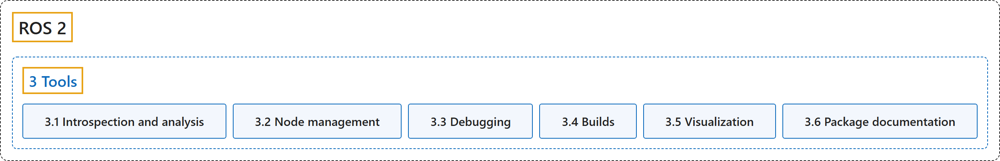

# 3. Tools

## Classification

## Glossary

| Term | Definition | 中文翻译 | Source |
|---|---|---|---|
| **3 Tools** 工具 | "Tools in ROS **help developers build, test, and monitor robotic systems**." | ROS 中的工具**帮助开发者构建、测试和监控机器人系统**。 | [Open Robotics, n.d.-a, "Tools", para. 1](https://docs.ros.org/en/lyrical/About-ROS.html#tools) |
| **[3.1 Introspection and analysis](introspection-and-analysis.md)** 内省与分析 | (No definition) | （无定义） | [Open Robotics, n.d.-d, "Introspection and analysis"](https://docs.ros.org/en/lyrical/Developer-Tools/About-introspection-and-analysis.html#introspection-and-analysis) |
| **[3.2 Node management](node-management.md)** 节点管理 | (context) "The launch system in ROS 2 is meant to **automate the running of many nodes with a single command**." | （语境）ROS 2 的启动系统用于**用一条命令自动运行许多节点**。 | [Open Robotics, n.d.-e, "Node management", para. 3](https://docs.ros.org/en/lyrical/Developer-Tools/About-Launch.html#node-management) |
| **[3.3 Debugging](debugging.md)** 调试 | (No definition) | （无定义） | [Open Robotics, n.d.-c, "Debugging"](https://docs.ros.org/en/lyrical/Developer-Tools/About-Debugging.html) |
| **[3.4 Builds](builds.md)** 构建 | (No definition) | （无定义） | [Open Robotics, n.d.-b, "Builds"](https://docs.ros.org/en/lyrical/Developer-Tools/About-Build.html) |
| **[3.5 Visualization](visualization.md)** 可视化 | (No definition) | （无定义） | [Open Robotics, n.d.-g, "Visualization"](https://docs.ros.org/en/lyrical/Developer-Tools/About-visualization.html) |
| **[3.6 Package documentation](package-documentation.md)** 包文档 | (No definition) | （无定义） | [Open Robotics, n.d.-f, "Package documentation"](https://docs.ros.org/en/lyrical/Developer-Tools/About-package-documentation.html) |

## References

Open Robotics. (n.d.-a). *About ROS*. ROS 2 Documentation: Lyrical. Retrieved October 30, 2026, from <https://docs.ros.org/en/lyrical/About-ROS.html>

Open Robotics. (n.d.-b). *Builds*. ROS 2 Documentation: Lyrical. Retrieved October 30, 2026, from <https://docs.ros.org/en/lyrical/Developer-Tools/About-Build.html>

Open Robotics. (n.d.-c). *Debugging*. ROS 2 Documentation: Lyrical. Retrieved October 30, 2026, from <https://docs.ros.org/en/lyrical/Developer-Tools/About-Debugging.html>

Open Robotics. (n.d.-d). *Introspection and analysis*. ROS 2 Documentation: Lyrical. Retrieved October 30, 2026, from <https://docs.ros.org/en/lyrical/Developer-Tools/About-introspection-and-analysis.html>

Open Robotics. (n.d.-e). *Node management*. ROS 2 Documentation: Lyrical. Retrieved October 30, 2026, from <https://docs.ros.org/en/lyrical/Developer-Tools/About-Launch.html>

Open Robotics. (n.d.-f). *Package documentation*. ROS 2 Documentation: Lyrical. Retrieved October 30, 2026, from <https://docs.ros.org/en/lyrical/Developer-Tools/About-package-documentation.html>

Open Robotics. (n.d.-g). *Visualization*. ROS 2 Documentation: Lyrical. Retrieved October 30, 2026, from <https://docs.ros.org/en/lyrical/Developer-Tools/About-visualization.html>
