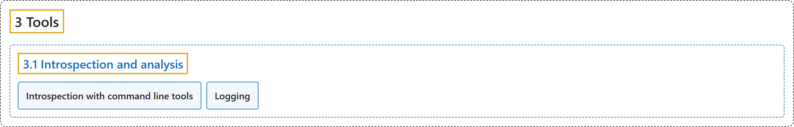

# 3.1 Introspection and analysis

## Classification

## Glossary

| Term | Definition | 中文翻译 | Source |
|---|---|---|---|
| **3.1 Introspection and analysis** 内省与分析 | (No definition) | （无定义） | [Open Robotics, n.d.-a, "Introspection and analysis"](https://docs.ros.org/en/lyrical/Developer-Tools/About-introspection-and-analysis.html#introspection-and-analysis) |
| **Introspection with command line tools** 用命令行工具内省 | "ROS 2 includes **a suite of command-line tools for introspecting a ROS 2 system**." | ROS 2 包含**一套用于内省 ROS 2 系统的命令行工具**。 | [Open Robotics, n.d.-b, "Introspection with command line tools", para. 2](https://docs.ros.org/en/lyrical/Developer-Tools/Introspection-and-analysis/About-Command-Line-Tools.html#introspection-with-command-line-tools) |
| **Logging** 日志 | "Logging in ROS helps you **understand node behavior, diagnose issues, and control how runtime information is reported**." | ROS 中的日志帮助你**理解节点行为、诊断问题，并控制运行时信息如何报告**。 | [Open Robotics, n.d.-c, "Logging", para. 1](https://docs.ros.org/en/lyrical/Developer-Tools/Introspection-and-analysis/Logging-and-logger-configuration.html#logging) |

## References

Open Robotics. (n.d.-a). *Introspection and analysis*. ROS 2 Documentation: Lyrical. Retrieved October 31, 2026, from <https://docs.ros.org/en/lyrical/Developer-Tools/About-introspection-and-analysis.html>

Open Robotics. (n.d.-b). *Introspection with command line tools*. ROS 2 Documentation: Lyrical. Retrieved October 31, 2026, from <https://docs.ros.org/en/lyrical/Developer-Tools/Introspection-and-analysis/About-Command-Line-Tools.html>

Open Robotics. (n.d.-c). *Logging*. ROS 2 Documentation: Lyrical. Retrieved October 31, 2026, from <https://docs.ros.org/en/lyrical/Developer-Tools/Introspection-and-analysis/Logging-and-logger-configuration.html>
