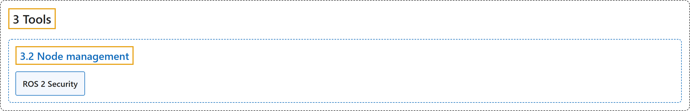

# 3.2 Node management

## Classification

## Glossary

| Term | Definition | 中文翻译 | Source |
|---|---|---|---|
| **3.2 Node management** 节点管理 | (context) "The launch system in ROS 2 is meant to **automate the running of many nodes with a single command**." | （语境）ROS 2 的启动系统用于**用一条命令自动运行许多节点**。 | [Open Robotics, n.d.-a, "Node management", para. 3](https://docs.ros.org/en/lyrical/Developer-Tools/About-Launch.html#node-management) |
| **ROS 2 Security** ROS 2 安全 | "Security in ROS **helps protect communications between nodes through authentication, encryption, data integrity, and access control**." | ROS 中的安全**通过认证、加密、数据完整性和访问控制，帮助保护节点之间的通信**。 | [Open Robotics, n.d.-b, "ROS 2 Security", para. 1](https://docs.ros.org/en/lyrical/Developer-Tools/Launch/Security/About-Security.html#ros-2-security) |

## References

Open Robotics. (n.d.-a). *Node management*. ROS 2 Documentation: Lyrical. Retrieved October 31, 2026, from <https://docs.ros.org/en/lyrical/Developer-Tools/About-Launch.html>

Open Robotics. (n.d.-b). *ROS 2 Security*. ROS 2 Documentation: Lyrical. Retrieved October 31, 2026, from <https://docs.ros.org/en/lyrical/Developer-Tools/Launch/Security/About-Security.html>
