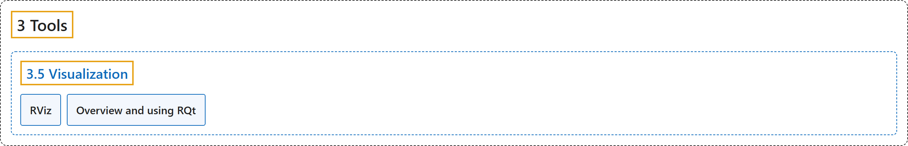

# 3.5 Visualization

## Classification

## Glossary

| Term | Definition | 中文翻译 | Source |
|---|---|---|---|
| **3.5 Visualization** 可视化 | (No definition) | （无定义） | [Open Robotics, n.d.-c, "Visualization"](https://docs.ros.org/en/lyrical/Developer-Tools/About-visualization.html) |
| **RViz** RViz | "RViz is **a 3D visualizer for the Robot Operating System (ROS) framework**." | RViz 是**机器人操作系统（ROS）框架的三维可视化工具**。 | [Open Robotics, n.d.-b, "RViz", para. 1](https://docs.ros.org/en/lyrical/Developer-Tools/Visualization/RViz/RViz-Main.html#rviz) |
| **Overview and using RQt** RQt 概述与使用 | "RQt is **a graphical user interface framework that implements various tools and interfaces in the form of plugins**." | RQt 是**一个图形用户界面框架，以插件的形式实现各种工具和界面**。 | [Open Robotics, n.d.-a, "Overview", para. 1](https://docs.ros.org/en/lyrical/Developer-Tools/Visualization/About-RQt.html#overview) |

## References

Open Robotics. (n.d.-a). *Overview and using RQt*. ROS 2 Documentation: Lyrical. Retrieved October 31, 2026, from <https://docs.ros.org/en/lyrical/Developer-Tools/Visualization/About-RQt.html>

Open Robotics. (n.d.-b). *RViz*. ROS 2 Documentation: Lyrical. Retrieved October 31, 2026, from <https://docs.ros.org/en/lyrical/Developer-Tools/Visualization/RViz/RViz-Main.html>

Open Robotics. (n.d.-c). *Visualization*. ROS 2 Documentation: Lyrical. Retrieved October 31, 2026, from <https://docs.ros.org/en/lyrical/Developer-Tools/About-visualization.html>
