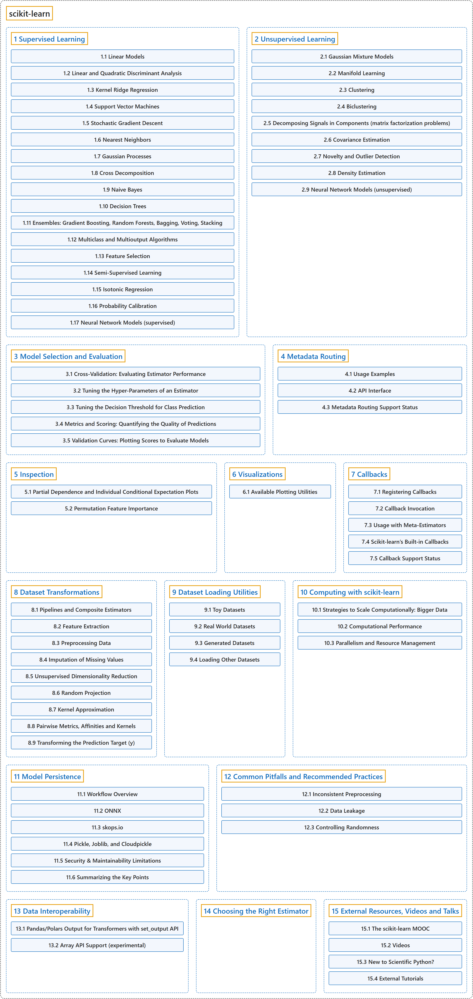

# scikit-learn

## Classification

## Glossary

| Term | Definition | 中文翻译 | Source |
|---|---|---|---|
| **scikit-learn** scikit-learn | "`Scikit-learn` is **an open source machine learning library that supports supervised and unsupervised learning**." | `Scikit-learn` 是**一个支持监督学习和无监督学习的开源机器学习库**。 | [scikit-learn developers, n.d.-b, "Getting Started", para. 1](https://scikit-learn.org/stable/getting_started.html#getting-started) |
| **[1 Supervised Learning](supervised-learning/index.md)** 监督学习 | "Learning where **the expected prediction (label or ground truth) is available for each sample** when fitting the model, provided as y." | 在拟合模型时，**每个样本的预期预测（标签或真实值）都可得到**的学习，以 y 的形式提供。 | [scikit-learn developers, n.d.-a, "supervised learning"](https://scikit-learn.org/stable/glossary.html#term-supervised-learning) |
| **[2 Unsupervised Learning](unsupervised-learning/index.md)** 无监督学习 | "Learning where **the expected prediction (label or ground truth) is not available for each sample** when fitting the model, as in clusterers and outlier detectors." | 在拟合模型时，**每个样本的预期预测（标签或真实值）都不可得到**的学习，如聚类器和离群点检测器。 | [scikit-learn developers, n.d.-a, "unsupervised learning"](https://scikit-learn.org/stable/glossary.html#term-unsupervised-learning) |
| **[3 Model Selection and Evaluation](model-selection-and-evaluation/index.md)** 模型选择与评估 | (context) "Fitting a model to some data does not entail that it will predict well on unseen data. This needs to be **directly evaluated**." | （语境）用一些数据拟合了模型，并不意味着它在未见过的数据上也能预测得好。这需要**直接加以评估**。 | [scikit-learn developers, n.d.-b, "Model evaluation", para. 1](https://scikit-learn.org/stable/getting_started.html#model-evaluation) |
| **[4 Metadata Routing](metadata-routing/index.md)** 元数据路由 | "This guide demonstrates how **metadata can be routed and passed between objects** in scikit-learn." | 本指南演示在 scikit-learn 中**元数据如何在对象之间路由和传递**。 | [scikit-learn developers, n.d.-c, "4. Metadata Routing", para. 1 after the Note](https://scikit-learn.org/stable/metadata_routing.html#metadata-routing) |
| **[5 Inspection](inspection/index.md)** 检查 | "The sklearn.inspection module **provides tools to help understand the predictions from a model and what affects them**." | sklearn.inspection 模块**提供工具，帮助理解模型的预测以及影响预测的因素**。 | [scikit-learn developers, n.d.-c, "5. Inspection", para. 1](https://scikit-learn.org/stable/inspection.html#inspection) |
| **[6 Visualizations](visualizations/index.md)** 可视化 | "Scikit-learn defines **a simple API for creating visualizations for machine learning**." | Scikit-learn 定义了**一个用于创建机器学习可视化的简单 API**。 | [scikit-learn developers, n.d.-c, "6. Visualizations", para. 1](https://scikit-learn.org/stable/visualizations.html#visualizations) |
| **[7 Callbacks](callbacks/index.md)** 回调 | "**An object which can be registered on a compatible estimator to have its hooks called during the fitting** of that estimator." | **一个可以注册到兼容估计器上的对象，在该估计器拟合期间调用它的钩子**。 | [scikit-learn developers, n.d.-a, "callbacks"](https://scikit-learn.org/stable/glossary.html#term-callbacks) |
| **[8 Dataset Transformations](dataset-transformations/index.md)** 数据集变换 | "scikit-learn provides **a library of transformers, which may clean (see Preprocessing data), reduce (see Unsupervised dimensionality reduction), expand (see Kernel Approximation) or generate (see Feature extraction) feature representations**." | scikit-learn 提供**一个变换器库，可以清洗（见 Preprocessing data）、约简（见 Unsupervised dimensionality reduction）、扩展（见 Kernel Approximation）或生成（见 Feature extraction）特征表示**。 | [scikit-learn developers, n.d.-c, "8. Dataset transformations", para. 1](https://scikit-learn.org/stable/data_transforms.html#dataset-transformations) |
| **[9 Dataset Loading Utilities](dataset-loading-utilities/index.md)** 数据集加载工具 | "The `sklearn.datasets` package **embeds some small toy datasets and provides helpers to fetch larger datasets** commonly used by the machine learning community to benchmark algorithms on data that comes from the ‘real world’." | `sklearn.datasets` 包**内置了一些小型玩具数据集，并提供辅助工具来获取更大的数据集**，这些数据集常被机器学习社区用来在来自“真实世界”的数据上对算法做基准测试。 | [scikit-learn developers, n.d.-c, "9. Dataset loading utilities", para. 1](https://scikit-learn.org/stable/datasets.html#dataset-loading-utilities) |
| **[10 Computing with scikit-learn](computing-with-scikit-learn/index.md)** 用 scikit-learn 计算 | (context) "For some applications the amount of examples, features (or both) and/or the speed at which they need to be processed are challenging for traditional approaches. In these cases scikit-learn has **a number of options you can consider to make your system scale**." | （语境）对某些应用来说，样本、特征（或两者）的数量，以及/或者处理它们所需的速度，对传统方法是一种挑战。这时 scikit-learn 有**一些选项可供考虑，让你的系统扩展**。 | [scikit-learn developers, n.d.-c, "10.1. Strategies to scale computationally: bigger data", para. 1](https://scikit-learn.org/stable/computing/scaling_strategies.html) |
| **[11 Model Persistence](model-persistence/index.md)** 模型持久化 | "After training a scikit-learn model, it is desirable to have **a way to persist the model for future use without having to retrain**." | 训练好一个 scikit-learn 模型后，最好有**一种方法把模型持久保存下来，供以后使用而无需重新训练**。 | [scikit-learn developers, n.d.-c, "11. Model persistence", para. 1](https://scikit-learn.org/stable/model_persistence.html#model-persistence) |
| **[12 Common Pitfalls and Recommended Practices](common-pitfalls-and-recommended-practices/index.md)** 常见陷阱与推荐做法 | "The purpose of this chapter is to illustrate **some common pitfalls and anti-patterns that occur when using scikit-learn**." | 本章的目的是说明**使用 scikit-learn 时出现的一些常见陷阱和反模式**。 | [scikit-learn developers, n.d.-c, "12. Common pitfalls and recommended practices", para. 1](https://scikit-learn.org/stable/common_pitfalls.html#common-pitfalls-and-recommended-practices) |
| **[13 Data Interoperability](data-interoperability/index.md)** 数据互操作性 | "Scikit-learn **handles four kinds of data for X** as used in `fit(X, y)`, `fit(X)`, `fit_transform(X)` and `transform(X)` as well as Xt as returned by `transform(X)` and `fit_transform(X)`:" | Scikit-learn **为 X 处理四种数据**，X 即 `fit(X, y)`、`fit(X)`、`fit_transform(X)` 和 `transform(X)` 中所用的 X，以及 `transform(X)` 和 `fit_transform(X)` 返回的 Xt： | [scikit-learn developers, n.d.-c, "13. Data Interoperability", para. 1](https://scikit-learn.org/stable/data_interoperability.html#data-interoperability) |
| **[14 Choosing the Right Estimator](choosing-the-right-estimator/index.md)** 选择合适的估计器 | "Often the hardest part of solving a machine learning problem can be **finding the right estimator for the job**." | 解决机器学习问题时，最难的部分往往是**为任务找到合适的估计器**。 | [scikit-learn developers, n.d.-c, "14. Choosing the right estimator", para. 1](https://scikit-learn.org/stable/machine_learning_map.html#choosing-the-right-estimator) |
| **[15 External Resources, Videos and Talks](external-resources-videos-and-talks/index.md)** 外部资源、视频与讲座 | (context) "If you are new to scikit-learn, or looking to strengthen your understanding, we highly recommend the **scikit-learn MOOC (Massive Open Online Course)**." | （语境）如果你刚接触 scikit-learn，或想加深理解，我们强烈推荐 **scikit-learn MOOC**（大型开放在线课程）。 | [scikit-learn developers, n.d.-c, "15.1. The scikit-learn MOOC", para. 1](https://scikit-learn.org/stable/presentations.html#the-scikit-learn-mooc) |

## References

scikit-learn developers. (n.d.-a). *Glossary of common terms and API elements* (Version 1.9.1). Retrieved October 30, 2026, from <https://scikit-learn.org/stable/glossary.html>

scikit-learn developers. (n.d.-b). *Getting started* (Version 1.9.1). Retrieved October 30, 2026, from <https://scikit-learn.org/stable/getting_started.html>

scikit-learn developers. (n.d.-c). *scikit-learn User Guide* (Version 1.9.1). Retrieved October 30, 2026, from <https://scikit-learn.org/stable/user_guide.html>
