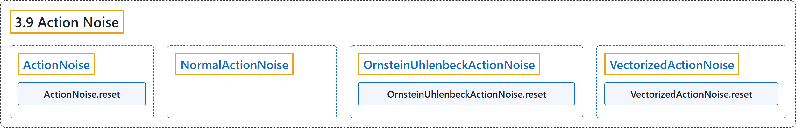

# 3.9 Action Noise

## Classification

## Glossary

| Term | Definition | 中文翻译 | Source |
|---|---|---|---|
| **3.9 Action Noise** 动作噪声 | (context) "**The action noise base class**" | （语境）**动作噪声的基类** | [Raffin et al., n.d., "ActionNoise", para. 1](https://stable-baselines3.readthedocs.io/en/master/common/noise.html#stable_baselines3.common.noise.ActionNoise) |
| **ActionNoise** ActionNoise 动作噪声基类 | "**The action noise base class**" | **动作噪声的基类** | [Raffin et al., n.d., "Action Noise", para. 1](https://stable-baselines3.readthedocs.io/en/master/common/noise.html#stable_baselines3.common.noise.ActionNoise) |
| **ActionNoise.reset** reset 方法 | "**Call end of episode reset for the noise**" | **在回合结束时对噪声调用重置** | [Raffin et al., n.d., "Action Noise", para. 1](https://stable-baselines3.readthedocs.io/en/master/common/noise.html#stable_baselines3.common.noise.ActionNoise.reset) |
| **NormalActionNoise** NormalActionNoise 高斯动作噪声 | "**A Gaussian action noise**." | **高斯动作噪声**。 | [Raffin et al., n.d., "Action Noise", para. 1](https://stable-baselines3.readthedocs.io/en/master/common/noise.html#stable_baselines3.common.noise.NormalActionNoise) |
| **OrnsteinUhlenbeckActionNoise** OrnsteinUhlenbeckActionNoise OU 动作噪声 | "**An Ornstein Uhlenbeck action noise**, this is designed to approximate Brownian motion with friction." | **Ornstein-Uhlenbeck 动作噪声**，用于近似带摩擦的布朗运动。 | [Raffin et al., n.d., "Action Noise", para. 1](https://stable-baselines3.readthedocs.io/en/master/common/noise.html#stable_baselines3.common.noise.OrnsteinUhlenbeckActionNoise) |
| **OrnsteinUhlenbeckActionNoise.reset** reset 方法 | "**reset the Ornstein Uhlenbeck noise, to the initial position**" | **把 Ornstein-Uhlenbeck 噪声重置到初始位置** | [Raffin et al., n.d., "Action Noise", para. 1](https://stable-baselines3.readthedocs.io/en/master/common/noise.html#stable_baselines3.common.noise.OrnsteinUhlenbeckActionNoise.reset) |
| **VectorizedActionNoise** VectorizedActionNoise 向量化动作噪声 | "**A Vectorized action noise for parallel environments**." | **用于并行环境的向量化动作噪声**。 | [Raffin et al., n.d., "Action Noise", para. 1](https://stable-baselines3.readthedocs.io/en/master/common/noise.html#stable_baselines3.common.noise.VectorizedActionNoise) |
| **VectorizedActionNoise.reset** reset 方法 | "**Reset all the noise processes, or those listed in indices**." | **重置所有噪声过程，或 indices 中列出的那些**。 | [Raffin et al., n.d., "Action Noise", para. 1](https://stable-baselines3.readthedocs.io/en/master/common/noise.html#stable_baselines3.common.noise.VectorizedActionNoise.reset) |

## References

Raffin, A., Hill, A., Gleave, A., Kanervisto, A., Ernestus, M., & Dormann, N.. (n.d.). *Action Noise*. Stable-Baselines3 docs (Version 2.9.2a0). Retrieved October 31, 2026, from <https://stable-baselines3.readthedocs.io/en/master/common/noise.html>
