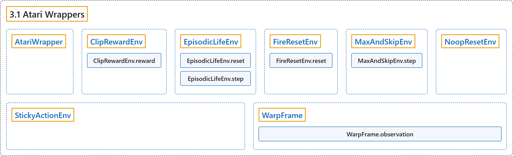

# 3.1 Atari Wrappers

## Classification

## Glossary

| Term | Definition | 中文翻译 | Source |
|---|---|---|---|
| **3.1 Atari Wrappers** Atari 包装器 | (context) "**Atari 2600 preprocessings**" | （语境）**Atari 2600 预处理** | [Raffin et al., n.d., "AtariWrapper", para. 1](https://stable-baselines3.readthedocs.io/en/master/common/atari_wrappers.html#stable_baselines3.common.atari_wrappers.AtariWrapper) |
| **AtariWrapper** AtariWrapper Atari 包装器 | "**Atari 2600 preprocessings**" | **Atari 2600 预处理** | [Raffin et al., n.d., "Atari Wrappers", para. 1](https://stable-baselines3.readthedocs.io/en/master/common/atari_wrappers.html#stable_baselines3.common.atari_wrappers.AtariWrapper) |
| **ClipRewardEnv** ClipRewardEnv 奖励裁剪包装器 | "**Clip the reward to {+1, 0, -1} by its sign**." | **按符号把奖励裁剪为 {+1, 0, -1}**。 | [Raffin et al., n.d., "Atari Wrappers", para. 1](https://stable-baselines3.readthedocs.io/en/master/common/atari_wrappers.html#stable_baselines3.common.atari_wrappers.ClipRewardEnv) |
| **ClipRewardEnv.reward** reward 方法 | "**Bin reward to {+1, 0, -1} by its sign**." | **按符号把奖励归入 {+1, 0, -1}**。 | [Raffin et al., n.d., "Atari Wrappers", para. 1](https://stable-baselines3.readthedocs.io/en/master/common/atari_wrappers.html#stable_baselines3.common.atari_wrappers.ClipRewardEnv.reward) |
| **EpisodicLifeEnv** EpisodicLifeEnv 生命即回合包装器 | "**Make end-of-life == end-of-episode, but only reset on true game over**." | **让生命结束等同于回合结束，但只在真正游戏结束时重置**。 | [Raffin et al., n.d., "Atari Wrappers", para. 1](https://stable-baselines3.readthedocs.io/en/master/common/atari_wrappers.html#stable_baselines3.common.atari_wrappers.EpisodicLifeEnv) |
| **EpisodicLifeEnv.reset** reset 方法 | "**Calls the Gym environment reset, only when lives are exhausted**." | **仅在生命耗尽时调用 Gym 环境的 reset**。 | [Raffin et al., n.d., "Atari Wrappers", para. 1](https://stable-baselines3.readthedocs.io/en/master/common/atari_wrappers.html#stable_baselines3.common.atari_wrappers.EpisodicLifeEnv.reset) |
| **EpisodicLifeEnv.step** step 方法 | "**Uses the step() of the env** that can be overwritten to change the returned data." | **使用 env 的 step()**，可以重写它来改变返回的数据。 | [Raffin et al., n.d., "Atari Wrappers", para. 1](https://stable-baselines3.readthedocs.io/en/master/common/atari_wrappers.html#stable_baselines3.common.atari_wrappers.EpisodicLifeEnv.step) |
| **FireResetEnv** FireResetEnv 开火重置包装器 | "**Take action on reset for environments that are fixed until firing**." | **对开火前保持静止的环境，在重置时执行动作**。 | [Raffin et al., n.d., "Atari Wrappers", para. 1](https://stable-baselines3.readthedocs.io/en/master/common/atari_wrappers.html#stable_baselines3.common.atari_wrappers.FireResetEnv) |
| **FireResetEnv.reset** reset 方法 | "**Uses the reset() of the env** that can be overwritten to change the returned data." | **使用 env 的 reset()**，可以重写它来改变返回的数据。 | [Raffin et al., n.d., "Atari Wrappers", para. 1](https://stable-baselines3.readthedocs.io/en/master/common/atari_wrappers.html#stable_baselines3.common.atari_wrappers.FireResetEnv.reset) |
| **MaxAndSkipEnv** MaxAndSkipEnv 跳帧取最大包装器 | "**Return only every skip-th frame (frameskipping) and return the max between the two last frames**." | **只返回每第 skip 帧（跳帧），并返回最后两帧之间的最大值**。 | [Raffin et al., n.d., "Atari Wrappers", para. 1](https://stable-baselines3.readthedocs.io/en/master/common/atari_wrappers.html#stable_baselines3.common.atari_wrappers.MaxAndSkipEnv) |
| **MaxAndSkipEnv.step** step 方法 | "**Step the environment with the given action** Repeat action, sum reward, and max over last observations." | **用给定的动作让环境前进一步** 重复动作、累加奖励，并对最后几个观测取最大值。 | [Raffin et al., n.d., "Atari Wrappers", para. 1](https://stable-baselines3.readthedocs.io/en/master/common/atari_wrappers.html#stable_baselines3.common.atari_wrappers.MaxAndSkipEnv.step) |
| **NoopResetEnv** NoopResetEnv 空操作重置包装器 | "**Sample initial states by taking random number of no-ops on reset**." | **在重置时执行随机次数的空操作来采样初始状态**。 | [Raffin et al., n.d., "Atari Wrappers", para. 1](https://stable-baselines3.readthedocs.io/en/master/common/atari_wrappers.html#stable_baselines3.common.atari_wrappers.NoopResetEnv) |
| **StickyActionEnv** StickyActionEnv 粘滞动作包装器 | "**Sticky action**." | **粘滞动作**。 | [Raffin et al., n.d., "Atari Wrappers", para. 1](https://stable-baselines3.readthedocs.io/en/master/common/atari_wrappers.html#stable_baselines3.common.atari_wrappers.StickyActionEnv) |
| **WarpFrame** WarpFrame 帧变换包装器 | "**Convert to grayscale and warp frames to 84x84 (default)** as done in the Nature paper and later work." | **转换为灰度并把帧变换为 84x84（默认）**，与 Nature 论文及后续工作的做法相同。 | [Raffin et al., n.d., "Atari Wrappers", para. 1](https://stable-baselines3.readthedocs.io/en/master/common/atari_wrappers.html#stable_baselines3.common.atari_wrappers.WarpFrame) |
| **WarpFrame.observation** observation 方法 | "**returns the current observation from a frame**" | **从一帧返回当前的观测** | [Raffin et al., n.d., "Atari Wrappers", para. 1](https://stable-baselines3.readthedocs.io/en/master/common/atari_wrappers.html#stable_baselines3.common.atari_wrappers.WarpFrame.observation) |

## References

Raffin, A., Hill, A., Gleave, A., Kanervisto, A., Ernestus, M., & Dormann, N.. (n.d.). *Atari Wrappers*. Stable-Baselines3 docs (Version 2.9.2a0). Retrieved October 31, 2026, from <https://stable-baselines3.readthedocs.io/en/master/common/atari_wrappers.html>
